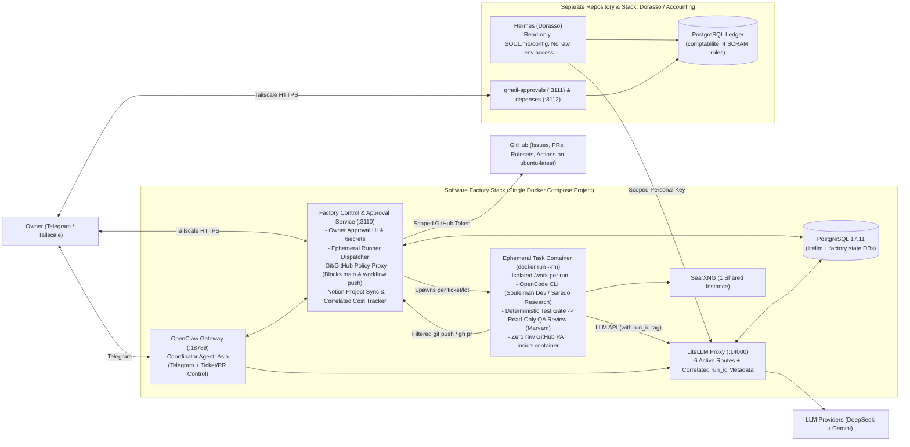
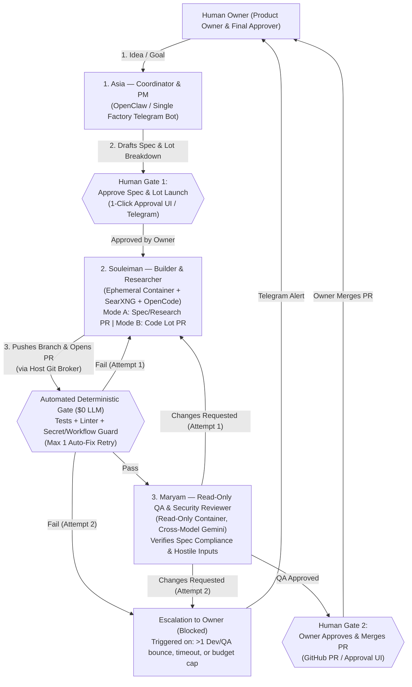
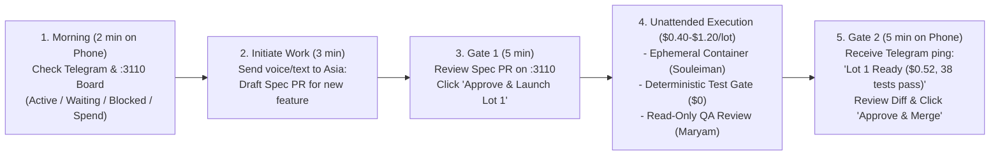

# Architecture Audit & Simplification — Local AI Software Factory

- **Repository:** `https://github.com/Abdourahmandev/Platforme_agentique.git`
- **Target Branch Reviewed:** `ubuntu-server` (commit `c9d8256`, compared against `origin/main` `3d3f9cc` and `origin/claude/reponse-audit` `5409b25`)
- **Audit Scope:** Full read-only technical, multi-agent, operational, and security audit across all 243 tracked files.

---

## 1. Executive Summary

### Overall Health Assessment

`Platforme_agentique` (on the active `ubuntu-server` branch) has successfully transitioned from an experimental Windows 11 + Docker Desktop pilot into a functioning, Linux-hosted multi-agent platform capable of delivering real software increments (demonstrated on `decidata-messagerie` and `Simulateur_tax_qc`). It contains several well-engineered building blocks: digest-pinned container images, internal Docker bridge networks, SCRAM-authenticated least-privilege PostgreSQL roles for its accounting ledger (`infra/dorasso/ledger/init-roles.sh`), cryptographic AES-256-GCM backups with automated isolated restore verification (`ops/backup-docker.py`), and Tailscale-gated human approval surfaces (`infra/approvals/server.py`, `infra/gmail-approvals/server.py`).

However, **the system has accumulated severe architectural, operational, and governance sprawl**. Because the platform was iteratively built and patched by Claude Code in response to 27+ live operational incidents (documented inside `infra/notion-bridge/journal.py`) and 12 post-mortem prompt-coaching PRs (`formation/*`), every upstream tool bug or agent mistake was solved by adding another container, another systemd polling script, another custom web server, or another paragraph of French rules in `PAPERCLIP.md`. Today, a single solo developer's local Ubuntu server (noted in `infra/notion-bridge/journal.py:121` as probable 2011-era hardware that has already experienced a hard freeze) is running **4 separate Docker Compose stacks, 14+ long-running containers (with 13.6 GB of combined memory limits), 3 separate PostgreSQL instances, 2 separate SearXNG instances, 4 distinct agent runtimes/orchestrators (OpenClaw, Paperclip, OpenCode, Hermes Agent) plus Claude Code and Codex, and 13 host systemd units/timers**.

### Direct Answers to Core Audit Questions

1. **Is the current architecture appropriate?**
   - **No, not for a solo operator.** It mixes two unrelated domains in one repository and runtime trust footprint: (a) a software engineering factory (`OpenClaw` + `Paperclip` + `Atelier/OpenCode`) and (b) a personal voice assistant and corporate bookkeeping suite (`Dorasso/Hermes` + `dorasso-ledger` + `depenses` + `gmail-approvals` + `speaches`/`tts-proxy`). Within the software factory itself, running both OpenClaw and Paperclip alongside an SSH-shared OpenCode container (`atelier`) and 4 host-side workarounds creates excessive moving parts.
2. **Is it unnecessarily complex?**
   - **Yes — critically so.** When Paperclip `2026.1005.0` failed to wake reviewers, failed to kill timed-out SSH processes, locked tickets on OpenClaw adapter errors, and shipped a broken UI approval button (`infra/notion-bridge/journal.py:128-149`), the architecture was not simplified. Instead, custom daemons (`wake-idle-assignees.py`, `reap-atelier-orphans.py`, `sync-costs.py`, and `infra/approvals/server.py`) were bolted around Paperclip to keep it alive. Meanwhile, 100% of the repository's top-level documentation (`README.md`, `docs/`, `documentation/`), 15 PowerShell scripts, the root Node.js web app (`server.mjs`), and over half of the unit tests still describe the abandoned Windows 11 architecture from October 11–12.
3. **What are its biggest weaknesses?**
   - **Public exposure of unrotated secret incidents and open vulnerabilities (`Critical`)**: `infra/notion-bridge/journal.py:177-202` is committed in plaintext to this **public** GitHub repository (contradicting `Audit/REPONSE_AUDIT_Claude.md` §3.4, which assumed the journal lived only in Notion). It publicly broadcasts that the Atelier GitHub PAT, Telegram bot tokens, and Google OAuth client secret were leaked and **not yet rotated**, and that Dorasso's terminal tool has an **unpatched (`Ouvert`) vulnerability** allowing it to read its own secrets.
   - **Broken `atelier` security & QA boundary (`High`)**: Developer (`Souleiman`), QA reviewer (`Maryam`), and Researcher (`Saredo`) all SSH into the **same container (`atelier`) as the same Unix user (`node`, UID 1000)**, sharing a writable `/work` volume and direct read access to the GitHub PAT (`/home/node/.config/gh/hosts.yml`). The `/etc/git-hooks/pre-push` guard can be trivially bypassed via `git push --no-verify`, `git -c core.hooksPath=/dev/null`, or `gh pr merge`.
   - **Prompt-patching (`regle du formateur`) in place of code enforcement (`High`)**: 11 `formation/*` PRs appended project-specific tax-simulator anecdotes to `PAPERCLIP.md` while leaving code bugs intact (e.g., `infra/paperclip/plugin/tickets.mjs:159` still explicitly permits `checkout` of `'backlog'` tickets, and `infra/agents/recherche/PAPERCLIP.md` contradicts itself between line 10 and line 33 on whether Saredo can open PRs).
   - **Silent code failures & broken scripts (`High/Medium`)**: Four `infra/` scripts (`configure-souleiman-connectors.py`, `configure-github-delegation.py`, `configure-github-publication.py`, and `infra/training/configure.py`) crash with `RuntimeError`/`IndexError`/`ValueError` against current `AGENTS.md` files; `node infra/platform-health.mjs` can never exit `0` because `diagnose-platform.py:23` hardcodes `delegation.state = 'unknown'`; `ops/backup.py:16` defaults `ASIA_BACKUP_DIR` to `r'D:\AsiaBackups'` on Linux; and `ops/systemd/depenses.service:10` invokes `/usr/bin/python3` which lacks `psycopg`.
4. **What is already working well?**
   - **Cryptographic backup & isolated restore verification (`ops/backup.py`, `ops/backup-docker.py`)**: AES-256-GCM encryption, Zip-Slip/symlink defenses, SHA-256 manifest verification, and nightly isolated container restore checks (`restore_ledger_isolated`).
   - **Dorasso PostgreSQL ledger isolation (`infra/dorasso/ledger/init-roles.sh`, `check-isolation.sh`, `entrypoint.sh`)**: Textbook least-privilege PostgreSQL design (`scram-sha-256` on all TCP/loopback connections, `PUBLIC` revoked, separate `ledger_migrator`, `ledger_engine`, `ledger_essai`, and read-only `ledger_dorasso` roles, fail-closed marker `dorasso-securite-ok`).
   - **Gmail draft approval gate (`infra/gmail-approvals/server.py`, `ops/systemd/gmail-approvals.service`)**: Clean privilege separation between draft creation (`/run/dorasso-drafts/api.sock`) and human approval (`/run/dorasso-approvals/api.sock`) with SHA-256 MIME/attachment binding, strict CSP nonces, and comprehensive systemd sandboxing.
   - **Cross-model QA concept**: Having `Souleiman` (DeepSeek V4 Pro) write code and `Maryam` (Gemini 3.8 Flash) review it caught real functional and security defects when properly scoped.
5. **What should be preserved?**
   - **LiteLLM** (with a trimmed 6-model catalog and correlated request metadata), **OpenClaw** (for Telegram conversational interface), **OpenCode** (as the headless coding CLI inside ephemeral per-run containers), the **backup/restore verification engine** (`ops/backup-docker.py`), the **Dorasso PostgreSQL ledger schema/role design** (moved to its own repository), and **Tailscale Serve** for private mobile access.
6. **What would you redesign?**
   - **Split Personal/Accounting (`Dorasso`, `ledger`, `depenses`, `gmail-approvals`) into a separate repository and stack** from the Software Factory.
   - **Replace the shared, persistent `atelier` SSH container** with **ephemeral, per-run containers (`docker run --rm`)** using short-lived, brokered GitHub credentials (or a credential-helper proxy outside the container) so agents never hold raw PAT files or share `/work`.
   - **Eliminate Claude Code as manual babysitter/trainer** and either fix Paperclip's orchestration boundary or replace Paperclip + its 4 Python band-aid daemons with a **GitHub Issues / PR + lightweight webhook/queue runner** where CI (`GitHub Actions` / local test runner) runs deterministic checks *before* an LLM QA reviewer is ever invoked (cutting QA token spend by 60–80%).
   - **Purge ~95 obsolete Windows/legacy/migration/training files** and merge `ubuntu-server` into `main`.
7. **How close is the project to a usable autonomous software factory?**
   - **Approximately 65% of the way to a safe, low-overhead solo-operator factory.** It is currently an **operator-assisted pilot** that works when Claude Code actively supervises tickets, cleans up stuck states, and patches prompts, but it is **not yet safe or reliable for unattended autonomous execution** until the credential leaks, shared `atelier` container boundary, Paperclip state-machine workarounds, and repository split are resolved.

---

## 2. Current Architecture

### 2.1 Actually Implemented Architecture on `ubuntu-server`

Contrary to `README.md` and `documentation/architecture.md` (which still depict the retired October 11–12 Windows PC + Docker Desktop + Windows OpenCode `:4096` topology), the `ubuntu-server` branch actually implements a **4-Compose-project, 14-container, 13-systemd-unit Linux architecture** on `/home/rass`:

1. **Compose Stack 1 — `asia-platform-staging` (`infra/compose.yaml`)**:
   - `openclaw` (`127.0.0.1:18789:18789`): Runs `Asia`, `Souleiman` (`developpement`), and `Saredo` (`recherche`) Telegram bots and WebSocket gateway (`openclaw-state` and `openclaw-npm` volumes).
   - `litellm` (`127.0.0.1:14000:4000`): LLM router connected to 5 Docker networks (`database`, `agents`, `outbound`, `personal`, `workshop`), mounting `gateway/config.yaml`, `gateway/routing_context.py`, and `gateway/metrics.py`.
   - `postgres` (PostgreSQL 17.11 #1): Stores LiteLLM keys, teams, budgets, and `LiteLLM_SpendLogs`.
   - `notion-bridge` (internal `:8080` on `agents` network): Reuses `ghcr.io/speaches-ai/speaches` image to run `infra/notion-bridge/server.py`, scoping `Asia`'s `asia_notion` plugin strictly to the `"Projets Decidata"` Notion database.
   - `playwright` (internal `:8931` on `browser_control` / `browser_egress`): Chromium headless MCP server mounting `openclaw-state` subpath `workspaces/asia`.
   - Profile `audio` services: `speaches` (`127.0.0.1:18000:8000`, Faster-Whisper CPU STT), `tts-proxy` (`127.0.0.1:18080:8080`, strips Gemini C2PA WAV chunks and converts to OGG/Opus via `ffmpeg`), and `budget-info` (`127.0.0.1:8091:8080`, unauthenticated AI budget summary endpoint for Dorasso and Messagerie).
2. **Compose Stack 2 — `asia-paperclip` (`infra/paperclip/compose.yaml`)**:
   - `paperclip` (`127.0.0.1:3100:3100`): Issue tracker, heartbeat scheduler, and agent orchestrator on `database`, `agents`, `outbound`, and `workshop` networks.
   - `postgres` (PostgreSQL 17.11 #2): Dedicated Paperclip database.
3. **Compose Stack 3 — `atelier` (`infra/atelier/compose.yaml` + `Dockerfile`)**:
   - `atelier` (internal SSH `:2222` on `workshop`, `outbound`, `search` networks): Custom Node.js + OpenSSH + `opencode-ai@1.18.34` + `gh@2.102.0` container. `Paperclip` connects via SSH as user `node` (`UID 1000`) to run `Souleiman` (Dev/Architect), `Maryam` (QA), and `Saredo` (Researcher) in a shared `/work` volume (`atelier-work`) with a shared GitHub PAT (`/home/node/.config/gh/hosts.yml`).
   - `searxng` (SearXNG instance #1 on internal `search` network): Metasearch engine for `atelier` agents.
4. **Compose Stack 4 — `dorasso` (`infra/dorasso/compose.yaml`)**:
   - `hermes` (`127.0.0.1:8642:8642` on `personal`, `search`, `outbound`, `ledger` networks): Nous Research `hermes-agent` running personal assistant `Dorasso`, mounting `/opt/data` (RW), `/opt/dorasso-comptable:ro`, `/opt/data/skills/comptable-decidata:ro`, and `/run/dorasso-drafts/api.sock:/run/decidata-drafts.sock`.
   - `ledger` (PostgreSQL 17.11 #3 on internal `ledger` network): `comptabilite` database with 4 SCRAM-authenticated roles (`ledger_migrator`, `ledger_engine`, `ledger_essai`, `ledger_dorasso`).
   - `searxng` (SearXNG instance #2 on internal `search` network): Private metasearch for `Dorasso`.
5. **Host Systemd Services & Timers (`ops/systemd/*`)**:
   - `paperclip-approvals.service` (`127.0.0.1:3110` -> `infra/approvals/server.py`): Workaround web UI for Paperclip ticket approvals, `/secrets` input (Notion, Jev), and `/qbo/callback` OAuth redirect display.
   - `gmail-approvals.service` (`127.0.0.1:3111` -> `infra/gmail-approvals/server.py`): Web UI to approve/delete Gmail drafts over `/run/dorasso-approvals/api.sock`.
   - `depenses.service` (`127.0.0.1:3112` -> `infra/depenses/server.py`): Read-only QuickBooks accounting expense dashboard querying `dorasso-ledger-1`.
   - `messagerie.service` (`127.0.0.1:3120` -> external `/home/rass/decidata-messagerie/server.py`): Custom unified chat/voice/approval web app built during tickets `DEC-16`..`DEC-27`.
   - `paperclip-wake.timer` & `.service` (every 2 min): Runs `reap-atelier-orphans.py` and `wake-idle-assignees.py`.
   - `paperclip-costs.timer` & `.service` (every 15 min): Runs `sync-costs.py` to join LiteLLM spend logs into Paperclip cost events.
   - `asia-backup.timer` & `.service` (nightly 03:00), `asia-backup-alert.service`, `asia-backup-watchdog.timer` & `.service` (09:00): Runs `ops/run-docker-backup.sh` (`ops/backup-docker.py --restore-check` + `rclone copy` to `gdrive:Openclawbackup-serveur`) and sends Telegram alerts via `ops/backup-alert.py`.

### 2.2 Current System Architecture Diagram

```mermaid
flowchart TB
    subgraph External["External Services & Human Operator"]
        Owner["Owner (Phone / Laptop via Tailscale & Telegram)"]
        Claude["Claude Code (External Operator / PO / Formateur)"]
        Codex["Codex (External Tax Engine & Security Reviewer)"]
        TG["Telegram Bot API"]
        LLMProviders["LLM APIs (DeepSeek / Google Gemini)"]
        GitHub["GitHub Repos, PRs & Actions (windows-latest)"]
        NotionAPI["Notion API (Projets & Journal Decidata)"]
        GDrive["Google Drive (rclone encrypted offsite backups)"]
    end

    subgraph Host["Ubuntu Server Host (/home/rass — systemd & Tailscale Serve)"]
        TS["Tailscale Serve (Identity Header Injection)"]
        AppSrv["paperclip-approvals.service (:3110)\ninfra/approvals/server.py"]
        GmailSrv["gmail-approvals.service (:3111)\ninfra/gmail-approvals/server.py"]
        DepSrv["depenses.service (:3112)\ninfra/depenses/server.py"]
        MsgSrv["messagerie.service (:3120)\n/home/rass/decidata-messagerie (External Repo)"]
        GmailDaemon["External Host Gmail Daemon\n/run/dorasso-drafts & /run/dorasso-approvals"]
        WakeTimer["paperclip-wake.timer (every 2m)\nreap-atelier-orphans.py + wake-idle-assignees.py"]
        CostTimer["paperclip-costs.timer (every 15m)\nsync-costs.py"]
        BackupTimer["asia-backup.timer (03:00) & watchdog (09:00)\nrun-docker-backup.sh + backup-alert.py"]
    end

    subgraph Stack1["Docker Compose 1: asia-platform-staging (infra/compose.yaml)"]
        OpenClaw["openclaw (:18789)\nAgents: Asia, Souleiman, Saredo\nPlugins: asia-paperclip, asia-opencode (legacy)"]
        LiteLLM["litellm (:14000)\n34 Routes + routing_context.py + metrics.py"]
        PG1[("postgres #1\nLiteLLM DB")]
        NotionBr["notion-bridge (:8080)\n(Speaches image)"]
        Speaches["speaches (:18000)\nFaster-Whisper CPU"]
        TTSProxy["tts-proxy (:18080)\nWAV C2PA stripper + ffmpeg"]
        BudgetInfo["budget-info (:8091)\nHolds full litellm.env"]
        Playwright["playwright (:8931)\nChromium --no-sandbox"]
    end

    subgraph Stack2["Docker Compose 2: asia-paperclip (infra/paperclip/compose.yaml)"]
        Paperclip["paperclip (:3100)\nOrchestrator & Issue Board"]
        PG2[("postgres #2\nPaperclip DB")]
    end

    subgraph Stack3["Docker Compose 3: atelier (infra/atelier/compose.yaml)"]
        Atelier["atelier (SSH :2222, shared user 'node', shared /work)\nOpenCode 1.18.34 + gh 2.102.0\nRuns: Souleiman (Dev), Maryam (QA), Saredo (Research)"]
        Searx1["searxng #1 (:8080)\nFactory Web Search"]
    end

    subgraph Stack4["Docker Compose 4: dorasso (infra/dorasso/compose.yaml)"]
        Hermes["hermes (:8642)\nAgent: Dorasso (Personal & Accounting)\nRW /opt/data + RO comptable skill"]
        PG3[("ledger / postgres #3\ncomptabilite DB (4 SCRAM roles)")]
        Searx2["searxng #2 (:8080)\nPersonal Web Search"]
    end

    Owner -->|"Telegram"| TG
    TG <--> OpenClaw
    TG <--> Hermes
    Owner -->|"HTTPS via Tailscale"| TS
    TS --> AppSrv
    TS --> GmailSrv
    TS --> DepSrv
    TS --> MsgSrv

    Claude -->|"SSH / Host CLI / Git"| Host
    Claude -->|"Commits & PRs"| GitHub
    Codex -->|"External Commits & Reviews"| GitHub

    MsgSrv --> OpenClaw
    MsgSrv --> Hermes
    MsgSrv --> AppSrv
    MsgSrv --> TTSProxy
    MsgSrv --> Speaches
    MsgSrv --> BudgetInfo

    AppSrv -->|"PATCH /api/issues"| Paperclip
    GmailSrv -->|"UNIX Socket"| GmailDaemon
    Hermes -->|"UNIX Socket (drafts only)"| GmailDaemon
    DepSrv -->|"TCP 5432 (role: ledger_dorasso)"| PG3

    OpenClaw <-->|"WS & asia_ticket plugin"| Paperclip
    OpenClaw -->|"asia_notion"| NotionBr
    NotionBr --> NotionAPI
    OpenClaw --> Playwright
    OpenClaw --> LiteLLM

    Paperclip --> PG2
    Paperclip -->|"SSH node@atelier:2222 (opencode_local)"| Atelier
    Atelier -->|"LLM Calls"| LiteLLM
    Atelier --> Searx1
    Atelier -->|"git push / gh pr"| GitHub

    Hermes -->|"personal net"| LiteLLM
    Hermes -->|"SELECT (ledger_dorasso)"| PG3
    Hermes --> Searx2
    Hermes -->|"curl"| BudgetInfo

    LiteLLM --> PG1
    LiteLLM --> LLMProviders

    WakeTimer -->|"docker exec kill & API wakeup"| Atelier
    WakeTimer --> Paperclip
    CostTimer -->|"Scrape /spend/logs -> POST /cost-events"| LiteLLM
    CostTimer --> Paperclip
    BackupTimer -->|"AES-256-GCM + Restore Check"| GDrive
```



### 2.3 Unknown, External, or Unverified Connections (`Requires Verification`)

Because this is a strictly read-only repository audit without live SSH inspection of `/home/rass` on the Ubuntu server, the following components referenced by the codebase live outside this repository or depend on host runtime state:

1. **External Repository `/home/rass/decidata-messagerie`**: Referenced by `ops/systemd/messagerie.service:9-10` and `ops/backup-docker.py:86-98`. Its codebase is in a separate repository (`https://github.com/Abdourahmandev/decidata-messagerie`, per `infra/notion-bridge/rebuild.py:64`).
2. **External Repository `Decidata_accoutant` & Host Gmail Socket Daemon**: Referenced by `infra/dorasso/prepare-comptable.py:1-5` (`~/Decidata_accoutant` or tar archive), `infra/dorasso/compose.yaml:18-23`, and `infra/gmail-approvals/README.md:6,31-37`. The host service managing `/run/dorasso-drafts/api.sock` and `/run/dorasso-approvals/api.sock` is not in this repository.
3. **External Repository `Simulateur_tax_qc`**: Target software factory project referenced across `infra/agents/*/PAPERCLIP.md` and `infra/agents/asia/AGENTS.md:39`.
4. **Live Secret Rotation & GitHub Branch Rulesets**: Whether the leaked GitHub PAT (`journal.py:187-191`) and Telegram/Google OAuth secrets (`journal.py:177-181`) were rotated after `journal.py` was written, and whether GitHub server-side rulesets are enabled on target repositories.
5. **Host Hardware & Memory Headroom**: `journal.py:119-122` notes a full server freeze on probable 2011 hardware; exact physical RAM, swap, and CPU core counts on the Ubuntu host require runtime verification (`free -h`, `lscpu`).

---

## 3. Findings & Problems

Every finding below is grounded in repository evidence and labeled as **Confirmed finding** (proven directly by code/config in the repo), **Likely concern** (strongly indicated by evidence), or **Requires verification** (depends on live server/account state).

| ID | Severity | Component | Finding | Evidence | Recommendation | Effort |
|---|---|---|---|---|---|---|
| **F-01** | **Critical** | Public Repo / `infra/notion-bridge/journal.py` & `rebuild.py` | **Confirmed finding (Public Info Leak) + Requires verification (Token Rotation):** `journal.py` is committed in plaintext to this **public** GitHub repository (contradicting `Audit/REPONSE_AUDIT_Claude.md` §3.4 which states the incident log is "hors de ce dépôt public"). Lines 177–202 publicly disclose: (1) Souleiman leaked the Atelier GitHub PAT to logs and DeepSeek on 2026-10-15 and rotation was postponed (`Statut: Partiellement corrigé`, `"Reste à faire : renouveler le jeton (reporté par le propriétaire)"`); (2) Telegram bot tokens and Google OAuth client secret were pasted in chat on 2026-10-13 and remain unrotated (`"Reste à faire : renouveler ces jetons"`); and (3) Dorasso's terminal tool has an **unpatched (`Ouvert`) secret-read vulnerability** (`L197-201`). | [`infra/notion-bridge/journal.py:177-202`](file:///C:/Users/User/Documents/Gemini_test/Platforme_agentique/infra/notion-bridge/journal.py#L177-L202), [`infra/notion-bridge/rebuild.py:1-116`](file:///C:/Users/User/Documents/Gemini_test/Platforme_agentique/infra/notion-bridge/rebuild.py#L1-L116) | **Immediate:** (1) Make `Platforme_agentique` private or purge `journal.py`/`rebuild.py` from public history; (2) immediately rotate the Atelier GitHub PAT, Telegram bot tokens, and Google OAuth secret; (3) never commit live security vulnerability trackers with `"Statut: Ouvert"` to a public repo. | Low (2–4 hours) |
| **F-02** | **Critical** | `infra/atelier/` (`compose.yaml`, `Dockerfile`, `pre-push`, `gh-wrapper.sh`) | **Confirmed finding:** Zero OS/filesystem isolation and trivial guard bypass inside `atelier`. `Souleiman` (Dev), `Maryam` (QA), and `Saredo` (Researcher) all SSH into the same container as `node` (`UID 1000`), sharing writable `/work` and read access to `/home/node/.config/gh/hosts.yml` (raw GitHub PAT) with `outbound` internet. Any agent (or prompt injection) can: (1) read and exfiltrate the GitHub PAT; (2) bypass `/etc/git-hooks/pre-push` via `git push --no-verify` or `git -c core.hooksPath=/dev/null`; (3) merge its own PRs via `gh pr merge` / `gh api`; (4) push changes to `.github/workflows/ci.yml` that execute on `push`; or (5) tamper with `/work` across Dev and QA runs. | [`infra/atelier/compose.yaml:11-20`](file:///C:/Users/User/Documents/Gemini_test/Platforme_agentique/infra/atelier/compose.yaml#L11-L20), [`infra/atelier/Dockerfile:24-38`](file:///C:/Users/User/Documents/Gemini_test/Platforme_agentique/infra/atelier/Dockerfile#L24-L38), [`infra/atelier/gh-wrapper.sh:1-6`](file:///C:/Users/User/Documents/Gemini_test/Platforme_agentique/infra/atelier/gh-wrapper.sh#L1-L6), [`infra/atelier/pre-push:1-16`](file:///C:/Users/User/Documents/Gemini_test/Platforme_agentique/infra/atelier/pre-push#L1-L16), [`infra/paperclip/provision-atelier.py:30-37`](file:///C:/Users/User/Documents/Gemini_test/Platforme_agentique/infra/paperclip/provision-atelier.py#L30-L37) | Replace persistent shared `atelier` SSH with ephemeral per-run containers (`docker run --rm`) with isolated workspaces; remove `hosts.yml` from inside the container (use a host-side git/gh credential broker that blocks `main` pushes, workflow edits, and `pulls/*/merge`); remove `Saredo` from code-push credentials. | Medium (2–3 days) |
| **F-03** | **High** | `infra/dorasso/` (`compose.yaml`, `prepare-dorasso.py`, `prepare-comptable.py`, `SOUL.md`) | **Confirmed finding:** Dorasso (`hermes`) runs as `UID 1000` with a bash terminal tool (`SOUL.md:15` instructs it to run `curl` in terminal), unrestricted `outbound` internet, SearXNG/Exa web ingestion, **read access to its own secrets** in `/opt/data/.env` (`TELEGRAM_BOT_TOKEN`, `DORASSO_LITELLM_KEY`, `DORASSO_SPEECH_KEY`) and `/opt/dorasso-comptable/ledger_dorasso.password`, and **read-write access to `/opt/data`** (allowing persistent self-modification of `SOUL.md`, `config.yaml`, and `plugins/`). Any indirect prompt injection from a web search or financial document can exfiltrate the entire `comptabilite` database and bot tokens or install a persistent plugin backdoor. | [`infra/dorasso/compose.yaml:11-28`](file:///C:/Users/User/Documents/Gemini_test/Platforme_agentique/infra/dorasso/compose.yaml#L11-L28), [`infra/dorasso/prepare-dorasso.py:79-86`](file:///C:/Users/User/Documents/Gemini_test/Platforme_agentique/infra/dorasso/prepare-dorasso.py#L79-L86), [`infra/dorasso/prepare-comptable.py:55-57`](file:///C:/Users/User/Documents/Gemini_test/Platforme_agentique/infra/dorasso/prepare-comptable.py#L55-L57), [`infra/dorasso/SOUL.md:15`](file:///C:/Users/User/Documents/Gemini_test/Platforme_agentique/infra/dorasso/SOUL.md#L15), [`infra/notion-bridge/journal.py:197-201`](file:///C:/Users/User/Documents/Gemini_test/Platforme_agentique/infra/notion-bridge/journal.py#L197-L201) | (1) Mount `SOUL.md`, `config.yaml`, and `plugins/` read-only (`:ro`); (2) disable the general bash terminal tool in `hermes` and expose `dorasso-lecture` and `budget-info` only as fixed, parameter-validated MCP/skill tools running under a separate UID that cannot read `.env` or `ledger_dorasso.password`; (3) add `cap_drop: [ALL]` to `dorasso/compose.yaml`. | Medium (1–2 days) |
| **F-04** | **High** | `ops/systemd/messagerie.service` & `paperclip-approvals.service` | **Confirmed finding:** Both network-facing web services run as `User=rass` with `ReadOnlyPaths=/home/rass`. Because `/home/rass/.local/share/` holds **every secret on the server** — including `AsiaBackup/recovery-key.txt` (the AES-256-GCM master backup encryption key!), `AsiaDocker/litellm.env` (`LITELLM_MASTER_KEY`, provider API keys), `Dorasso/ledger/*.password`, and `Atelier/gh/hosts.yml` — and `rass` has access to `/var/run/docker.sock`, any vulnerability in `messagerie` or `approvals` compromises the entire host and all encrypted backups. | [`ops/systemd/messagerie.service:6-15`](file:///C:/Users/User/Documents/Gemini_test/Platforme_agentique/ops/systemd/messagerie.service#L6-L15), [`ops/systemd/paperclip-approvals.service:6-19`](file:///C:/Users/User/Documents/Gemini_test/Platforme_agentique/ops/systemd/paperclip-approvals.service#L6-L19), [`ops/backup.py:32-38`](file:///C:/Users/User/Documents/Gemini_test/Platforme_agentique/ops/backup.py#L32-L38) | Run `messagerie.service` and `paperclip-approvals.service` under dedicated unprivileged system users (like `depenses-viewer` in `depenses.service`) with `ProtectHome=true` and narrow group/file access solely to their own state directories; move `recovery-key.txt` off-host (or encrypt backups with an asymmetric public key whose private key is kept offline). | Low-Medium (0.5–1 day) |
| **F-05** | **High** | Multi-Stack Infrastructure Footprint (`infra/compose.yaml`, `paperclip`, `atelier`, `dorasso`) | **Confirmed finding (Sprawl) + Likely concern (Hardware Freeze):** The architecture runs 4 Docker Compose projects (14+ long-running containers with **13.6 GB** of combined `mem_limit`, 3 PostgreSQL 17.11 instances, 2 SearXNG instances, 4 agent frameworks, and 3 containers reusing the heavy `ghcr.io/speaches-ai/speaches` image just to run 100-line Python scripts) plus 13 systemd units on probable 2011 hardware (`journal.py:121`). | [`infra/compose.yaml:1-308`](file:///C:/Users/User/Documents/Gemini_test/Platforme_agentique/infra/compose.yaml#L1-L308), [`infra/paperclip/compose.yaml:1-66`](file:///C:/Users/User/Documents/Gemini_test/Platforme_agentique/infra/paperclip/compose.yaml#L1-L66), [`infra/atelier/compose.yaml:1-65`](file:///C:/Users/User/Documents/Gemini_test/Platforme_agentique/infra/atelier/compose.yaml#L1-L65), [`infra/dorasso/compose.yaml:1-121`](file:///C:/Users/User/Documents/Gemini_test/Platforme_agentique/infra/dorasso/compose.yaml#L1-L121), [`infra/notion-bridge/journal.py:119-122`](file:///C:/Users/User/Documents/Gemini_test/Platforme_agentique/infra/notion-bridge/journal.py#L119-L122) | Consolidate to **1 PostgreSQL instance** (with isolated databases/roles for `litellm`, `paperclip`, and `comptabilite`), **1 SearXNG instance** (or direct search API), merge `tts-proxy`/`budget-info`/`notion-bridge` into lightweight host or single-container gateways, and run coding containers ephemerally on demand rather than 24/7. Saves ~4–5 GB of idle RAM. | Medium (2–3 days) |
| **F-06** | **High** | Paperclip Orchestration & Host Band-Aids (`infra/paperclip/`, `infra/approvals/`) | **Confirmed finding:** Paperclip `2026.1005.0` has required 4 separate custom Python workarounds to function: (1) `wake-idle-assignees.py` (every 2m) because Paperclip fails to wake `Maryam` on review handoff and leaves timed-out agents stuck in `error`; (2) `reap-atelier-orphans.py` (every 2m) because Paperclip fails to kill timed-out/cancelled remote SSH processes; (3) `infra/approvals/server.py` because Paperclip's UI approval button is broken upstream (#3921/#15496); and (4) `sync-costs.py` (every 15m). Furthermore, `tickets.mjs:159` still allows `checkout` of `'backlog'` tickets (`expectedStatuses:['todo','backlog','blocked','in_review']`), which caused Souleiman to execute `B6a/B6b/B6c` prematurely (`developpement/PAPERCLIP.md:67-69`). | [`infra/paperclip/wake-idle-assignees.py:1-76`](file:///C:/Users/User/Documents/Gemini_test/Platforme_agentique/infra/paperclip/wake-idle-assignees.py#L1-L76), [`infra/paperclip/reap-atelier-orphans.py:1-57`](file:///C:/Users/User/Documents/Gemini_test/Platforme_agentique/infra/paperclip/reap-atelier-orphans.py#L1-L57), [`infra/approvals/server.py:1-11`](file:///C:/Users/User/Documents/Gemini_test/Platforme_agentique/infra/approvals/server.py#L1-L11), [`infra/paperclip/plugin/tickets.mjs:157-159`](file:///C:/Users/User/Documents/Gemini_test/Platforme_agentique/infra/paperclip/plugin/tickets.mjs#L157-L159), [`infra/notion-bridge/journal.py:123-149`](file:///C:/Users/User/Documents/Gemini_test/Platforme_agentique/infra/notion-bridge/journal.py#L123-L149) | Short term: remove `'backlog'` from `expectedStatuses` in `tickets.mjs:159` and block wakeups on `backlog` issues. Medium term: replace Paperclip + its 4 band-aid daemons with a GitHub Issues/PR-driven runner (or upgrade Paperclip only once upstream bugs are fixed and eliminate custom sweepers). | Low (1h fix) / Medium (3–5d replace) |
| **F-07** | **High** | Agent Instructions & `formation/*` Prompt Drift (`infra/agents/**`) | **Confirmed finding:** Agent instructions contain direct self-contradictions and stale state: (1) `infra/agents/recherche/PAPERCLIP.md:10` says *"Ne modifie jamais le code du depot et n'ouvre ni branche ni PR"*, while **line 33 of the same file** mandates *"Dans un projet de realisation... un livrable de conception ou de specification (...recherche) est toujours publie dans le depot par une PR"*; (2) `developpement/PAPERCLIP.md:13`, `recherche/PAPERCLIP.md:11`, and `maryam/PAPERCLIP.md:15` instruct agents to finish with `done`, while `agent-instructions.md:17` and `tickets.mjs:123` forbid `done` and `developpement/PAPERCLIP.md:33` says `in_review`; (3) `developpement/PAPERCLIP.md:19` claims a 20-minute timeout while `provision-atelier.py:33` sets 45 minutes (`2700s`); (4) `asia/AGENTS.md:39` hardcodes stale project progress (`"D1, D2 et le Lot A (DEC-15) termines ; D3 a fermer"`) while the project is at `DEC-87` / Lot `B6c`; and (5) 11 `formation/*` PRs have bloated `PAPERCLIP.md` with tax-simulator-specific rules (`RL-1`, `B.A`/`B.B`, `2026 14%`). | [`infra/agents/recherche/PAPERCLIP.md:10-34`](file:///C:/Users/User/Documents/Gemini_test/Platforme_agentique/infra/agents/recherche/PAPERCLIP.md#L10-L34), [`infra/agents/developpement/PAPERCLIP.md:13-73`](file:///C:/Users/User/Documents/Gemini_test/Platforme_agentique/infra/agents/developpement/PAPERCLIP.md#L13-L73), [`infra/agents/asia/AGENTS.md:39`](file:///C:/Users/User/Documents/Gemini_test/Platforme_agentique/infra/agents/asia/AGENTS.md#L39), [`infra/paperclip/agent-instructions.md:11-19`](file:///C:/Users/User/Documents/Gemini_test/Platforme_agentique/infra/paperclip/agent-instructions.md#L11-L19) | Separate **platform-level role instructions** (`infra/agents/*/PAPERCLIP.md` — concise, project-agnostic) from **project-specific conventions** (which belong in `Simulateur_tax_qc/CLAUDE.md` or `AGENTS.md` inside the target project repo!). Reconcile Saredo's PR rule, timeout numbers, and status transitions (`done` vs `in_review`), and delete hardcoded milestone state from `asia/AGENTS.md:39`. | Low (0.5–1 day) |
| **F-08** | **High** | Broken Provisioning & Training Scripts (`infra/configure-*.py`, `infra/training/configure.py`) | **Confirmed finding:** Four Python scripts in `infra/` crash immediately against the current repository because they split `AGENTS.md` on exact French strings deleted during the Ubuntu rewrite: (1) `configure-souleiman-connectors.py:35,217-220` requires `\n## Documentation et GitHub\n` (`RuntimeError`); (2) `configure-github-delegation.py:19,46` splits on `\n## Acces GitHub en delegation\n` (`IndexError`); (3) `configure-github-publication.py:17-52` requires `\n## Publication des PR\n` (`RuntimeError`/`IndexError`); (4) `infra/training/configure.py:69-71` runs `text.index('Tu peux maintenant travailler')` on `developpement/AGENTS.md` (`ValueError: substring not found`), breaking `training/configure.py`, `training/control.py`, and `training/isolated.py`. | [`infra/configure-souleiman-connectors.py:35`](file:///C:/Users/User/Documents/Gemini_test/Platforme_agentique/infra/configure-souleiman-connectors.py#L35), [`infra/configure-github-delegation.py:19`](file:///C:/Users/User/Documents/Gemini_test/Platforme_agentique/infra/configure-github-delegation.py#L19), [`infra/configure-github-publication.py:17-52`](file:///C:/Users/User/Documents/Gemini_test/Platforme_agentique/infra/configure-github-publication.py#L17-L52), [`infra/training/configure.py:69-71`](file:///C:/Users/User/Documents/Gemini_test/Platforme_agentique/infra/training/configure.py#L69-L71) | Delete the obsolete Windows/MCP connector scripts (`configure-souleiman-connectors.py`, `configure-github-delegation.py`, `configure-github-publication.py`, `configure-souleiman-windows.py`, `configure-asia-tools.py`) and archive/remove the Oct 11–12 `infra/training/` harness (preserving only the Docker helper functions in `infra/paperclip/control.py`). Never mutate markdown files via fragile prose substring splitting; use explicit marker comments (`<!-- marker -->`) if templating is needed. | Low (0.5 day) |
| **F-09** | **Medium** | Cost Attribution (`infra/paperclip/sync-costs.py`) | **Confirmed finding:** `sync-costs.py` has 4 concrete defects: (1) **False attribution of Telegram chats**: `ALIASES` (`L27-28`) maps `'Saredo'` and `'staging-asia'` (the exact same LiteLLM keys used for Telegram chats!) and attributes any spend within `[startedAt, finishedAt + 60m)` to the Paperclip ticket; (2) **60-minute reporting lag** (`L96`: `if finished + GRACE > now: continue`); (3) **Silent loss of sub-half-cent spend** (`L103-105`: `cents = round(t['spend'] * 100); if cents == 0: continue` drops `< $0.005` model spend while still marking the run `posted` at `L113`); and (4) **Non-atomic state persistence** (`L106-117`: posts cost events in a loop and only writes `cost-sync-state.json` at the end, risking duplicate posts on mid-loop failure). | [`infra/paperclip/sync-costs.py:25-117`](file:///C:/Users/User/Documents/Gemini_test/Platforme_agentique/infra/paperclip/sync-costs.py#L25-L117) | Give Paperclip runs dedicated LiteLLM virtual keys (separate from Telegram keys for `Asia` and `Saredo`) OR pass `metadata: {"paperclip_run_id": run_id}` in LiteLLM calls; accumulate fractional cents or post in micro-USD/exact float if supported; and persist `cost-sync-state.json` after each run. | Low-Medium (1 day) |
| **F-10** | **Medium** | LiteLLM Gateway (`gateway/config.yaml`, `routing_context.py`, `metrics.py`) | **Confirmed finding:** (1) **Forced downgrade of PDF / JSON-schema requests**: `routing_context.py:62-66` (`if auto and special: data['model'] = 'gemini-3.1-flash-lite'`) unconditionally overrides `asia-auto` with `gemini-3.1-flash-lite` whenever a PDF or `json_schema` is present, bypassing the complexity router even on complex/reasoning tasks; (2) **Wasted SHA-256 hashing of full chat history**: `routing_context.py:37-43,59` serializes and hashes `messages[:end]` on every `asia-auto` call to set `metadata['session_id']`, even though `config.yaml:1072` sets `session_affinity: false`; (3) **Blocking synchronous disk I/O on asyncio loop**: `metrics.py:39-49` runs synchronous `open`/`write`/`stat` under `threading.Lock()` inside `async def async_log_success_event`; and (4) **Catalog bloat**: 26 of the 34 routes in `config.yaml` are unused, and `routing-policy.json` is dead documentation duplicated inside `config.example.json`. | [`gateway/routing_context.py:37-70`](file:///C:/Users/User/Documents/Gemini_test/Platforme_agentique/gateway/routing_context.py#L37-L70), [`gateway/metrics.py:39-49`](file:///C:/Users/User/Documents/Gemini_test/Platforme_agentique/gateway/metrics.py#L39-L49), [`gateway/config.yaml:1-1168`](file:///C:/Users/User/Documents/Gemini_test/Platforme_agentique/gateway/config.yaml#L1-L1168), [`gateway/routing-policy.json:1-71`](file:///C:/Users/User/Documents/Gemini_test/Platforme_agentique/gateway/routing-policy.json#L1-L71) | (1) In `routing_context.py`, allow `asia-auto` to route PDF/`json_schema` requests across Gemini tiers (`gemini-3.1-flash-lite`, `gemini-3.8-flash`, `gemini-3.1-pro-preview`) rather than forcing `flash-lite`; (2) remove dead `task_identity` hashing; (3) remove `metrics.py` (`usage.jsonl` is only used by retired `server.mjs:78`, and LiteLLM already logs spend to PostgreSQL); (4) prune `config.yaml` from 34 routes to the ~6 active models. | Low (0.5–1 day) |
| **F-11** | **Medium** | Backup & Operational Bugs (`ops/backup.py`, `ops/backup-docker.py`, `infra/compose.yaml`, `ops/systemd/depenses.service`, `infra/diagnose-platform.py`) | **Confirmed finding:** Five operational bugs exist in checked-in code: (1) `ops/backup.py:16` defaults `DEST = Path(os.environ.get('ASIA_BACKUP_DIR', r'D:\AsiaBackups'))` and `ops/systemd/asia-backup.service` does not set `ASIA_BACKUP_DIR`, creating a literal directory named `D:\AsiaBackups` on Linux unless overridden; (2) `ops/backup-docker.py:360-427` omits `$LOCALAPPDATA/Atelier` (SSH keys, GitHub PAT, LiteLLM keys), `atelier-work`, and `/etc/{depenses,gmail-approvals,dorasso-gmail}/*.env` from backups; (3) `infra/compose.yaml:158,163` references Windows `${LOCALAPPDATA}/Notion` directly; (4) `ops/systemd/depenses.service:10` calls `/usr/bin/python3` instead of `/opt/depenses/venv/bin/python3` (lacking `psycopg`); and (5) `infra/diagnose-platform.py:23` hardcodes `'delegation': {'state': 'unknown'}`, causing `node infra/platform-health.mjs` (`infra/health-report.mjs:85-88`) to **permanently exit 2 (`unknown`) and never report `ok`**. | [`ops/backup.py:16`](file:///C:/Users/User/Documents/Gemini_test/Platforme_agentique/ops/backup.py#L16), [`ops/backup-docker.py:360-427`](file:///C:/Users/User/Documents/Gemini_test/Platforme_agentique/ops/backup-docker.py#L360-L427), [`infra/compose.yaml:158-163`](file:///C:/Users/User/Documents/Gemini_test/Platforme_agentique/infra/compose.yaml#L158-L163), [`ops/systemd/depenses.service:10`](file:///C:/Users/User/Documents/Gemini_test/Platforme_agentique/ops/systemd/depenses.service#L10), [`infra/diagnose-platform.py:23`](file:///C:/Users/User/Documents/Gemini_test/Platforme_agentique/infra/diagnose-platform.py#L23), [`infra/health-report.mjs:85-88`](file:///C:/Users/User/Documents/Gemini_test/Platforme_agentique/infra/health-report.mjs#L85-L88) | Fix `DEST` default in `ops/backup.py` to `~/.local/share/AsiaBackups`; include `$LOCALAPPDATA/Atelier` config in `backup-docker.py`; replace `${LOCALAPPDATA}` in `infra/compose.yaml` with `${ASIA_RUNTIME_DIR}/../Notion`; update `depenses.service` `ExecStart` to `/opt/depenses/venv/bin/python3`; and replace `diagnose-platform.py` with a unified Ubuntu health check. | Low (0.5–1 day) |
| **F-12** | **Medium** | Container & Secret Hardening Gaps (`infra/compose.yaml`, `paperclip/compose.yaml`, `dorasso/compose.yaml`, `reap-atelier-orphans.py`) | **Confirmed finding:** (1) `infra/budget-info/server.py` (`compose.yaml:131`) mounts the entire `litellm.env` (containing `LITELLM_MASTER_KEY`, `DEEPSEEK_API_KEY`, `GEMINI_API_KEY`, `DATABASE_URL`, `LITELLM_SALT_KEY`) into an unauthenticated HTTP service; (2) `cap_drop: [ALL]` is missing on all services in `dorasso/compose.yaml` and `paperclip/compose.yaml`, `postgres` in `infra/compose.yaml`, and `searxng` in `atelier/compose.yaml` (`paperclip/compose.yaml` also omits `no-new-privileges:true` and uses plaintext `postgres.env` instead of Docker secrets); and (3) `reap-atelier-orphans.py:22-52` only matches `pgrep -f "opencode run|paperclip-bridge-server"` with `/.paperclip-runtime/runs/<uuid>/` in `cwd`/`cmdline` and sends `SIGTERM`, which any background child process that `chdir`s or traps `SIGTERM` easily evades. | [`infra/compose.yaml:120-148`](file:///C:/Users/User/Documents/Gemini_test/Platforme_agentique/infra/compose.yaml#L120-L148), [`infra/paperclip/compose.yaml:4-53`](file:///C:/Users/User/Documents/Gemini_test/Platforme_agentique/infra/paperclip/compose.yaml#L4-L53), [`infra/dorasso/compose.yaml:6-98`](file:///C:/Users/User/Documents/Gemini_test/Platforme_agentique/infra/dorasso/compose.yaml#L6-L98), [`infra/paperclip/reap-atelier-orphans.py:22-52`](file:///C:/Users/User/Documents/Gemini_test/Platforme_agentique/infra/paperclip/reap-atelier-orphans.py#L22-L52) | Scope `budget-info` credentials to a read-only key or fold budget reporting into `approvals`; add `security_opt: [no-new-privileges:true]` and `cap_drop: [ALL]` across all compose files; and eliminate `reap-atelier-orphans.py` by running each coding task in its own ephemeral container (`docker stop` / `--rm` kills the entire PID namespace). | Low (0.5–1 day) |
| **F-13** | **Medium** | Documentation, Branch & CI Drift (`README.md`, `docs/`, `documentation/`, `.github/workflows/ci.yml`) | **Confirmed finding:** (1) `origin/main` is 105 commits behind `ubuntu-server`; (2) all 25 markdown files in `README.md`, `docs/`, and `documentation/` describe the retired Oct 11–12 Windows PC setup (`%LOCALAPPDATA%`, `D:\AsiaBackups`, `start-asia.ps1`, Windows OpenCode `:4096`, Tavily/Context7/GitHub MCP on OpenClaw) and have zero documentation for `atelier`, `dorasso`, `Maryam`, or `ops/systemd/`; (3) `.github/workflows/ci.yml:9,27` runs only on `windows-latest`, silently skips the 24 unit tests in `infra/depenses/test_server.py` and `infra/gmail-approvals/test_server.py`, and has zero tests for `approvals/server.py`, `sync-costs.py`, `wake-idle-assignees.py`, or `.sh`/`.service` files; and (4) `scripts/check-repository.mjs:6-13` omits `ntn_`/`secret_` Notion token regexes. | [`README.md:1-92`](file:///C:/Users/User/Documents/Gemini_test/Platforme_agentique/README.md#L1-L92), [`documentation/architecture.md:1-80`](file:///C:/Users/User/Documents/Gemini_test/Platforme_agentique/documentation/architecture.md#L1-L80), [`.github/workflows/ci.yml:1-41`](file:///C:/Users/User/Documents/Gemini_test/Platforme_agentique/.github/workflows/ci.yml#L1-L41), [`scripts/check-repository.mjs:6-13`](file:///C:/Users/User/Documents/Gemini_test/Platforme_agentique/scripts/check-repository.mjs#L6-L13) | Merge `ubuntu-server` into `main` and delete the 26 stale remote branches; switch `.github/workflows/ci.yml` to `ubuntu-latest`, run `infra/depenses/test_server.py` and `infra/gmail-approvals/test_server.py`, add `ntn_`/`secret_` to `check-repository.mjs`, and replace the 25 obsolete Windows markdown files with a single authoritative Ubuntu architecture & operations guide. | Medium (1–2 days) |
| **F-14** | **Low** | Approval & Ticket Creation Guards (`infra/paperclip/plugin/tickets.mjs`, `infra/approvals/server.py`, `infra/tts-proxy/server.py`) | **Confirmed finding:** (1) `tickets.mjs:32-50` validates `params.ownerRequest` against explicit task-creation regexes, but `params.ownerRequest` is a free-text tool parameter supplied by the LLM (`Asia`) itself, so a prompt-injected or hallucinating LLM can pass a synthetic qualifying string; (2) `approvals/server.py:86,124,160` uses `.headers.get('Tailscale-User-Login')` instead of `.get_all()` (unlike `gmail-approvals/server.py:120`), does not cap `FORM_TOKENS` dict size, and allows `POST` requests with an omitted `Origin` header; and (3) `tts-proxy/server.py:82-111` reads the full upstream audio response into memory without a byte cap. | [`infra/paperclip/plugin/tickets.mjs:32-50`](file:///C:/Users/User/Documents/Gemini_test/Platforme_agentique/infra/paperclip/plugin/tickets.mjs#L32-L50), [`infra/approvals/server.py:86-165`](file:///C:/Users/User/Documents/Gemini_test/Platforme_agentique/infra/approvals/server.py#L86-L165), [`infra/tts-proxy/server.py:82-111`](file:///C:/Users/User/Documents/Gemini_test/Platforme_agentique/infra/tts-proxy/server.py#L82-L111) | Create new realization lots in `draft`/`awaiting_owner_kickoff` state requiring a 1-click owner confirmation on the approval page (rather than relying on LLM-supplied `ownerRequest` regexes); align `approvals/server.py` header/token/Origin checks with `gmail-approvals/server.py`; cap upstream response reads in `tts-proxy`. | Low (0.5 day) |

---

## 4. Recommended Target Architecture

### 4.1 Architectural Design Principles for a Solo Operator

If rebuilding this software factory today on your local Ubuntu server for a **team of one human supervising autonomous agents**, the primary goal is to **cut the number of always-on containers and custom daemons by >60% while making security boundaries physical (container/credential isolation) rather than rhetorical (prompt rules in `PAPERCLIP.md`)**:

1. **Hard Domain Separation (Two Repositories, Two Stacks)**:
   - **Repo 1 (`Platforme_agentique` — The Software Factory)**: Contains only the software engineering factory (`OpenClaw` or Telegram bot gateway, `LiteLLM`, task/PR runner, ephemeral `atelier-runner` image, factory `postgres`, and factory backups).
   - **Repo 2 (`Decidata_accoutant` / `Dorasso` — Personal & Corporate Finance)**: Move `infra/dorasso/**`, `infra/depenses/**`, and `infra/gmail-approvals/**` into the personal/accounting repository. It can still route LLM calls through `LiteLLM` on `127.0.0.1:14000` with its own scoped virtual key, without tangling QuickBooks SQL views and Gmail sockets into the software factory repo.
2. **Ephemeral Per-Task Execution Instead of a Shared Persistent `atelier` SSH Server**:
   - Instead of keeping `atelier` running 24/7 with `Souleiman`, `Maryam`, and `Saredo` logging in as the same `node` user over SSH and sharing `/work` and `/home/node/.config/gh/hosts.yml`, **every coding or research run should launch a fresh, ephemeral container (`docker run --rm`)** with:
     - Its own temporary worktree volume (destroyed on exit, eliminating cross-agent contamination and eliminating the need for `reap-atelier-orphans.py`),
     - No raw GitHub PAT mounted inside the container; instead, `git push` and `gh pr create` talk to a **tiny host-side Git/GitHub proxy** (or scoped GitHub App token broker) that physically rejects pushes to `main`/`master`, rejects modifications to `.github/workflows/**`, and rejects `PUT /pulls/*/merge`.
3. **Deterministic CI Before LLM QA Review**:
   - Currently, `Maryam` (an expensive multi-turn Gemini 3.8 Flash OpenCode session) is woken up to check out the PR and run tests, costing almost as much as development (`infra/notion-bridge/rebuild.py:77`: *"La revue QA coûte presque autant que le développement"*).
   - In the target architecture, **deterministic checks (`pytest`, `npm test`, linters, secret scan, build) run automatically in zero-LLM-cost CI / container step first**. Only if deterministic tests pass is a **single-shot, read-only `Reviewer` LLM pass** invoked on the `git diff` + test output + specification to verify semantic compliance.

### 4.2 Component Disposition Summary

- **Components to Keep**:
  - **LiteLLM** (`infra/compose.yaml`) — trimmed from 34 routes down to 6 active routes (`asia-auto`, `asia-rapide`, `asia-pro`, `gemini-3.1-flash-lite`, `gemini-3.8-flash`, `gemini-3.1-pro-preview`, plus 1 TTS route if voice is kept).
  - **OpenClaw** (`infra/compose.yaml`) — kept as the conversational Telegram & WebSocket front-end for `Asia` (or optionally consolidated with `decidata-messagerie`).
  - **OpenCode (`opencode-ai` CLI)** — kept as the headless coding engine inside the `atelier` runner image, invoked per job in ephemeral containers.
  - **Encrypted Backup & Isolated Restore Engine** (`ops/backup-docker.py` + `ops/backup-alert.py`) — kept with `ops/backup.py` merged in and `$LOCALAPPDATA/Atelier` included.
  - **Tailscale Serve** — kept for zero-trust private access from phone/laptop.
- **Components to Remove from `Platforme_agentique`**:
  - **All Legacy Windows & Pre-Docker Files (~95 files)**: Root Node.js web app (`server.mjs`, `request-journal.mjs`, `src/`, `public/`, `build.mjs`, `start-asia.ps1`), `integrations/**` (`openchamber`, `speech`, `telegram`, `opencode`), `infra/opencode-bridge/**`, all 15 `.ps1` scripts, `gateway/run.py` & `windows_prisma.py`, one-off Oct 11–12 Windows migration/connector scripts (`infra/activate-asia.py`, `infra/configure-souleiman-*.py`, `infra/configure-github-*.py`, `infra/rename-agents.py`), and the Oct 11–12 `infra/training/**` qualification harness.
  - **`playwright` MCP container (`infra/compose.yaml:10-41`)**: Unused on Ubuntu (`infra/agents/asia/AGENTS.md:13` explicitly states the interactive browser is disabled), saving 768 MB RAM limit and eliminating a `--no-sandbox` Chromium surface.
  - **`gateway/metrics.py` (`usage.jsonl`)**: Redundant with LiteLLM's PostgreSQL `LiteLLM_SpendLogs` and blocks the `asyncio` event loop.
- **Components to Move (Separate Repository)**:
  - **`infra/dorasso/**`, `infra/depenses/**`, `infra/gmail-approvals/**`**: Move to the `Decidata_accoutant` / `Dorasso` repository so personal accounting and Gmail drafting are decoupled from the software factory.
- **Components to Consolidate**:
  - **3 PostgreSQL containers -> 1 PostgreSQL 17.11 container** (or 1 for Factory [`litellm` + `paperclip` databases] and 1 in the separate `Dorasso` stack for `comptabilite`), saving ~512 MB–1 GB RAM.
  - **2 SearXNG containers -> 1 shared SearXNG container** on an internal `search` network, saving 512 MB RAM.
  - **3 `speaches`-image Python sidecars (`notion-bridge`, `budget-info`, `tts-proxy`) + `approvals/server.py` -> 1 consolidated `factory-control` Python service** using a slim `python:3.12-slim` image (or host systemd service under a dedicated unprivileged user).
- **Components to Replace (Phased)**:
  - **Persistent SSH `atelier` container + `reap-atelier-orphans.py` -> Ephemeral `docker run --rm` task runner** with a host-side Git/GitHub credential broker.
  - **Paperclip `2026.1005.0` + `wake-idle-assignees.py` + `approvals/server.py` + `sync-costs.py` -> Either** (Option A, lowest migration effort) keep Paperclip for now but replace SSH `atelier` with ephemeral per-run containers and pass `run_id` in LiteLLM metadata, **OR** (Option B, cleanest long-term architecture) replace Paperclip with **GitHub Issues + Pull Requests + a 300-line Python Factory Runner** driven by GitHub/Telegram webhooks, eliminating Paperclip's 1.8 GB RAM footprint (`paperclip` + `paperclip-postgres`) and all 4 custom workaround daemons.
- **Missing Capabilities Worth Adding**:
  - **Host-side Git/GitHub Policy Broker**: Enforces branch protection (`main`/`master` deny), workflow protection (`.github/workflows/**` deny), and merge protection (`pulls/*/merge` deny) outside the agent container where `--no-verify` cannot bypass it.
  - **Deterministic Pre-Review Gate**: Automatically runs `pytest` / `npm test` + `check-repository.mjs` before invoking the QA Reviewer LLM.
  - **Single-Command Factory Status CLI & Daily Telegram Digest (`ops/factory-status.py`)**: Gives instant visibility into active runs, waiting approvals, PR/CI status, and exact LiteLLM spend per ticket/project.

### 4.3 Target Architecture Diagram



---

## 5. Recommended Agent Organization

### 5.1 Critique of the Current 7-Persona Organization

Currently, the ecosystem involves **7 distinct personas/actors** across 4 frameworks:
1. **Claude Code (`Claude (opérateur)` / `PO` / `Formateur`)** — Human-operated external director, platform mechanic, PO of `simulateur`, and author of `formation/*` prompt rules.
2. **Asia (`asia`, OpenClaw + Paperclip CEO)** — Telegram coordinator, Phase A/B project manager, subtask creator, and Notion writer.
3. **Souleiman (`developpement`, OpenClaw + Paperclip/Atelier Engineer & Architect)** — Static advisor in OpenClaw; Software Architect in `conception`; Developer in `atelier`.
4. **Saredo (`recherche`, OpenClaw + Paperclip/Atelier Researcher)** — Web/source researcher and spec writer.
5. **Maryam (`maryam`, Paperclip/Atelier QA)** — Full OpenCode SSH session checking out PRs, running tests, and reviewing specs/code.
6. **Codex (External)** — External tax engine developer and security reviewer outside Paperclip (`infra/agents/asia/AGENTS.md:39`).
7. **Dorasso (`hermes` + `comptable`)** — Personal assistant and read-only accounting analyst.

**What is wrong with this organization?**
- **Split-brain identities (`Souleiman` and `Saredo` in OpenClaw vs. Atelier)**: Having `Souleiman` and `Saredo` exist as separate Telegram bots in OpenClaw (where they have no shell, no search engine, and no repo access) *and* as `opencode_local` SSH agents in `atelier` (where they have full shell, SearXNG, and Git/GitHub access) serves no practical purpose for a solo developer and creates severe instruction conflicts (`AGENTS.md` vs `PAPERCLIP.md`). You do not need 3 separate Telegram bots (`Asia`, `Souleiman`, `Saredo`) when `Asia` is already your unified front door.
- **Unnecessary separation between `Saredo` (Researcher) and `Souleiman` (Architect) during Conception**: On `Simulateur_tax_qc`, splitting domain research (`Saredo`), architecture (`Souleiman`), and spec review (`Maryam`) across separate multi-turn tickets caused handoff loss, citation drift, and prompt-patching churn (`PR #13` through `PR #21`), and even forced `Saredo` to be provisioned into the `atelier` coding container (`provision-atelier.py:36`) with contradictory rules about opening PRs (`recherche/PAPERCLIP.md:10` vs `L33`).
- **Expensive LLM QA (`Maryam`) running before deterministic CI**: Using an interactive OpenCode LLM agent to run `pytest`/`curl` from scratch on every PR wastes tokens on work that a deterministic shell script (`run-checks.sh`) does in 10 seconds for \$0.00.

### 5.2 Proposed Simplified Agent Hierarchy (3 Core Factory Roles + 1 Separate Personal Agent)

Consolidate the Software Factory to **3 clear, non-overlapping roles** (with **1 Telegram bot** for the factory, `Asia`):

| Role & Name | Runtime | Model Tier | Responsibilities & Boundaries | Autonomy Level |
|---|---|---|---|---|
| **1. Coordinator & PM (`Asia`)** | OpenClaw (Single Factory Telegram Bot) | `gemini-3.8-flash` / `asia-auto` | • Single conversational interface with the Owner on Telegram.<br>• Translates Owner ideas into structured Specification & Lot tickets.<br>• Can query factory status, ticket costs, and Notion project summaries.<br>• **Cannot** execute shell commands, write code, or start realization lots without an explicit Owner approval token. | **Semi-autonomous** (Read/Draft autonomous; Lot launch & closure gated by Owner). |
| **2. Builder & Researcher (`Souleiman`)**<br>*(merges `Saredo`'s research/spec tools into a pre-coding phase or dedicated read-only mode)* | Ephemeral Container (`opencode run`) | • Research / Spec mode: `gemini-3.8-flash` (with SearXNG)<br>• Coding mode: `asia-pro` (`deepseek-v4-pro`) or `gemini-3.1-pro-preview` | • **Phase A (Research & Spec)**: Queries SearXNG/official docs, produces versioned specification/ADR in `docs/` via PR with exact source URLs and verbatim quotes.<br>• **Phase B (Implementation)**: Implements one approved lot per branch (`souleiman/<ticket>-<slug>`), writes unit + hostile-input tests, runs local test suite, and opens a PR via the host Git/GitHub broker.<br>• **Cannot** push to `main`, modify `.github/workflows/**`, merge PRs, or read raw credentials. | **Autonomous within ephemeral sandbox** per assigned ticket (hard-capped at 1 retry and \$1.50/run budget). |
| **3. Automated Verifier (`Deterministic Gate + Maryam QA`)** | Step 1: Deterministic Container Script (`$0`)<br>Step 2: Read-Only Ephemeral Review (`Maryam`) | `gemini-3.8-flash` (different model family from `Souleiman` `asia-pro`) | • **Step 1 (Automated Gate — Zero LLM Cost)**: Runs `git diff` guard (no workflow/secret changes), unit tests, linter, and service boot check. If Step 1 fails, returns failure directly to `Souleiman` (max 1 auto-retry) without waking `Maryam`!<br>• **Step 2 (LLM Semantic & Security Review — `Maryam`)**: Runs in a **read-only** container (`read_only: true`, no `git push` access) only after Step 1 passes. Compares the PR diff and test output against the ticket specification and security checklist, posts `gh pr review --comment`, and transitions ticket to `awaiting_owner_approval` or `changes_requested` (max 1 ping-pong cycle with `Souleiman`). | **Fully autonomous trigger** on PR update; **cannot** edit code or merge PRs; capped at 1 review-fix cycle before escalating to Owner. |
| **4. Personal Assistant (`Dorasso`)**<br>*(Separate Repo/Stack)* | Hermes (`dorasso` repo) | Gemini only (`gemini-3.8-flash`) | • Handles personal notes, read-only `comptabilite` ledger queries (`dorasso-lecture`), and Gmail draft creation.<br>• Completely outside the Software Factory repo and container stack. | **Isolated**; all external effects (sending Gmail, modifying ledger) require human approval. |

### 5.3 Proposed Organizational & Escalation Diagram



### 5.4 Instruction Governance: How to Stop `PAPERCLIP.md` Sprawl
1. **Two-Tier Instruction Architecture**:
   - **Tier 1 — Platform Role Contract (`Platforme_agentique/infra/agents/<role>/ROLE.md`, max 40 lines)**: Defines only universal software factory mechanics (how to read the ticket, how to run tests, how to open a PR, how to report status, never log secrets).
   - **Tier 2 — Project Engineering Rules (`<Project_Repo>/AGENTS.md`, e.g., inside `Simulateur_tax_qc`)**: Defines project-specific domain rules (e.g., 2026 Quebec tax brackets, `Officiel` vs `Calcule` labels, RL-1 box rules, delivery plan `D3.x`/`D4`).
2. **Precedence Rule for Conflicting Instructions**:
   - **Hard System/Broker Policy** (container mounts, Git broker rules, LiteLLM budgets) > **Ticket Specification** > **Project `AGENTS.md`** > **Platform `ROLE.md`**.
   - Every time an agent makes a mistake, ask first: *"Can a 5-line code check in the runner or CI prevent this deterministically?"* Only add a prompt rule if a code check is impossible.

---

## 6. Technology Stack Assessment

| Technology | Current Purpose | Keep / Replace / Remove | Reason | Alternative | Migration Effort |
|---|---|---|---|---|---|
| **OpenClaw (`2026.10.1`)** | Conversational gateway for Telegram bots (`Asia`, `Souleiman`, `Saredo`), session state, and `asia_ticket` / `asia_notion` plugins (`infra/compose.yaml:246-286`). | **Keep (Simplify to 1 Bot)** | Solid, digest-pinned Telegram/WebSocket agent runtime with workspace confinement. However, running 3 separate Telegram bots and duplicating `Souleiman`/`Saredo` inside OpenClaw when they actually execute in `atelier` is unnecessary. | Keep OpenClaw with only `Asia` enabled on Telegram; disable `Souleiman`/`Saredo` Telegram bots. | Low (2 hours) |
| **LiteLLM Proxy (`1.104.1`)** | Central LLM router (`:14000`), virtual keys, team budgets, fallback management, and spend logs (`gateway/config.yaml`, `infra/compose.yaml:214-244`). | **Keep (Trim Config & Fix Callbacks)** | Essential single choke-point for multi-provider routing (DeepSeek + Gemini) and hard spend caps (`$20/30d`). Suffers only from catalog bloat (34 routes vs 6 used) and custom callback flaws (`routing_context.py`, `metrics.py`). | Keep LiteLLM; prune `config.yaml` to 6 routes, remove `metrics.py`, and fix PDF/`json_schema` downgrade in `routing_context.py`. | Low (4 hours) |
| **OpenCode (`opencode-ai@1.18.34`)** | Headless coding & research agent CLI inside `atelier` (`infra/atelier/Dockerfile:21`) + retired Windows server (`:4096`). | **Keep (Ephemeral CLI Only)** | Effective, model-agnostic coding CLI that integrates cleanly with LiteLLM (`infra/atelier/opencode.json`). The retired Windows server/bridge (`infra/opencode-bridge/`) should be removed. | Run `opencode run` inside ephemeral per-task Docker containers (`docker run --rm`). | Low-Medium (1–2 days) |
| **Paperclip (`2026.1005.0`)** | Issue board, multi-stage review/approval state machine, and SSH agent dispatcher (`infra/paperclip/compose.yaml`). | **Keep Short-Term / Replace Medium-Term** | Provides a structured issue/review data model, **but** upstream version `2026.1005.0` has 5 major bugs documented in `journal.py:123-149` (broken UI approval button, un-woken reviewers, un-killed SSH orphans, masked-secret overwrite, OpenClaw adapter lockups) requiring 4 custom host daemons and 1.8 GB RAM (`paperclip` + `postgres`). | **Phase 1**: Keep Paperclip but fix `tickets.mjs:159` (`backlog` checkout) and `sync-costs.py`.<br>**Phase 2**: Replace Paperclip + its 4 band-aid daemons with **GitHub Issues/PRs + a 300-line Python Factory Dispatcher**. | Phase 1: 0.5 day<br>Phase 2: 3–4 days |
| **Claude Code** | External human-driven director, platform operator, PO of `simulateur`, and author of `formation/*` prompt rules. | **Keep as Interactive IDE Only / Remove as Runtime Coordinator** | Excellent interactive co-pilot for the human owner, but using Claude Code as a manual ticket babysitter (`po-watch.py`, `journal.py:150-152`) and prompt-patcher (`formation/*`) violates autonomous factory operation. | Shift orchestration to deterministic container gates + Paperclip/GitHub webhook transitions; reserve Claude Code for interactive architecture/debugging. | Low (Process shift) |
| **PostgreSQL 17.11 (x3 Containers)** | 3 separate instances: `asia-platform-staging-postgres-1` (LiteLLM), `asia-paperclip-postgres-1` (Paperclip), `dorasso-ledger-1` (Accounting). | **Consolidate (3 -> 1 Factory + 1 Separate Personal)** | Running 3 separate PostgreSQL engines on one machine wastes RAM/CPU and complicates backups (`ops/backup-docker.py` has 3 separate dump/restore pipelines). | Consolidate `litellm` and `paperclip` into separate databases/roles on a single Factory PostgreSQL container; move `dorasso-ledger` to the separate `Dorasso` stack. | Low-Medium (1 day) |
| **Hermes Agent (`nousresearch/hermes-agent`) / `Dorasso`** | Personal assistant (`infra/dorasso/compose.yaml:6-35`) with voice plugin, Gmail draft socket, and `comptable` skill. | **Move to Separate Repository** | Well-isolated at the network level (`personal`), but belongs to personal/corporate administration, not the software engineering factory. Also has an open secret-read vulnerability (`F-03`). | Move `infra/dorasso/**`, `infra/depenses/**`, and `infra/gmail-approvals/**` to the `Decidata_accoutant` / `Dorasso` repo; harden `/opt/data` mounts (`:ro`). | Low-Medium (1 day) |
| **SearXNG (x2 Containers)** | Two identical private metasearch containers (`infra/atelier/compose.yaml:35-55` and `infra/dorasso/compose.yaml:75-98`). | **Consolidate (2 -> 1)** | Running two identical `searxng/searxng` containers (`512m` RAM cap each) on the same server is pure duplication. | Run 1 shared internal SearXNG service connected to an internal `search` network. | Low (1 hour) |
| **Speaches (`faster-whisper`) + `tts-proxy`** | Local CPU STT (`:18000`) and Gemini WAV-to-OGG/Opus transcoder (`:18080`) (`infra/compose.yaml:57-118`). | **Keep Optional (`audio` profile)** | Actively used for owner voice notes on Telegram/Messagerie (`Audit/REPONSE_AUDIT_Claude.md` §2). However, reusing the heavy `speaches` image for `budget-info` and `notion-bridge` is a hack. | Keep `speaches` + `tts-proxy` in the optional `audio` profile; switch `notion-bridge`/`budget-info` off the `speaches` image. | Low (2 hours) |
| **Playwright MCP (`0.0.83`)** | Headless Chromium MCP container (`infra/compose.yaml:10-41`). | **Remove / Disable** | `infra/agents/asia/AGENTS.md:13` explicitly states the interactive browser is disabled on Ubuntu, yet `playwright` is in the default compose profile (not behind a profile!) consuming up to `768m` RAM with `--no-sandbox`. | Remove `playwright` from `infra/compose.yaml` (or put behind `profiles: [browser]` disabled by default). | Low (15 minutes) |
| **Custom Host Web Microservices (`approvals`, `gmail-approvals`, `depenses`, `budget-info`, `notion-bridge`)** | 5 separate Python `BaseHTTPRequestHandler` micro-servers across Docker and systemd (`:3110`, `:3111`, `:3112`, `:8091`, `:8080`). | **Consolidate (5 -> 2)** | Maintaining 5 separate HTTP servers, systemd units, and Tailscale routes increases operational overhead. | Keep Factory endpoints (`approvals`, `/secrets`, `budget-info`, `notion-bridge`) in **1 Factory Control service**, and move `gmail-approvals` + `depenses` to the **Dorasso** repo. | Medium (1–2 days) |
| **Root Node.js Web App (`server.mjs`, `src/`, `public/`) + `integrations/` + `.ps1` Scripts** | Retired Windows 11 OpenCode web UI (`:3210`), OpenChamber (`:3000`), Windows Whisper (`:4123`), and 15 PowerShell scripts. | **Remove Completely** | Confirmed dead since the Windows environment was lost on Oct 13, 2026 (`Audit/REPONSE_AUDIT_Claude.md:27`). Clutters the repository root and CI. | Delete all ~95 legacy Windows files and update `package.json` / `.github/workflows/ci.yml`. | Low (2–3 hours) |
| **GitHub Actions + `rclone` + `ops/backup-docker.py`** | CI verification (`.github/workflows/ci.yml`) and nightly AES-256-GCM encrypted backup + isolated restore check (`ops/`). | **Keep & Upgrade CI to Ubuntu** | The backup/restore verification script is one of the strongest parts of the repo. CI just needs to run on `ubuntu-latest` and include the missed Python test suites. | Switch `.github/workflows/ci.yml` to `ubuntu-latest` and add `depenses` + `gmail-approvals` + `approvals` tests. | Low (2 hours) |

---

## 7. Repository Cleanup Recommendations

> [!IMPORTANT]
> **Read-Only Audit Constraint:** None of the files below have been modified or deleted during this audit. When executing this cleanup, delete each group together with its coupled unit tests so CI remains green at every commit.

### 7.1 Files Recommended for Deletion (~95 Tracked Files)

#### Group 1 — Retired Windows Root Web App (`server.mjs` & Frontend, 17 files)
- **Files**: [`server.mjs`](file:///C:/Users/User/Documents/Gemini_test/Platforme_agentique/server.mjs), [`request-journal.mjs`](file:///C:/Users/User/Documents/Gemini_test/Platforme_agentique/request-journal.mjs), [`build.mjs`](file:///C:/Users/User/Documents/Gemini_test/Platforme_agentique/build.mjs), [`start-asia.ps1`](file:///C:/Users/User/Documents/Gemini_test/Platforme_agentique/start-asia.ps1), [`config.example.json`](file:///C:/Users/User/Documents/Gemini_test/Platforme_agentique/config.example.json), [`src/app.js`](file:///C:/Users/User/Documents/Gemini_test/Platforme_agentique/src/app.js), [`src/submission.js`](file:///C:/Users/User/Documents/Gemini_test/Platforme_agentique/src/submission.js), [`public/icon.svg`](file:///C:/Users/User/Documents/Gemini_test/Platforme_agentique/public/icon.svg), [`public/index.html`](file:///C:/Users/User/Documents/Gemini_test/Platforme_agentique/public/index.html), [`public/manifest.webmanifest`](file:///C:/Users/User/Documents/Gemini_test/Platforme_agentique/public/manifest.webmanifest), [`public/offline.html`](file:///C:/Users/User/Documents/Gemini_test/Platforme_agentique/public/offline.html), [`public/styles.css`](file:///C:/Users/User/Documents/Gemini_test/Platforme_agentique/public/styles.css), [`public/sw.js`](file:///C:/Users/User/Documents/Gemini_test/Platforme_agentique/public/sw.js), [`public/ui.css`](file:///C:/Users/User/Documents/Gemini_test/Platforme_agentique/public/ui.css), and coupled tests [`test/delivery.test.mjs`](file:///C:/Users/User/Documents/Gemini_test/Platforme_agentique/test/delivery.test.mjs), [`test/security.test.mjs`](file:///C:/Users/User/Documents/Gemini_test/Platforme_agentique/test/security.test.mjs), [`test/submission.test.mjs`](file:///C:/Users/User/Documents/Gemini_test/Platforme_agentique/test/submission.test.mjs).
- **Why unnecessary**: Legacy Windows web interface for OpenCode (`127.0.0.1:3210`), superseded by `decidata-messagerie` (`:3120`) and OpenClaw (`:18789`).
- **Dependencies**: Only `package.json` scripts (`build`, `start`) and `.github/workflows/ci.yml:23` (`npm run build`).

#### Group 2 — Retired Windows `integrations/` & Windows Native Gateway Scripts (23 files)
- **Files**: All 11 files under [`integrations/`](file:///C:/Users/User/Documents/Gemini_test/Platforme_agentique/integrations/README.md) (`openchamber/run-openchamber.ps1`, `opencode/opencode.example.json`, `opencode/run-server.ps1`, `speech/download-model.py`, `speech/requirements.txt`, `speech/run-speech.ps1`, `speech/speech_server.py`, `telegram/distribution.json`, `telegram/local-changes.patch`, `telegram/run-bot.ps1`), [`gateway/run.py`](file:///C:/Users/User/Documents/Gemini_test/Platforme_agentique/gateway/run.py), [`gateway/windows_prisma.py`](file:///C:/Users/User/Documents/Gemini_test/Platforme_agentique/gateway/windows_prisma.py), [`gateway/start-gateway.ps1`](file:///C:/Users/User/Documents/Gemini_test/Platforme_agentique/gateway/start-gateway.ps1), [`gateway/start-postgres.ps1`](file:///C:/Users/User/Documents/Gemini_test/Platforme_agentique/gateway/start-postgres.ps1), [`gateway/test_fallbacks.py`](file:///C:/Users/User/Documents/Gemini_test/Platforme_agentique/gateway/test_fallbacks.py), [` gateway/routing-policy.json`](file:///C:/Users/User/Documents/Gemini_test/Platforme_agentique/gateway/routing-policy.json), [`ops/run-backup.ps1`](file:///C:/Users/User/Documents/Gemini_test/Platforme_agentique/ops/run-backup.ps1), [`ops/run-docker-backup.ps1`](file:///C:/Users/User/Documents/Gemini_test/Platforme_agentique/ops/run-docker-backup.ps1), [`ops/start-docker.ps1`](file:///C:/Users/User/Documents/Gemini_test/Platforme_agentique/ops/start-docker.ps1), [`infra/compose.ps1`](file:///C:/Users/User/Documents/Gemini_test/Platforme_agentique/infra/compose.ps1), [`infra/paperclip/compose.ps1`](file:///C:/Users/User/Documents/Gemini_test/Platforme_agentique/infra/paperclip/compose.ps1), [`infra/install-docker-operations.ps1`](file:///C:/Users/User/Documents/Gemini_test/Platforme_agentique/infra/install-docker-operations.ps1), [`infra/set-telegram-token.ps1`](file:///C:/Users/User/Documents/Gemini_test/Platforme_agentique/infra/set-telegram-token.ps1).
- **Why unnecessary**: Pre-Docker Windows native launchers, Windows Prisma `kernel32` monkey-patches, and PowerShell wrappers.
- **Dependencies**: None on Ubuntu (remove `integrations` from `compileall` and remove the `.ps1` AST step in `.github/workflows/ci.yml:29-40`).

#### Group 3 — Retired Windows OpenCode Bridge & Broken Oct 11–12 Migration Scripts (28 files)
- **Files**: [`infra/opencode-bridge/bridge.mjs`](file:///C:/Users/User/Documents/Gemini_test/Platforme_agentique/infra/opencode-bridge/bridge.mjs), `index.mjs`, `openclaw.plugin.json`, `package.json`, [`infra/telegram-approval-evidence.mjs`](file:///C:/Users/User/Documents/Gemini_test/Platforme_agentique/infra/telegram-approval-evidence.mjs), [`infra/prepare-runtime.py`](file:///C:/Users/User/Documents/Gemini_test/Platforme_agentique/infra/prepare-runtime.py), [`infra/migrate-database.py`](file:///C:/Users/User/Documents/Gemini_test/Platforme_agentique/infra/migrate-database.py), [`infra/quarantine-imported-keys.py`](file:///C:/Users/User/Documents/Gemini_test/Platforme_agentique/infra/quarantine-imported-keys.py), [`infra/prepare-existing-asia.ps1`](file:///C:/Users/User/Documents/Gemini_test/Platforme_agentique/infra/prepare-existing-asia.ps1), [`infra/control-legacy-telegram.ps1`](file:///C:/Users/User/Documents/Gemini_test/Platforme_agentique/infra/control-legacy-telegram.ps1), [`infra/activate-asia.py`](file:///C:/Users/User/Documents/Gemini_test/Platforme_agentique/infra/activate-asia.py), [`infra/add-telegram-account.py`](file:///C:/Users/User/Documents/Gemini_test/Platforme_agentique/infra/add-telegram-account.py), [`infra/rename-agents.py`](file:///C:/Users/User/Documents/Gemini_test/Platforme_agentique/infra/rename-agents.py), [`infra/configure-asia-tools.py`](file:///C:/Users/User/Documents/Gemini_test/Platforme_agentique/infra/configure-asia-tools.py), [`infra/configure-souleiman-windows.py`](file:///C:/Users/User/Documents/Gemini_test/Platforme_agentique/infra/configure-souleiman-windows.py), [`infra/configure-souleiman-connectors.py`](file:///C:/Users/User/Documents/Gemini_test/Platforme_agentique/infra/configure-souleiman-connectors.py), [`infra/configure-github-delegation.py`](file:///C:/Users/User/Documents/Gemini_test/Platforme_agentique/infra/configure-github-delegation.py), [`infra/configure-github-publication.py`](file:///C:/Users/User/Documents/Gemini_test/Platforme_agentique/infra/configure-github-publication.py), and their 12 coupled unit tests (`test/opencode-bridge.test.mjs`, `test/task-outcome.test.mjs`, `test/telegram-approval-evidence.test.mjs`, `test/test_telegram_migration.py`, `test/test_asia_handoff.py`, `test/test_telegram_addition.py`, `test/test_asia_tools.py`, `test/test_souleiman_windows.py`, `test/test_souleiman_connectors.py`, `test/test_github_delegation.py`, `test/test_github_publication.py`, `test/test_agent_names.py`).
- **Why unnecessary**: One-off Windows migration scripts (3 of which crash on current `AGENTS.md`, see `F-08`).
- **Dependencies**: Self-contained once deleted with their unit tests.

#### Group 4 — Oct 11–12 Training Harness & Live Staging Probes (`infra/training/**` & `infra/test-*`, 43 files)
- **Files**: 26 of 27 files in [`infra/training/`](file:///C:/Users/User/Documents/Gemini_test/Platforme_agentique/infra/training/configure.py) (**Warning**: `infra/training/common.py` is imported by `infra/paperclip/install-plugin.py:8`, `update-plugin.py:17`, and `enable-notion-tool.py:7` — move its 35 lines of Docker helper functions into `infra/paperclip/control.py` before deleting `infra/training/`!), plus `test/training.test.mjs`, `test/test_training.py`, `test/test_runner_recovery.py`, and the 16 imperative live probe scripts in `infra/test-*.py` and `infra/test-*.mjs`.
- **Why unnecessary**: `infra/training/configure.py` is currently broken (`ValueError: substring not found` on `developpement/AGENTS.md`), and `infra/test-platform.py`, `test-lifecycle.py`, `test-team-budget.py` exit immediately when `phase != 'staging'`.

#### Group 5 — Obsolete Windows Documentation (`docs/**` and 15 journals in `documentation/**`, 17 files)
- **Files**: [`docs/operations.md`](file:///C:/Users/User/Documents/Gemini_test/Platforme_agentique/docs/operations.md), [`docs/plan-plateforme-agents.md`](file:///C:/Users/User/Documents/Gemini_test/Platforme_agentique/docs/plan-plateforme-agents.md), and the 15 chronological Oct 11–12 Windows migration/training journals in `documentation/` (`migration.md`, `bascule-asia.md`, `rollback.md`, `redemarrage-windows.md`, `acces-windows-souleiman.md`, `approbations-telegram.md`, `connecteurs-souleiman.md`, `publication-github.md`, `renommage-agents.md`, `paperclip-validation.md`, `tests-robustesse.md`, `revue-et-tests.md`, `formation/README.md`, `formation/bilan-cycle-1.md`, `formation/bilan-reprise.md`).
- **Why unnecessary**: 100% Windows-specific historical logs that mislead operators and AI agents inspecting the repo.

#### Group 6 — One-Off Notion Rebuild Scripts Containing Incident Logs (2 files)
- **Files**: [`infra/notion-bridge/journal.py`](file:///C:/Users/User/Documents/Gemini_test/Platforme_agentique/infra/notion-bridge/journal.py) and [`infra/notion-bridge/rebuild.py`](file:///C:/Users/User/Documents/Gemini_test/Platforme_agentique/infra/notion-bridge/rebuild.py).
- **Why unnecessary / dangerous**: One-off scripts (`run once`) that publicly expose unrotated token incidents and open vulnerabilities (`F-01`). Move outside the public git repository immediately.

### 7.2 Recommended Clean Repository Structure

```text
Platforme_agentique/
├── .github/workflows/ci.yml          # Runs on ubuntu-latest; tests all active Python/Node modules
├── README.md                         # Authoritative Ubuntu Server overview & quickstart
├── documentation/
│   ├── architecture.md               # True Ubuntu + Ephemeral Runner architecture
│   ├── exploitation.md               # Systemd, Tailscale, backups, secret rotation, recovery runbook
│   └── modeles.md                    # Generated from gateway/config.yaml (6 active routes)
├── gateway/
│   ├── config.yaml                   # Trimmed LiteLLM catalog (6 active routes)
│   └── routing_context.py            # Modality/fallback guard (without dead hashing or forced lite downgrade)
├── infra/
│   ├── compose.yaml                  # Unified Factory Compose stack (OpenClaw, LiteLLM, Postgres, SearXNG)
│   ├── compose.sh
│   ├── openclaw.example.json
│   ├── init-openclaw.mjs
│   ├── prepare-runtime-linux.py
│   ├── create-database.py
│   ├── provision-agents.py
│   ├── configure-telegram.py
│   ├── configure-delegation.py
│   ├── configure-audio.py
│   ├── configure-tts-gateway.py
│   ├── set-provider-key.py
│   ├── agents/                       # Concise, non-contradictory platform role definitions
│   │   ├── catalogue.json
│   │   ├── asia/
│   │   ├── developpement/
│   │   ├── maryam/
│   │   └── recherche/
│   ├── atelier/                      # Ephemeral runner Dockerfile & host Git/GitHub policy broker
│   ├── control/                      # Consolidated approvals (:3110), budget-info, and notion-bridge
│   ├── paperclip/                    # Paperclip compose & plugin (until replaced by GitHub runner)
│   └── tts-proxy/
├── ops/
│   ├── backup-docker.py              # Self-contained AES-256-GCM backup + isolated restore check
│   ├── backup-alert.py
│   ├── run-docker-backup.sh
│   ├── requirements.txt
│   └── systemd/                      # Hardened Ubuntu systemd units & timers
├── scripts/
│   ├── check-repository.mjs          # Secret & tracked-file scanner (with ntn_/secret_ added)
│   └── document-models.py
└── test/                             # Hermetic unit tests for active Ubuntu components
```

---

## 8. Security & Governance Recommendations

### 8.1 Prioritized Security Remediation Plan

1. **Priority 0 (Immediate — Today): Rotate Exposed Credentials & Purge Public Incident Disclosure (`F-01`)**
   - Rotate the **Atelier GitHub fine-grained PAT** (`$LOCALAPPDATA/Atelier/gh/hosts.yml`), the **Telegram bot tokens**, and the **Google OAuth client secret** documented as unrotated in `infra/notion-bridge/journal.py:177-191`.
   - Switch `Platforme_agentique` to a **private** GitHub repository (or remove `infra/notion-bridge/journal.py` and `rebuild.py` and rewrite git history if keeping a public showcase).
2. **Priority 1 (Before Any Unattended Coding Runs): Fix the `atelier` Execution & Credential Boundary (`F-02`)**
   - **Never mount `/home/node/.config/gh/hosts.yml` inside the agent container.** Instead, run a tiny Git/GitHub credential-helper & API proxy on the host side of the `workshop` network that:
     - Supplies credentials to `git fetch` / `git push` only for branches matching `^(souleiman|saredo)/[A-Za-z0-9._-]+$`,
     - Rejects any `git push` where the target ref is `refs/heads/main` or `refs/heads/master`, or where `git diff` touches `.github/**`,
     - Exposes a narrow endpoint for `PR create` / `PR comment` / `PR review` while **blocking** `PUT /repos/:owner/:repo/pulls/:num/merge` and `DELETE` operations.
   - **Isolate Dev (`Souleiman`), QA (`Maryam`), and Research (`Saredo`)**: Run each task in a fresh `docker run --rm` container with an ephemeral `/work` directory so `Souleiman` cannot leave background processes or poisoned files for `Maryam`, and `Maryam` runs with a read-only workspace / no push permission.
3. **Priority 2: Lock Down `Dorasso` (`hermes`) Secret & Self-Modification Access (`F-03`)**
   - In `infra/dorasso/compose.yaml:17`, stop mounting all of `${DORASSO_DATA_DIR}:/opt/data` read-write with `.env` inside it.
   - Mount `SOUL.md`, `config.yaml`, and `plugins/` read-only (`:ro`).
   - Pass secrets via environment variables consumed only by the parent gateway process (or a separate UID), disable the arbitrary bash terminal tool in `hermes`, and expose `dorasso-lecture` and `budget-info` as strict, argument-less or fixed-enum tools so a prompt injection from SearXNG/Exa or a financial PDF cannot run `cat /opt/data/.env` or `curl` secrets to an external host.
4. **Priority 3: Isolate Host Systemd Users & Off-Host Backup Recovery Key (`F-04`, `F-05`, `F-12`)**
   - Create dedicated unprivileged users for `messagerie.service` (`messagerie-svc`) and `paperclip-approvals.service` (`approvals-svc`) with `ProtectHome=true`, removing `ReadOnlyPaths=/home/rass`.
   - Copy `$LOCALAPPDATA/AsiaBackup/recovery-key.txt` to an offline password manager (1Password/Bitwarden + physical print) and remove read access from runtime service users; if switching to age/public-key encryption (`age` or `RSA-OAEP` envelope around AES-256-GCM), the server only needs the **public encryption key** to create nightly backups, making it cryptographically impossible for a compromised server to decrypt historical backups!
   - Replace `rclone delete` in `ops/run-docker-backup.sh:31` with `rclone copy` only (manage retention via Google Drive lifecycle or an append-only bucket) so a compromised host cannot wipe off-site backups.
   - Remove `litellm.env` from `budget-info` (`infra/compose.yaml:131`); pass only a read-only scoped key.

### 8.2 Practical Permission & Approval Matrix for Autonomous Agents

| Action Category | Agent Permission | Enforcement Mechanism (Code, Not Prompt!) | Human Approval Gate |
|---|---|---|---|
| **Read repo, search web (SearXNG), run tests in sandbox** | **Autonomous** (`Souleiman`, `Maryam`, `Saredo`) | Ephemeral container (`cap_drop: ALL`, `no-new-privileges`, `mem_limit: 2g`, `pids_limit: 256`, `timeout: 45m`). | None |
| **Create specification / project plan** | **Autonomous draft** (`Asia` / `Souleiman`) | Saved as Markdown in `docs/` PR or `conception` ticket. | **Gate 1 (Mandatory):** Owner clicks "Approve Spec & Launch Lot N" on Tailscale Approval UI (`:3110`). |
| **Push feature branch & open PR** | **Autonomous on `souleiman/*` branches** | Host Git/GitHub Broker verifies branch prefix and blocks `.github/workflows/**` modifications. | None (automated deterministic CI + `Maryam` review triggered). |
| **Push to `main` / `master`, modify CI workflows, or merge PR** | **Forbidden to all agents** | Host Git/GitHub Broker + GitHub Repository Ruleset (if available) hard-rejects. | **Gate 2 (Mandatory):** Only Owner can merge PRs into `main`. |
| **Install new OS packages, SDKs, or container images** | **Forbidden at runtime** | Container rootfs is `read_only: true` (with non-exec `/tmp` or bounded workdir) and `USER node` has no `sudo`/`root`. | Owner updates `infra/atelier/Dockerfile` via reviewed PR. |
| **Send external emails (Gmail) or mutate accounting ledger** | **Draft-only** (`Dorasso` creates draft via `/run/dorasso-drafts/api.sock`) | Unix socket GID isolation (`dorasso-drafts` vs `dorasso-approvals`) + PostgreSQL `ledger_dorasso` (`SELECT` only). | **Mandatory:** Owner approves draft on `gmail-approvals` (`:3111`) with SHA-256 MIME check. |
| **Spend LLM tokens** | **Bounded per run & per day** | LiteLLM virtual key `max_budget` + runner hard-cap (`max 2 runs/ticket`, `$1.50/run`, `$20/30d` team cap). | Owner alerted on Telegram at 80% budget or after 2 failed attempts. |

---

## 9. Autonomy & Orchestration Strategy

### 9.1 Why the System Currently Depends on Claude Code

Inspection of `infra/notion-bridge/journal.py`, `infra/agents/asia/AGENTS.md:39`, and the git commit history shows that **Claude Code (`Claude (opérateur)`) is currently acting as the human-in-the-loop glue across four failure points**:
1. **Acting as Product Owner (PO) on `Simulateur_tax_qc`** (`asia/AGENTS.md:39`): Manually reviewing specs, ordering lot launches, and checking PRs.
2. **Babysitting Paperclip transitions (`journal.py:128-134, 150-152`)**: Running watch scripts (`po-watch.py`) and clearing stuck tickets when Paperclip's state machine stalls.
3. **Performing manual DevOps interventions (`journal.py:73-76, 102-106, 123-127, 171-176`)**: Rebasing stacked PRs, cleaning up unauthorized SDK installs in `atelier`, and rebuilding Notion databases.
4. **Acting as "Le Formateur" (`PR #13`–`#24`)**: Manually diagnosing every agent mistake and committing new paragraphs to `PAPERCLIP.md`.

### 9.2 Evaluation of Alternative Orchestration Patterns

| Pattern | How It Works | Pros | Cons | Verdict for Solo Operator |
|---|---|---|---|---|
| **1. Centralized Orchestration (LLM Director)** | One central LLM agent (`Asia` or `Claude Code`) stays in a loop calling subagents and deciding every next step. | Flexible for ad-hoc chat queries. | Context window saturates quickly (`journal.py:143-145`: Asia froze after 86 messages); expensive; single point of failure; non-deterministic handoffs. | **Reject for multi-lot software builds** (keep only for short synchronous Telegram queries). |
| **2. Supervisor-Worker Architecture (Current Paperclip + OpenClaw)** | `Asia` creates tickets in Paperclip; Paperclip dispatches `Souleiman` and `Maryam` via SSH. | Persistent ticket state outside LLM context. | Paperclip `2026.1005.0` is buggy (`journal.py:128-149`), requiring 4 custom host daemons (`wake-idle-assignees.py`, `reap-atelier-orphans.py`, `sync-costs.py`, `approvals/server.py`) and 2 databases. | **Acceptable transitional state, but over-complicated long-term.** |
| **3. Event-Driven Autonomous Agents** | Agents subscribe to an event bus and autonomously claim/spawn tasks until done. | High theoretical autonomy. | High risk of runaway loops (`journal.py:97-101`: Asia launched Android Lot 1 without approval; `developpement/PAPERCLIP.md:67-69`: Souleiman started `B6a/B6b/B6c` prematurely), unpredictable costs, and hard to debug. | **Reject.** Violates Principle 2 (*Practical autonomy over theoretical autonomy*). |
| **4. GitHub Issues & PR-Driven Workflows** | GitHub Issues/Labels and PR webhooks trigger local container runs directly. | Uses existing GitHub UI/mobile app; zero custom issue database to host or back up; PRs and code live in the same place. | Requires a small local dispatcher daemon (polling or webhook) to launch local Docker runs and enforce local LiteLLM budgets. | **Strongest foundation for code execution.** |
| **5. Hybrid Deterministic State-Machine with Human Approval Gates (Recommended)** | Combine conversational intake (`Asia` on Telegram) with a **deterministic Python state machine** (backed by Paperclip short-term, or GitHub Issues/PRs medium-term) that enforces hard gates between **Spec -> Lot Launch -> Ephemeral Build -> Deterministic Test Gate -> Read-Only QA -> Owner Merge**. | **Best balance of autonomy, low cost, high visibility, and safety.** Agents run 100% autonomously *inside* an approved lot, while state transitions and retries are controlled by deterministic code, not LLM judgment. | Requires ~150 lines of deterministic gate logic in the runner. | **RECOMMENDED TARGET.** |

### 9.3 Concrete End-to-End Task Lifecycle (Zero Claude Code Babysitting Required)

1. **Initiation (Telegram or GitHub Issue)**:
   - You send a voice note or text to `Asia` on Telegram: *"Je veux ajouter le calcul du crédit TPS au simulateur."*
   - `Asia` creates a **Conception / Spec Ticket** (never a coding lot directly).
2. **Autonomous Specification (`Souleiman` in Spec Mode)**:
   - The dispatcher spawns an ephemeral container running `Souleiman` (`gemini-3.8-flash` + SearXNG).
   - `Souleiman` researches official sources, writes/updates `docs/specs/credit-tps.md` with exact citations and proposed lot breakdown (`Lot 1`, `Lot 2`), and opens a **Spec PR**.
   - Deterministic linter checks that `docs/` was updated; `Maryam` (read-only) verifies citation formatting; you get a Telegram notification with a link to the Spec PR / Approval page (`:3110`).
3. **Human Gate 1 (Approve Spec & Queued Lots)**:
   - On your phone (`:3110`), you click **Approve Spec & Queue Lots**.
   - The state machine marks **only Lot 1** as `todo` (`ready`) and keeps Lots 2..N in `locked_backlog` (which the dispatcher physically refuses to wake or check out until Lot 1's PR is merged to `main`!).
4. **Autonomous Execution + Deterministic Gate (`Souleiman` -> `$0` Test Gate)**:
   - Dispatcher spawns a fresh `docker run --rm` container for Lot 1 (`Souleiman` on `asia-pro`, passing `metadata={"ticket_id": "DEC-90", "run_id": "<uuid>"}` to LiteLLM).
   - `Souleiman` implements Lot 1, runs tests, and pushes `souleiman/DEC-90-lot-1` via the Host Git Broker.
   - **Before waking `Maryam`**, the dispatcher runs the project's deterministic test command (`pytest` / `npm test`) in a clean container:
     - If tests fail (Attempt 1): Dispatcher feeds the exact `stdout/stderr` back to `Souleiman` for **1 automatic fix attempt** (no `Maryam` tokens wasted).
     - If tests fail on Attempt 2: Ticket transitions to `blocked` and sends you a Telegram alert.
5. **Autonomous Cross-Model QA Review (`Maryam` in Read-Only Container)**:
   - Once deterministic tests pass, the dispatcher runs `Maryam` (`gemini-3.8-flash`) in a **read-only** container (`read_only: true`, no write/push credentials) with the `git diff`, spec file, and deterministic test log already injected into the prompt (saving 50%+ of `Maryam`'s exploration tokens!).
   - If `Maryam` requests changes (Attempt 1): Dispatcher wakes `Souleiman` once to address `Maryam`'s review comments, re-runs deterministic tests, and re-runs `Maryam`.
   - If `Maryam` approves: Ticket transitions to `awaiting_owner_merge` and sends you a single Telegram message with the PR link, test summary, and exact LiteLLM cost (`$0.42`).
6. **Human Gate 2 (Merge & Auto-Advance to Next Lot)**:
   - You review and click **Approve & Merge** on your phone.
   - Merging Lot 1's PR to `main` automatically unlocks **Lot 2** from `locked_backlog` -> `todo` (if you enabled auto-advance for the project) or waits for your 1-click **"Start Lot 2"** button.

### 9.4 Hard Safeguards Against Runaway Loops, Cost Spikes, and Conflicts
- **Strict Concurrency & Branch Serialization**: Only **1 active coding lot per repository** at a time. Stacked PRs (`B6a` on `B5` before `B5` is merged) are physically prevented because `Lot N+1` remains in `locked_backlog` until `Lot N` is merged into `main`.
- **Hard Bounce Limits in Code**: Max **2 builder runs** and **2 QA review runs** per ticket (`idle-wake-state.json` / runner state). On the 2nd rejection, the runner sets `status = 'blocked'` and alerts the owner on Telegram.
- **Per-Run & Daily Cost Circuit Breakers**: Each run uses a scoped LiteLLM budget/tag; if a single ticket exceeds **\$2.00** or daily factory spend exceeds **\$5.00**, the dispatcher pauses new runs and notifies the owner.

---

## 10. Progress Tracking & Observability

### 10.1 Answering All 10 Observability Questions Without Custom Platform Bloat

You do not need Grafana, Prometheus, ELK, or Langfuse containers eating more RAM on your Ubuntu server. Your existing stack (**Paperclip/GitHub + LiteLLM PostgreSQL + Tailscale Serve**) already holds 95% of the required data — it simply lacks **1 correlation ID** and **1 unified view**.

| Owner Question | Where the Truth Lives Today | Why It Feels Opaque Today | Minimal Fix (Zero New Infrastructure) |
|---|---|---|---|
| **1. Which agents are currently working?** | Paperclip `/heartbeat-runs` (`status='running'`) + `docker ps` | Requires SSH + `curl` or navigating Paperclip sub-pages. | Add an **"En cours (Live)"** top banner on the existing `:3110` Approval page (`infra/approvals/server.py`) showing active runs, elapsed time, and agent name. |
| **2. What tasks are assigned to each agent?** | Paperclip `/companies/:id/issues` | Split across Paperclip project boards. | Group active issues (`todo`, `in_progress`, `in_review`, `blocked`) by assignee on `:3110`. |
| **3. Which tasks are completed, running, blocked, or waiting for approval?** | Paperclip issue `status` + `assigneeUserId` | `:3110` (`approvals/server.py:59-61`) currently filters **only** `status == 'in_review' and assigneeUserId == owner`, hiding `running` and `blocked` tickets! | Expand `infra/approvals/server.py` (adds ~60 lines of Python) into a **Unified Factory Board** with 4 sections: **1. Waiting for Your Approval**, **2. Blocked (Needs Intervention)**, **3. Currently Running**, and **4. Recently Completed (Last 7 Days)**. |
| **4. What code changes have been produced?** | GitHub Pull Requests | Ticket cards on `:3110` link to Paperclip (`PAPERCLIP_URL/issues/DEC-X`), not directly to the GitHub PR diff! | Extract the GitHub PR URL (`https://github.com/Abdourahmandev/.../pull/N`) from the ticket comments and render a direct **"Voir le diff GitHub (PR #N)"** button on `:3110`. |
| **5. What tests passed or failed?** | GitHub Actions + `Souleiman`/`Maryam` ticket comments | Buried in long prose comments. | Enforce a structured 3-line header at the top of every agent report (`PR: #N | Tests: 42 passed, 0 failed | Commit: abc1234`) and display it as a badge on `:3110`. |
| **6. What decisions did agents make?** | Paperclip issue comments + `docs/` ADRs | Scattered across multi-turn comments. | Require architecture/spec decisions to live in versioned `docs/` Markdown files in the target repo PR. |
| **7. How much does each task cost?** | LiteLLM `LiteLLM_SpendLogs` + `sync-costs.py` | Delayed by 60 minutes, drops `< $0.005` spend, mixes Telegram chat into ticket spend (`F-09`), and is hidden from `:3110`. | Fix `sync-costs.py` (separate Paperclip vs Telegram LiteLLM keys + pass `run_id`), remove the 60m delay once a run finishes, and show **`Coût ticket : $0.48`** directly on every card on `:3110`. |
| **8. Which LLM models are being used?** | LiteLLM `/spend/logs` & `cost-events` (`model` field) | Only visible by querying LiteLLM or `asia_ticket(action="costs")`. | Display the model breakdown (`deepseek-v4-pro: $0.31 · gemini-3.8-flash: $0.17`) alongside the ticket cost on `:3110`. |
| **9. Which projects are progressing?** | Notion `"Projets Decidata"` + Paperclip projects | Requires manual prompt to `Asia` to update Notion. | Show per-project progress (`Lots terminés: 8/10 · Coût cumulé: $6.12`) at the top of `:3110` and auto-sync to Notion on PR merge. |
| **10. Which actions require my intervention?** | `:3110` (`approvals`), `:3111` (`gmail-approvals`), blocked tickets | No push notification when a ticket becomes `awaiting_owner` or `blocked`! | Have `wake-idle-assignees.py` (or the dispatcher) send a **1-line Telegram notification** to the owner with a direct Tailscale link whenever a ticket enters `in_review (owner)` or `blocked`. |

---

## 11. Simplification Opportunities (Top 10 Ranked by Benefit)

| Rank | Opportunity | What Is Removed or Consolidated | Functionality Lost | Net Benefit to Solo Operator |
|---:|---|---|---|---|
| **1** | **Delete ~95 Obsolete Windows, Pre-Docker Web UI, & Oct 11–12 Migration/Training Files** | Delete `server.mjs`, `request-journal.mjs`, `build.mjs`, `src/`, `public/`, `integrations/**`, `infra/opencode-bridge/**`, 15 `.ps1` scripts, `gateway/run.py`, `windows_prisma.py`, `infra/activate-asia.py`, `infra/configure-souleiman-*.py`, `infra/configure-github-*.py`, `infra/rename-agents.py`, `infra/training/**` (except `common.py` helpers), `docs/**`, 15 Windows journals in `documentation/`, and 15 obsolete test files. | **Zero.** (The Windows environment was permanently lost on Oct 13, 2026 per `Audit/REPONSE_AUDIT_Claude.md:27`, and 4 of these scripts already crash on current files.) | **Massive:** Cuts tracked repository file count by **~40%**, shrinks nightly backup archives, eliminates false leads for humans/agents, and speeds up CI. |
| **2** | **Split Personal/Accounting (`Dorasso`, `ledger`, `depenses`, `gmail-approvals`) into Its Own Repository** | Move `infra/dorasso/**`, `infra/depenses/**`, `infra/gmail-approvals/**`, and `ops/systemd/{depenses,gmail-approvals}.service` to `Decidata_accoutant` / `Dorasso`. | **Zero.** `Dorasso` still calls `LiteLLM` on `127.0.0.1:14000` using its scoped key. | Decouples personal finance, QuickBooks SQL views, and Gmail sockets from the software factory codebase, CI, and security blast radius. |
| **3** | **Replace Shared Persistent `atelier` SSH + `reap-atelier-orphans.py` with Ephemeral Per-Task Containers** | Remove persistent `sshd` in `atelier`, shared `/work` volume across agents, and `infra/paperclip/reap-atelier-orphans.py`. Run each task via `docker run --rm`. | **Zero** (dependency caches like `~/.npm` and `~/.cache/pip` can be mounted as separate per-language cache volumes). | Eliminates orphan runaway processes burning DeepSeek tokens, enforces hard isolation between Dev (`Souleiman`) and QA (`Maryam`), and removes SSH key/daemon management. |
| **4** | **Run Deterministic Tests (`$0` Container Gate) Before Waking `Maryam` (LLM QA)** | Insert an automated test/lint check before Stage 1 (`Maryam` review) and inject the `git diff` + test output directly into `Maryam`'s prompt. | `Maryam` no longer wastes turns running `git status` and discovering basic syntax/test failures that `pytest` catches in 5 seconds. | **Cuts QA LLM token costs by 60–80%** (currently QA costs nearly as much as coding, per `rebuild.py:77`) and halves review latency. |
| **5** | **Consolidate 3 PostgreSQL Instances & 2 SearXNG Instances into 1 of Each** | Remove `asia-paperclip-postgres-1` (use a `paperclip` database/role inside `asia-platform-staging-postgres-1`) and remove duplicate `searxng` container. | **Zero** (database-level and SCRAM role isolation is preserved, and `ops/backup-docker.py` still dumps each database separately). | Frees **~1.0–1.3 GB of RAM** on the 2011-era Ubuntu server (`journal.py:121`), reducing OOM/freeze risk. |
| **6** | **Prune `gateway/config.yaml` from 34 Routes to 6 Active Routes & Remove `metrics.py` + `routing-policy.json`** | Remove 26 unused model definitions (`gemini-nano-banana-2.1`, duplicate `-preview`/`-latest` routes, unused embeddings/image routes), delete `gateway/routing-policy.json` and `gateway/metrics.py`. | **Zero** (none of the 26 removed routes are used by any agent or service, and LiteLLM already records all spend in PostgreSQL `LiteLLM_SpendLogs`). | Eliminates a 1,168-line YAML maintenance burden, removes synchronous disk I/O blocking LiteLLM's `asyncio` loop (`F-10`), and fixes `document-models.py`. |
| **7** | **Disable Separate Telegram Bots for `Souleiman` and `Saredo` (Keep Single `Asia` Bot for Factory)** | Disable `developpement` and `recherche` Telegram accounts in OpenClaw; route all owner factory requests through `Asia` (or `decidata-messagerie`). | You no longer message `Souleiman` or `Saredo` in separate Telegram chats (where they have no shell, no search, and no GitHub access anyway). | Eliminates split-brain agent instructions (`AGENTS.md` vs `PAPERCLIP.md`, see `F-07`) and reduces active Telegram polling connections. |
| **8** | **Remove `playwright` MCP Container from Default Compose Startup** | Move `playwright` in `infra/compose.yaml:10-41` into `profiles: [browser]` (disabled by default) or remove it. | **Zero** (`infra/agents/asia/AGENTS.md:13` already states the interactive browser is disabled on Ubuntu). | Saves **768 MB RAM limit** and removes an always-on Chromium `--no-sandbox` container. |
| **9** | **Separate Platform Role Prompts from Project Domain Rules (`PAPERCLIP.md` vs Project `AGENTS.md`)** | Move tax-simulator rules (`RL-1`, `2026 14%`, `Officiel vs Calcule`, `D3.x`/`D4`) out of `Platforme_agentique/infra/agents/*/PAPERCLIP.md` into `Simulateur_tax_qc/AGENTS.md`. | **Zero** (`opencode` automatically reads `AGENTS.md` from the checked-out repository root in `/work`!). | Stops `Platforme_agentique` from needing a `formation/*` PR and `deploy-role-instructions.py` run every time a domain rule changes in a child project. |
| **10** | **Expand `infra/approvals/server.py` (`:3110`) into the Single Factory Status & Approval Page** | Fold `budget-info` (`:8091`), active/blocked ticket status, GitHub PR links, per-ticket LiteLLM costs, and Telegram notification triggers into `approvals/server.py`. | Removes the need for a separate `budget-info` container (which currently mounts `litellm.env` master secrets, `F-12`). | Gives the owner a single mobile-friendly URL (`:3110`) answering all 10 observability questions at a glance. |

---

## 12. Migration Roadmap

This roadmap is designed specifically for **one person** operating the live Ubuntu server, structured so every phase is small, verifiable, and reversible.

### Phase 0 — Security & Critical Corrections (Days 1–2)

- **Concrete Actions**:
  1. Rotate the **Atelier GitHub fine-grained PAT** (`infra/atelier/set-github-token.sh`), the **Telegram bot tokens**, and the **Google OAuth client secret** (`F-01`).
  2. Make `Platforme_agentique` **private** on GitHub (or remove `infra/notion-bridge/journal.py` and `rebuild.py` and scrub them from public git history).
  3. Copy `$LOCALAPPDATA/AsiaBackup/recovery-key.txt` to an offline password manager + physical backup, and test decrypting one archive from `gdrive:Openclawbackup-serveur` on a separate machine (`F-04`).
  4. Fix the 5 immediate operational bugs (`F-06`, `F-11`):
     - Remove `'backlog'` from `expectedStatuses` in `infra/paperclip/plugin/tickets.mjs:159`.
     - Fix `ops/systemd/depenses.service:10` to use `/opt/depenses/venv/bin/python3`.
     - Fix `ops/backup.py:16` default `DEST` from `r'D:\AsiaBackups'` to `Path.home() / '.local/share/AsiaBackups'`, and add `$LOCALAPPDATA/Atelier` to `ops/backup-docker.py`.
     - Replace `${LOCALAPPDATA}/Notion` in `infra/compose.yaml:158,163` with `${ASIA_RUNTIME_DIR}/../Notion`.
     - Add `cap_drop: [ALL]` and `security_opt: [no-new-privileges:true]` to `infra/paperclip/compose.yaml` and `infra/dorasso/compose.yaml`, and mount `SOUL.md`/`config.yaml`/`plugins/` read-only (`:ro`) in `infra/dorasso/compose.yaml` (`F-03`, `F-12`).
- **Dependencies**: SSH access to Ubuntu server and GitHub account settings.
- **Estimated Effort**: **1–1.5 days**.
- **Expected Benefits**: Eliminates public disclosure of open security issues, rotates compromised credentials, prevents agents from starting `backlog` tickets prematurely, and fixes broken backup/systemd paths.
- **Risks**: Rotating tokens requires restarting `openclaw`, `dorasso`, and updating `/home/rass/.local/share/Atelier/gh/hosts.yml`.
- **Validation Criteria**:
  - `git push` from `atelier` works with the new token and old token is revoked in GitHub Settings.
  - `systemctl status depenses.service` is `active (running)` and `curl -H "Tailscale-User-Login: <owner>" http://127.0.0.1:3112/depenses` returns HTTP 200.
  - `ops/run-docker-backup.sh` completes with exit code 0 and archive decrypts on a separate machine.
- **Rollback Approach**: Keep previous `.env` / token files backed up as `.bak` with `0600` permissions during rotation; revert `compose.yaml` if any service fails healthcheck.

### Phase 1 — Repository Cleanup, Branch Unification & Gateway Simplification (Days 3–5)

- **Concrete Actions**:
  1. Merge `ubuntu-server` into `main` as the single default branch and delete the 26 merged/stale remote branches on `origin`.
  2. Delete the ~95 obsolete Windows, root web UI (`server.mjs`, `src/`, `public/`), `integrations/`, `opencode-bridge/`, one-off migration, and `infra/training/` files (Groups 1–5 in Section 7.1), after moving the 35-line Docker helper from `infra/training/common.py` into `infra/paperclip/control.py`.
  3. Update `.github/workflows/ci.yml` to run on `ubuntu-latest`, execute `infra/depenses/test_server.py` and `infra/gmail-approvals/test_server.py`, check `.sh` syntax (`bash -n`), and add `ntn_`/`secret_` to `scripts/check-repository.mjs` (`F-13`).
  4. Prune `gateway/config.yaml` from 34 routes to the 6 active routes, remove `gateway/metrics.py` (`usage.jsonl`) and `gateway/routing-policy.json`, and fix `gateway/routing_context.py:57-66` (remove dead `task_identity` hashing and stop forcing `gemini-3.1-flash-lite` on complex PDF/`json_schema` requests) (`F-10`).
  5. Disable `playwright` in `infra/compose.yaml` (`profiles: [browser]`) and consolidate `searxng` to 1 instance (`F-05`).
  6. Move project-specific `Simulateur_tax_qc` rules out of `infra/agents/*/PAPERCLIP.md` into `Simulateur_tax_qc/AGENTS.md` and fix the self-contradictory PR rule in `infra/agents/recherche/PAPERCLIP.md:10,33` (`F-07`).
  7. Write a single, accurate `README.md` and `documentation/exploitation.md` reflecting the Ubuntu server.
- **Dependencies**: Phase 0 completed.
- **Estimated Effort**: **2–3 days**.
- **Expected Benefits**: Repository size drops by ~40%, CI actually tests the Linux production code, LiteLLM latency and config clarity improve, and ~1.3 GB of container RAM limit is freed.
- **Risks**: Deleting a file still imported by an active script (mitigated by following the exact dependency groups in Section 7.1 and running CI).
- **Validation Criteria**:
  - GitHub Actions `verify` job passes on `ubuntu-latest` (running `test/`, `infra/depenses/test_server.py`, and `infra/gmail-approvals/test_server.py`).
  - `docker compose` stacks pass all healthchecks with `playwright` and duplicate `searxng` stopped.
- **Rollback Approach**: Git revert of the cleanup PR (all deleted historical files remain in Git commit history forever).

### Phase 2 — Agent Isolation, Host Git Broker & Deterministic Pre-QA Gate (Days 6–10)

- **Concrete Actions**:
  1. Move `infra/dorasso/**`, `infra/depenses/**`, and `infra/gmail-approvals/**` into the dedicated `Decidata_accoutant` / `Dorasso` repository (`Simplification #2`), and run `messagerie.service` and `paperclip-approvals.service` under dedicated unprivileged Linux users (`F-04`).
  2. Build the **Host Git/GitHub Policy Broker** (~120 lines of Python inside `infra/control/`):
     - Remove `/home/node/.config/gh` from the coding container (`F-02`).
     - Configure `atelier` containers to push/create PRs through the host broker, which enforces branch naming (`souleiman/*`), blocks `main`/`master` pushes, blocks `.github/workflows/**` edits, and blocks `pulls/*/merge`.
  3. Convert `atelier` execution from a shared persistent SSH container to **per-run isolated workspaces / ephemeral containers** (`docker run --rm`), and add the **Deterministic Pre-Review Gate** (run unit tests + `check-repository.mjs` automatically after `Souleiman` finishes; only wake `Maryam` in a read-only container if deterministic tests pass, with `git diff` and test output pre-injected).
- **Dependencies**: Phase 1 completed.
- **Estimated Effort**: **3–4 days**.
- **Expected Benefits**: Closes the critical `atelier` shared-UID/PAT/hook-bypass vulnerability (`F-02`), eliminates orphan processes (`reap-atelier-orphans.py`), and cuts `Maryam` QA LLM costs by 60–80%.
- **Risks**: Paperclip's `opencode_local` SSH adapter expects an SSH endpoint; if keeping Paperclip during Phase 2, the SSH `ForceCommand` / wrapper inside `atelier` can spawn an isolated per-run sub-directory/namespace or container and run the deterministic test script before returning `done` to Paperclip.
- **Validation Criteria**:
  - Inside a coding run, `cat /home/node/.config/gh/hosts.yml` fails (`No such file or directory`), `git push --no-verify origin HEAD:main` is rejected by the broker, and `gh pr merge` is rejected.
  - A deliberate test failure in `Souleiman`'s branch is caught by the deterministic gate without waking `Maryam`.
- **Rollback Approach**: Re-enable the read-only `gh` mount if the broker encounters an edge case while keeping server-side rulesets active.

### Phase 3 — Unified Observability & Correlated Cost Tracking (Days 11–13)

- **Concrete Actions**:
  1. Create separate LiteLLM virtual keys for `Asia (Telegram)` vs `Asia (Paperclip)` and `Saredo (Telegram)` vs `Saredo (Paperclip)`, or pass `paperclip_run_id` in LiteLLM request metadata (`F-09`).
  2. Fix `infra/paperclip/sync-costs.py`: remove the 60-minute reporting delay for finished runs, accumulate or preserve sub-half-cent spend instead of dropping `round(spend * 100) == 0`, and persist `cost-sync-state.json` after each run (`F-09`).
  3. Upgrade `infra/approvals/server.py` (`:3110`) into the **Unified Factory Board** (showing Waiting Approvals, Blocked, Running, and Completed tickets with direct GitHub PR links, test badges, and correlated LiteLLM cost per ticket, plus folding in `budget-info` so the separate `budget-info` container can be removed) (`Section 10`).
  4. Add a 1-line Telegram push notification in `wake-idle-assignees.py` whenever a ticket transitions to `awaiting_owner` (`in_review` assigned to owner) or `blocked`.
- **Dependencies**: Phase 2 completed.
- **Estimated Effort**: **2 days**.
- **Expected Benefits**: Instant mobile visibility into all 10 observability questions on `:3110`, accurate per-ticket cost accounting, and immediate Telegram notifications when human action is required.
- **Risks**: Low (changes are confined to read/display paths in `approvals/server.py` and `sync-costs.py`).
- **Validation Criteria**:
  - Completing a ticket displays its exact cost and GitHub PR link on `:3110` within 2 minutes of run completion, and sends a Telegram notification to the owner.
  - Sending a Telegram message to `Asia` during a ticket run does not add the Telegram chat cost to the Paperclip ticket.
- **Rollback Approach**: Revert `sync-costs.py` and `approvals/server.py` to their prior commits.

---

## 13. Final Recommendation

### "If I Were the Sole Owner of This Software Factory..."

If I owned and operated this platform by myself, my guiding rule would be: **Every container, database, agent identity, and cron script must earn its keep every week, or be deleted.** Right now, you are paying an "enterprise platform tax" — managing 4 Compose stacks, 3 PostgreSQL servers, 2 SearXNG instances, 4 agent frameworks, 13 systemd units, and 11 `formation/*` prompt-coaching PRs — just to coordinate one coding agent and one reviewer agent.

#### 1. What I Would Keep
- **Ubuntu Server + Docker Compose + Tailscale Serve**: Rock-solid, private, low-cost foundation.
- **LiteLLM Proxy (with 1 PostgreSQL database)**: Your financial firewall (`$20/30d` cap) and clean abstraction over DeepSeek V4 Pro and Gemini 3.8 Flash.
- **OpenClaw (Single `Asia` Bot) + `decidata-messagerie`**: Your conversational front door from your phone.
- **OpenCode CLI (`opencode-ai`)**: Running headlessly inside ephemeral containers for coding (`Souleiman`) and cross-model review (`Maryam`).
- **`ops/backup-docker.py` + `ops/backup-alert.py`**: Your AES-256-GCM nightly backup and isolated restore verification (with the recovery key stored **offline** in your password manager, never left exclusively on the server!).
- **The `Dorasso` PostgreSQL Ledger & Gmail Draft Approval Gate**: Moved cleanly into its own separate `Dorasso` / `Decidata_accoutant` repository so your personal accounting never mixes with your software factory.

#### 2. What I Would Remove
- **All ~95 legacy Windows files, PowerShell scripts, root `server.mjs` web app, `integrations/`, `opencode-bridge/`, and `infra/training/`**: Dead weight from the October 11–12 Windows pilot.
- **`infra/notion-bridge/journal.py` and `rebuild.py` from the public repo**: Never publish open vulnerability logs and unrotated token notes in a public GitHub repo.
- **2 of the 3 PostgreSQL containers, 1 of the 2 SearXNG containers, `playwright`, and `budget-info`**: Frees ~2 GB of RAM immediately on your 2011 hardware.
- **Separate Telegram bots for `Souleiman` and `Saredo`**, and **`Saredo` as a separate coding-container identity**: Fold web/source research into `Souleiman`'s Phase A (Specification mode) using SearXNG, leaving you with just **3 clear roles**: `Asia` (PM/Coordinator), `Souleiman` (Spec & Code Builder), and `Maryam` (Read-Only Cross-Model Reviewer after deterministic tests pass).
- **Claude Code as a manual runtime babysitter**: Stop using Claude Code to watch Paperclip tickets (`po-watch.py`) or append project-specific anecdotes to `PAPERCLIP.md`. Put project rules in `<Project_Repo>/AGENTS.md` and enforce workflow rules in code.

#### 3. How I Would Operate the Minimal Viable Software Factory Every Day (15 Minutes/Day)



1. **You only touch the factory at two high-leverage gates**:
   - **Gate 1 (Before Code Is Written)**: Reviewing and approving the short Specification & Lot breakdown (`docs/specs/...`).
   - **Gate 2 (Before Code Lands on `main`)**: Reviewing the clean GitHub PR diff (which has *already* passed deterministic unit tests, secret scanning, and `Maryam`'s read-only cross-model check) and clicking **Merge**.
2. **Everything between Gate 1 and Gate 2 is 100% unattended and bounded**:
   - If a lot passes deterministic tests and `Maryam`'s review (within max 1 auto-fix bounce), your phone buzzes once on Telegram: *"DEC-91 Lot 1 prêt à fusionner — PR #18 — 44 tests OK — Coût : $0.48."*
   - If a lot fails twice or hits its `$1.50` run cap, it stops immediately and buzzes you: *"DEC-91 bloqué après 2 essais — voir le journal sur :3110."*
   - At 03:00 every night, `ops/run-docker-backup.sh` backs up and test-restores the state, alerting you on Telegram only if something breaks.
