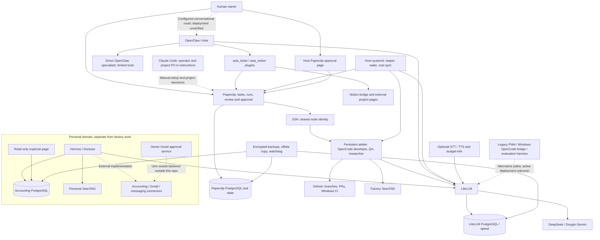
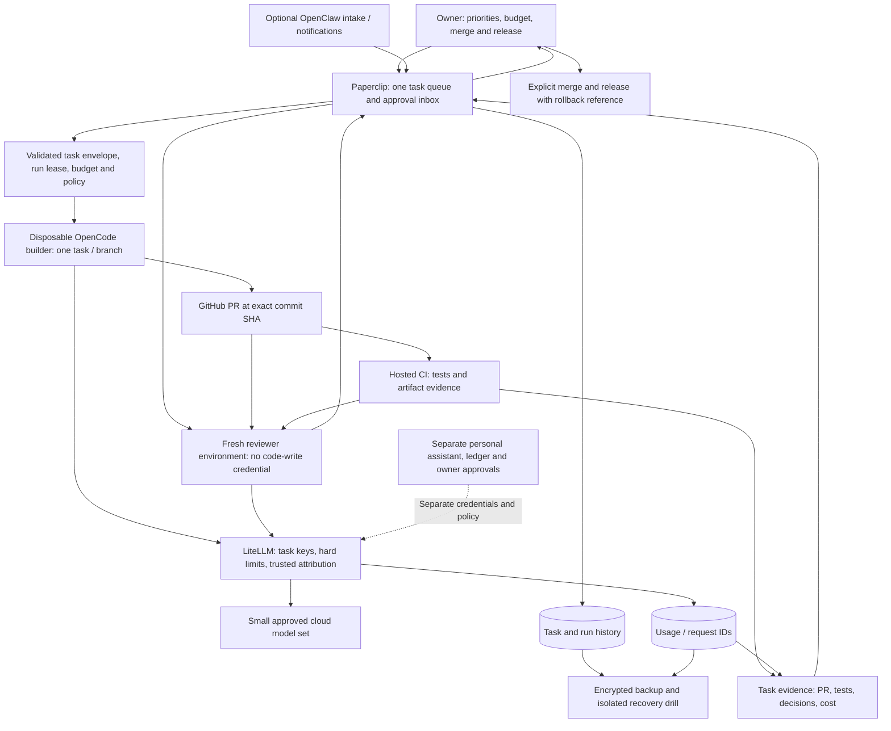
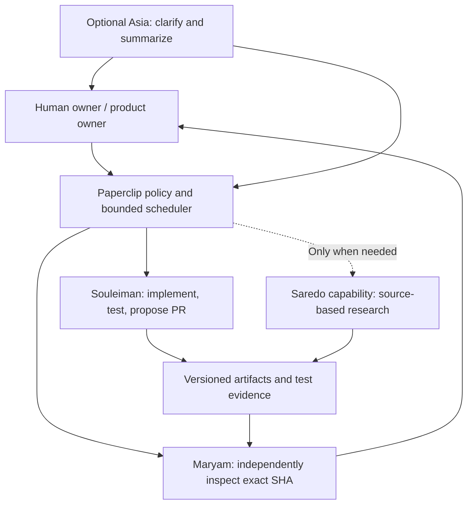

# Software Factory Architecture Audit & Simplification

**Author: Codex (OpenAI)**  
**Audit date:** October 28, 2026, America/New_York; remote checks continued into October 29 UTC.  
**Repository:** [Abdourahmandev/Platforme_agentique](https://github.com/Abdourahmandev/Platforme_agentique)  
**Audited branch:** `ubuntu-server`  
**Audited commit:** [`8384bb3e5e893fb87f16f0a808de2b123cfb4a70`](https://github.com/Abdourahmandev/Platforme_agentique/commit/8384bb3e5e893fb87f16f0a808de2b123cfb4a70)  
**Scope:** Independent, read-only source and architecture audit. Recommendations are not implementations or deployment instructions.

## 1. Executive Summary

**The project is a capable, supervised software-development prototype, but it is not yet a reliably bounded unattended software factory.** Ubuntu, Docker Compose, OpenCode, LiteLLM, GitHub, and a task scheduler are reasonable building blocks for one operator. The main problem is the accumulation of overlapping execution paths, handwritten integration state, project-specific instructions, and recovery mechanisms whose guarantees differ between components.

There is enough working structure to improve incrementally. A replacement platform, Kubernetes cluster, event bus, vector database, or additional management agents would increase the burden before fixing the demonstrated problems. The recommended factory is **Paperclip for tasks and scheduling, isolated OpenCode workers for implementation and review, LiteLLM for model access and budgets, and GitHub for source, PRs, and CI**. OpenClaw can remain an optional conversational entrance. Personal assistance and accounting should remain a separate trust domain.

The most consequential findings are:

- **Publication protection is weaker than the prompts imply.** GitHub reports `ubuntu-server` and `main` as unprotected. The local push hook is explicitly bypassable and does not cover `ubuntu-server`. Agents share a GitHub credential in the workshop. The credential's actual permissions were not inspected. [E03], [E04]
- **A stopped task is not proven to be a stopped process.** The orphan reaper sends a signal without checking termination, then the systemd service invokes the wake script. Recovery can therefore overlap with stale work. This is a demonstrated control gap, not proof that an orphan was running during this audit. [E06], [E07]
- **Human authority and spending boundaries need stronger enforcement.** A ticket-creation check accepts approval text supplied by the model; the workshop setup limits runs per agent but does not demonstrate an end-to-end task budget or a factory-wide execution lease. Final owner approval is a useful existing control, but it does not prevent all preceding work or spending. [E05], [E08]
- **The main visibility problem is unreliable correlation.** Task costs are inferred from agent aliases and time windows, rounded before posting, and reported after a substantial delay. Task, run, commit, test result, approval, and provider request need stable links. [E10]
- **The Ubuntu operating contract is incomplete.** CI runs on Windows; newer Gmail and expense service tests are outside its test discovery. Current Ubuntu instructions coexist with Windows-era setup tools and hardcoded project/branch assumptions. Backups are substantial but do not yet demonstrate complete clean-host recovery of the workshop and host-side connectors. [E11], [E12], [E13], [E14]

Preserve the work already invested in digest-pinned images, mostly loopback-bound services, separate networks, bounded retries, request journals, encrypted backups, offsite verification, and accounting access separation. The Gmail approval service is a particularly useful example of dedicated identities and content-bound approval. These are concrete strengths, not merely stated intentions. [E01], [E15], [E16], [E17]

**Readiness:** source-level mechanisms exist for intake, assignment, code production, PR creation, testing, review, and owner approval. Their deployed behavior was not exercised. The missing step is a controlled demonstration of a complete task surviving cancellation, retry, review, cost reconciliation, and recovery without hidden manual intervention. There is no defensible percentage-complete estimate from source inspection alone.

**Method and coverage.** The audit inventoried all 269 tracked files: 268 UTF-8 text files and one WAV test fixture, totaling 22,064 text lines. Source, infrastructure, prompts, operational scripts, tests, dependencies, documentation, and the two existing audit reports were inspected through whole-tree text inventory, dependency/reference searches, and detailed control-flow review of critical paths. This is broad static coverage, not a claim that every line received formal verification. Existing audits were treated as secondary opinions and their material claims rechecked.

| Repository area | Tracked files | Review focus |
|---|---:|---|
| Root, `src/`, `public/`, `scripts/` | 21 | PWA, HTTP boundary, build manifest, request journal, repository checks |
| `infra/` | 150 | All Compose stacks, provisioners, agent prompts, integrations, training/evaluation, approval services |
| `gateway/` | 10 | Routing, fallbacks, request context, metrics, runtime dependencies |
| `ops/` | 21 | Backup/restore, offsite copy, alerts, systemd units and timers |
| `integrations/` | 11 | Legacy Windows execution, Telegram distribution, speech and OpenCode configuration |
| `test/` | 28 | Coverage boundaries and regression protections, including the binary fixture |
| `docs/`, `documentation/`, `Audit/` | 27 | Operating contract, migration history, conflicting claims |
| `.github/` | 1 | CI runner, permissions, checks and test discovery |

**Verification performed:** Python AST parsing of 95 Python files and JSON parsing of 17 JSON files succeeded; `node --check` succeeded for 46 JavaScript/MJS files. These checks parse source without running repository programs. A location-only scan of tracked text found no matches for the tested GitHub, Google, Telegram, provider, Notion token and private-key patterns. This is not a historical secret scan or proof that no secret exists. A registry advisory lookup for the lockfile's 31 package names identified DOMPurify advisories discussed in F15. No dependency installation or repository test execution was performed locally.

Read-only GitHub checks found the latest workflow at the audited commit [completed successfully](https://github.com/Abdourahmandev/Platforme_agentique/actions/runs/40805762084). That result covers the workflow as written, not Ubuntu deployment or every service. GitHub reported this repository public, default branch `main`, both named branches unprotected, and no effective rules for `ubuntu-server`. At inspection, `ubuntu-server` was **109 commits ahead and 5 behind `main`**, i.e. diverged; the audit did not merge or reconcile them. These are time-specific API observations, available through the [branch endpoint](https://api.github.com/repos/Abdourahmandev/Platforme_agentique/branches/ubuntu-server), [effective rules endpoint](https://api.github.com/repos/Abdourahmandev/Platforme_agentique/rules/branches/ubuntu-server), [main branch endpoint](https://api.github.com/repos/Abdourahmandev/Platforme_agentique/branches/main), and [comparison endpoint](https://api.github.com/repos/Abdourahmandev/Platforme_agentique/compare/main...ubuntu-server).

**Limits:** no Ubuntu host, running containers, private runtime files, live Paperclip configuration, active LiteLLM keys, Tailscale policy, provider invoices, external application repositories, or backup destination was accessed. Actual credential scope, effective permissions, hardware, utilization, active profiles, deployed versions, task outcomes, firewall exposure, and successful disaster recovery remain unverified. No services, deployment commands, autonomous workflows, or untrusted repository scripts were run. Only this report is proposed for the repository.

## 2. Current Architecture

### Implemented components and boundaries

The repository contains several generations of the system. They must not be read as one simultaneously active deployment:

1. **Ubuntu conversational layer:** OpenClaw hosts Asia, Souleiman (`developpement`), and Saredo (`recherche`). Direct delegation is short-lived and constrained; the current prompts distinguish it from workshop execution. The seed configuration disables shell execution and browser access. Installed configuration can differ. [E18], [E19]
2. **Factory control layer:** Paperclip has its own PostgreSQL database, persistent state and authenticated private mode. Asia's plugin creates scoped tickets, comments and execution policies. Initial provisioning connects agents through OpenClaw; workshop provisioning subsequently changes developer, researcher and QA to `opencode_local`. [E02], [E05], [E08], [E20]
3. **Factory execution layer:** Paperclip connects over SSH to one persistent workshop container as `node`, under `/work`. Souleiman, Maryam and Saredo share this environment, persistent volume, network access and mounted GitHub credential. Paperclip may create distinct run checkouts; separate checkouts do not create separate OS security identities. The adapter implementation itself is upstream and not included here. [E03], [E05]
4. **Model layer:** LiteLLM, backed by PostgreSQL, routes generation to cloud providers. The workshop chooses explicit model aliases, so the general `auto` router does not govern every request. Local CPU speech services are optional. This is locally operated orchestration, not local inference for the principal development models. [E01], [E05], [E21]
5. **Reconciliation layer:** systemd runs wake/orphan handling every two minutes and cost synchronization every fifteen minutes. These scripts supplement upstream behavior. Their docstrings describe observed upstream defects; this audit confirmed the workaround code, not those historical incidents. [E06], [E07], [E10], [E22]
6. **Personal layer:** Hermes/Dorasso, its separate search service, accounting PostgreSQL and external accounting/messaging connectors handle personal workflows. Host approval pages and a read-only expense page support them. This is useful adjacent functionality, but it is not required to build software. [E23], [E24], [E25]
7. **Legacy/supporting layer:** the root Node PWA, OpenCode HTTP bridge, Windows launchers, older Telegram integration and supervised training/evaluation system remain tracked. Their presence does not prove that they are active on Ubuntu. The `messagerie.service` unit points to another repository, not to the root PWA. [E26], [E27], [E28]



Solid arrows describe repository-defined connections, not observed network traffic. Dashed arrows identify manual, external, or deployment-dependent paths. The diagram deliberately does not imply that the personal system can approve factory changes, that Claude is a running scheduler, or that all old components are deployed.

### Trust, state and resource inventory

| Boundary | State and authority | Assessment |
|---|---|---|
| OpenClaw | Per-agent workspaces/sessions, gateway credential, Telegram integration, bounded native delegation | Useful conversational isolation; one gateway remains one operator trust boundary. Prompts and workspace restrictions do not secure arbitrary shell execution elsewhere. |
| Paperclip | Task/run history, project configuration, encrypted managed secrets, owner and agent credentials | Appropriate primary task record. Actual deployed policies and secret access rules need inspection. |
| Workshop | Shared `/work`, OpenCode state/configuration, SSH host keys and mounted GitHub credential | Separate tasks are not separate hostile-code boundaries. Persistent state can outlive a run. |
| LiteLLM | Provider credentials, virtual keys, models, spend logs and policy | Good place for spend enforcement. Exact key budgets, expiry, fallbacks and attribution are private runtime state. |
| GitHub | Code, PRs, CI results; default `main`, active Ubuntu branch | A strong artifact record, currently lacking demonstrated server-enforced protection on the audited branches. |
| Personal services | Hermes memory, accounting data/documents, drafts, approval identities | Preserve separation from factory code. Several necessary implementations live in other repositories. |
| Notion / role prompts | Project specifications, status summaries, operating instructions, incident lessons | Multiple copies of evolving truth create drift and repeated context. |
| Recovery | Encrypted archives, manifests, local state, offsite copies and separate decryption key | Substantial implementation; full restoration of all deployed components is not established. |

Compose files apply memory, CPU and PID limits, use many read-only mounts, and do not mount the Docker socket into agent containers. Most published ports bind to `127.0.0.1`. Network separation is meaningful, but outbound networks still permit internet communication, and containers share a host kernel. The workshop's SSH daemon requires more capabilities than the smaller services. Treat model-controlled shell programs as untrusted code. [E01], [E02], [E03], [E23]

The defined long-running factory services, including the workshop and both its search service and the core Playwright service, have approximately **9.625 GiB of summed memory ceilings**. Enabling the three audio-profile services and the personal stack brings the sum to about **13.25 GiB**. Bootstrap containers are excluded. These sums are limits, not reservations or measured usage; they do not establish minimum hardware or expected savings. The host, caches, build children, backups and external host services also need headroom. No RAM, CPU, GPU or disk benchmark was available. [E01], [E02], [E03], [E23]

### Development lifecycle maturity

| Stage | Source-level maturity | Operational consequence |
|---|---|---|
| Idea and requirements | Implemented as conversational procedure; manual approvals | Good owner control, but many handoffs and repeated specification copies. |
| Planning and project onboarding | Partial; Paperclip/Notion plus operator provisioning | Claude is explicitly assigned an operator/PO role in prompts. A declarative project registration flow is missing. |
| Development | Implemented adapter configuration and worker procedure | Can produce code and PRs, but shares execution authority and persistent state. |
| Code review | Conditional native execution policy plus Maryam instructions | Distinct model is useful; shared credentials and environment weaken independent review. Not every project/assignee receives a QA stage. |
| Testing | Node/Python tests and passing Windows CI | Meaningful coverage exists; Ubuntu, newer service suites and key reconciliation paths are not covered by the workflow. |
| Deployment | Manual/operator-driven in this repository | Do not claim a general multi-project release pipeline exists. External projects may have their own pipelines. |
| Monitoring | Partial: health probes, logs, cost sync, backup alerts | No demonstrated complete task-to-commit-to-test-to-cost view or broad failure escalation. |
| Maintenance and rollback | Partial: pinned images, backups, migration docs, incident lessons | Stronger data recovery than application release governance; clean-host recovery and version compatibility remain unproved. |

## 3. Findings & Problems

**Classification:** **Confirmed** means directly demonstrated by source or identified read-only GitHub evidence. **Likely concern** means a plausible consequence is supported but was not reproduced. **Requires verification** identifies deployment facts that cannot be established here. A confirmed control gap is not automatically a demonstrated exploit.

**Priorities:** **P0** before increasing unattended authority; **P1** in the next stabilization cycle; **P2** subsequent simplification. **Effort:** XS under half a day, S roughly 0.5–1 day, M 2–3 days, L 4–7 days of focused engineering and validation. Estimates overlap and must not be added mechanically. No confirmed Critical vulnerability is asserted.

| ID | Severity | Component | Finding | Evidence | Recommendation | Effort |
|---|---|---|---|---|---|---|
| F01 · P0 | High | GitHub publication | **Confirmed:** both relevant branches are unprotected; the local hook only rejects `main`/`master` pushes and deletes, and explicitly admits bypass. **Requires verification:** actual workshop token write/admin scope. Impact: prompt or hook failure may permit unauthorized publication. | [Hook][E04]; GitHub observations in §1; [credential mount][E03] | Protect every deployment/base branch server-side, require checks, restrict bypass, separate automation identity, and verify rejection with that identity. Do not rely on a client hook as authorization. | S |
| F02 · P0 | High | Workshop isolation | **Confirmed:** developer, QA and researcher use one SSH user/environment and a persistent work volume with a shared GitHub credential. **Likely concern:** untrusted tests or injected commands can read that credential or affect another run's state. Read-only mount prevents modification, not reading. | [Compose][E03], [provisioning][E05], [token script][E29] | Give each run a disposable boundary and scoped short-lived credentials; isolate QA with no code-write credential. Keep host administration and personal secrets outside workers. | L |
| F03 · P0 | High | Cancellation/recovery | **Confirmed:** reaper ignores the result of `kill`, does not wait for process-tree termination, and returns successfully on some inspection failures. The next service command wakes work. **Likely concern:** stale processes continue spending or writing while a replacement runs. | [Reaper][E06], [service sequence][E07] | Make termination and credential revocation verifiable; retain a run lease until quiescence is proven. Unknown state blocks replacement. Regression-test child processes and cancellation. | M |
| F04 · P0 | High | Intake authority | **Confirmed:** `ownerRequest` and `proposal` are model-supplied strings checked by regex, not authenticated human approval records. Child creation requires parent context but has no tool-level child-count cap. Impact: this check cannot establish owner authorization to start work/spend. | [Ticket creation and policy][E08], [journal][E09] | Bind launch authority to an owner-created approval/envelope and immutable task revision; enforce child count, scope and budget in the control layer. Preserve request idempotency. | M |
| F05 · P0 | High | Budgets and concurrency | **Confirmed:** configured concurrency and daily-run limits are per agent; the setup injects reusable agent keys, not visibly newly issued task keys. The sweeper clears agent errors automatically. **Requires verification:** live key caps/expiry and global controls. Impact: several individually bounded runs can exceed a task or daily envelope. | [Provisioning][E05], [wake limits/error clearing][E30] | One factory execution lease initially; hard task and daily budgets at LiteLLM plus local wall-time/attempt limits. Distinguish safe retry from operator-required errors. | M |
| F06 · P0 | High | Privilege minimization | **Confirmed:** budget-info receives the whole LiteLLM environment; the Paperclip approvals page runs as the general operator and can read that user's files. **Likely concern:** compromise reaches more credentials than needed. No credential disclosure was observed. | [compose.yaml:120–148][E62], [budget-info/server.py:26–43][E63], [approval unit][E32] | Supply a narrowly scoped reporting identity or sanitized snapshot to budget-info; use a dedicated approval user and narrowly readable token file. Verify effective groups and file ACLs. | M |
| F07 · P0 | Medium | Approval integrity | **Confirmed:** Paperclip approval form tokens bind to issue ID and expiry, but not the issue revision, action or reviewed commit; POST does not re-read the displayed decision state before PATCH. **Likely concern:** an old page approves changed work. | [Approval page][E33] | Bind approval to task revision, action and artifact SHA; revalidate current assignee/stage and reject stale approval. Prefer native owner UI if it supplies the required semantics. | M |
| F08 · P1 | Medium | Task cost accounting | **Confirmed:** alias/time-window inference, 60-minute grace, pre-post rounding, finite fetches without explicit pagination, and no idempotency key in cost-event writes. **Likely concern:** unrelated conversational spend is misassigned and retries double-count accepted writes; upstream behavior needs verification. | [Cost attribution][E10], [timer][E22] | Propagate trusted task/run/request IDs, retain fractional cost, reconcile pagination, and use a tested idempotent sink. Label current values estimated/incomplete. | M |
| F09 · P1 | Medium | CI and regression scope | **Confirmed:** Windows-only workflow; Python discovery starts at `test/`; 24 test methods in two newer service suites are outside discovery. Syntax checking is not execution. No tests of the cost sync/reaper/waker were found. | [Workflow][E11], [Gmail tests][E34], [expense tests][E35], [infrastructure tests][E36] | Add Ubuntu checks and explicit pure-test discovery; cover state transitions, cancellation, costs and approval drift. Keep deployment/network tests opt-in and isolated. | M |
| F10 · P1 | Medium | Disaster recovery | **Confirmed:** backup selection omits workshop private directory/volumes and host `/etc` approval/connector configuration; Hermes snapshot skips a stopped container. Paperclip/LiteLLM restore checks reuse running database containers. **Requires verification:** other host backups and clean-host restoration. | [Snapshot selection][E12], [Paperclip restore:262–294][E13], [LiteLLM restore:475–490][E64], [Hermes snapshot][E37] | Define recovery inventory and recovery objectives; preserve or deliberately reconstruct each omitted item; exercise isolated clean-host recovery with a separate key copy. | L |
| F11 · P1 | Medium | Instructions and project policy | **Confirmed:** global roles hardcode a specific default project and `main`; researcher instructions contain a broad no-PR rule followed by a narrower PR requirement; developer's 20-minute text conflicts with 45-minute provisioned timeout. Impact: wrong project/base, unnecessary gates and inconsistent completion. | [Asia][E14], [developer][E38], [researcher][E39], [timeout][E05] | Separate role policy from project manifests and incident history; define precedence, repository/base branch, time limit and completion contract explicitly. | M |
| F12 · P1 | Medium | Legacy configuration tools | **Confirmed:** training CLI uses Windows `msvcrt`; its configuration splice searches for text absent from current instructions. Older GitHub setup scripts also depend on absent headings. Impact: plausible setup commands are no longer reliable for this branch. | [Runner][E40], [training splice][E41], [publication splice][E42], [delegation splice][E66] | Mark supported Ubuntu entrypoints; archive unsupported migration paths only after dependency checks. Extract shared helpers before retiring training. | M |
| F13 · P1 | Medium | Orchestration complexity | **Confirmed:** direct OpenClaw delegation, Paperclip OpenClaw and OpenCode adapters, legacy bridge state, role-specific procedures, Notion summaries and reconciliation timers coexist. **Likely concern:** operator effort and status/context drift outweigh useful parallelism. | [Direct delegation][E19], [Paperclip setup][E20], [workshop][E05], [legacy bridge][E27], [project procedure][E14] | One scheduler and one factory execution path; optional chat intake; one canonical task and artifact record. Retire alternatives after a measured trial. | L |
| F14 · P0 | High | Personal-data routing | **Confirmed:** Dorasso setup states Gemini-only intent, while global gateway configuration includes Gemini-to-DeepSeek fallback. **Requires verification:** whether the actual Dorasso key's model restrictions and deployed fallback logic prevent it. No cross-provider disclosure is asserted. | [Personal model policy][E43], [fallback configuration][E44] | Verify fail-closed routing under provider failure using synthetic data; enforce allowed providers per credential and disable incompatible fallback. | S |
| F15 · P1 | Medium | Frontend dependency | **Confirmed:** lockfile resolves DOMPurify 3.4.16, within three published advisory ranges. **Exploitability not demonstrated:** the inspected renderer uses default HTML string sanitization, not the identified special modes. | [Lockfile][E45], [renderer][E46]; advisory discussion below | If retaining the PWA, update to a maintained patched release and test hostile Markdown. Avoid treating supplier severity as proven application severity. | S |
| F16 · P1 | Medium | Supply chain and reproducibility | **Confirmed:** Actions use mutable version tags; workshop apt packages and OpenCode transitive installation are not fully locked; ops Python dependencies are ranges. Image digests and a verified `gh` download are positive controls. Impact: rebuilds can differ without a source change. | [CI][E11], [Dockerfile][E47], [requirements][E48] | Pin Actions by commit, record runtime/build dependency versions and image provenance, schedule reviewed updates and vulnerability checks. Do not freeze vulnerable versions indefinitely. | M |
| F17 · P2 | Medium | Notion integration | **Confirmed:** discovering a database can PATCH missing schema during a read path; create uses search-then-create; appends lack a durable operation journal. **Likely concern:** surprise mutation or duplicate content after uncertain writes. | [Database discovery][E49], [write operations][E50] | Remove the mandatory duplicate status workflow, or make schema changes explicit and writes idempotent with an outbox/reconciliation record. | M |
| F18 · P1 | Medium | External deployment dependencies | **Confirmed:** messaging/accounting implementations are outside this repo, with host paths, packages, sockets and service configuration required. The expense service documents a manually maintained container-IP allowlist. **Requires verification:** installed versions, ACLs and drift handling. | [External service][E28], [accounting preparation][E51], [expense deployment][E52] | Publish a deployment manifest of exact external revisions, identities and recovery requirements; eliminate fragile IP assumptions where practical. | M |
| F19 · P1 | Medium | Operational visibility | **Confirmed:** task/plugin result windows are bounded, cost reporting lags, and wake/cost units lack the backup system's failure escalation. **Likely concern:** a quiet failure looks like idle agents or zero cost. | [Ticket reads][E53], [costs][E10], [cost service][E65], [wake service][E07], [backup alerts][E54] | Expose last successful reconciliation, incomplete data, run/PR/test links and one actionable owner inbox; alert on persistent failure and stale leases. | M |
| F20 · P2 | Low | Optional services | **Confirmed:** Playwright starts without an opt-in profile although current OpenClaw seed/prompts disable browser use. Separate factory/personal search services may be intentional privacy separation. **Requires verification:** active consumers and measured idle use. | [Compose][E01], [seed config][E18], [capability prompt][E19] | Make unused capabilities opt-in after usage inspection. Preserve separate search when it protects personal data. Do not promise RAM savings from configured ceilings. | S |
| F21 · P2 | Low | Model/configuration sprawl | **Confirmed:** the gateway declares 34 model names plus routing/fallback policy; model lists and selection logic also appear in clients/provisioning. Explicit workshop selection bypasses the auto route. **Likely concern:** unsupported aliases, duplicated context and slow/costly defaults add maintenance. | [Gateway][E21], [routing policy][E55], [workshop selection][E05] | Maintain a small tested production model set and one policy source; retain special audio/image routes only for actual consumers. Benchmark quality per task. | M |

### Interpretation of the highest-risk findings

**F01–F02: authority must survive prompt failure.** The workshop comment saying it has no secrets beyond a per-run LiteLLM key is contradicted by its GitHub credential mount. Furthermore, the injected keys are stored per agent; the code shown does not establish creation/expiry for every run. Shared ownership of files and processes makes QA a different reasoning pass, not a fully independent security boundary. A GitHub App token still needs server-side branch rules: token expiry and repository scope alone do not make it branch-scoped. GitHub documents [protected branch controls](https://docs.github.com/en/repositories/configuring-branches-and-merges-in-your-repository/managing-protected-branches/about-protected-branches); availability is not an excuse for the hook in this public repository.

**F03–F05: limits exist, but they do not compose into a task guarantee.** The wake script has a useful three-wakes-per-ticket-per-day cap and respects paused agents. Native direct delegation also limits depth and duration. Preserve these. However, the wake cap is persisted after remote operations, the busy-run query is limited to 100 records, and unknown process state does not prevent a new wake. A crash-safe run lease and verified stop are more important than adding another retry. Likewise, a Paperclip accounting limit informed by delayed costs should not be assumed to stop provider spending immediately. [E19], [E30], [E10]

**F06–F07: network locality is part of the security boundary.** The Paperclip approval service checks a Tailscale identity header and binds to loopback. A process able to reach that loopback listener can supply the header; this is not evidence of unauthenticated public internet access. Verify that the proxy authenticates and strips/replaces identity headers, that untrusted workers cannot reach owner-only services, and that the service identity cannot read unrelated secrets. The Gmail approval service already demonstrates stronger UID isolation and approval bound to exact draft content. [E32], [E33], [E16]

**F08: the current cost view is not a reliable invoice per task.** Alias matching cannot distinguish an overlapping Asia conversation from an Asia ticket using the same alias. A run is not posted until at least 60 minutes after completion, then waits for the 15-minute timer: approximately 60–75 minutes under normal scheduling, longer on errors. Per-model/run rounding can discard small charges. A crash after a successful remote POST but before local state persistence can replay a charge. Current Paperclip [cost API documentation](https://docs.paperclip.ing/reference/api/costs/) documents task/run IDs, fractional cents and an `idempotencyKey`; compatibility with the pinned server must be checked before relying on those features. Even perfect posting would not fix heuristic attribution upstream.

**F15: known vulnerable version does not prove a reachable exploit.** The advisories cover [template handling with shadow roots and DOM output](https://github.com/cure53/DOMPurify/security/advisories/GHSA-cg2g-xh64-v4q7), [in-place sanitization with mutating hooks](https://github.com/cure53/DOMPurify/security/advisories/GHSA-mrv2-3pqr-j5jr), and [XHTML parser mode](https://github.com/cure53/DOMPurify/security/advisories/GHSA-c6gr-qvv4-5v3f). Their published patched version is 3.4.17. Those special configurations were not found in the renderer. This report assigns Medium to the dependency maintenance finding, without claiming critical XSS in the deployed app. The advisory lookup was limited to npm lockfile versions, not Python packages, image layers, runtime plugins or external repositories.

## 4. Recommended Target Architecture

### One task scheduler, bounded workers, owner-controlled publication

Retain Paperclip as the factory's task and execution record. It already has project, run and review concepts, so replacing it immediately would throw away substantial integration work. Use its native execution policies where the pinned version supports and correctly enforces them. Current [Paperclip documentation](https://docs.paperclip.ing/guides/power/execution-policy/) describes enforced review/approval stages and bounded review escalation; this is a capability to validate against the deployed version, not evidence that all current tasks have it configured.

Keep OpenCode as the initial coding executor. Replace the persistent shared workshop boundary with disposable run environments controlled by a trusted launcher. First evaluate a supported Paperclip isolation mechanism; if unavailable, use a small, narrowly scoped launcher around container lifecycle rather than another orchestration platform. Agents must never receive the host Docker socket. The launcher accepts validated task IDs and preapproved images, not arbitrary model-provided host arguments.

Keep LiteLLM as the only model gateway. Bind each execution to a scoped model credential with hard budget, expiry and trusted task/run metadata. Keep GitHub as the code, PR and CI record, and human merge/release authority. Use the existing Paperclip board instead of building another general dashboard.



| Decision | Concrete change | Measurable benefit and tradeoff |
|---|---|---|
| Keep | Ubuntu, Compose, Paperclip, OpenCode, LiteLLM, GitHub, systemd, encrypted backups | Reuse working infrastructure; fewer migrations. Success is an accepted PR with complete evidence and a recoverable execution record. |
| Remove from the core factory | Direct OpenClaw specialist execution for tasks already in Paperclip; legacy Windows bridge/PWA if no active user; mandatory Notion status mirroring | One task dispatch path and fewer status stores. Loses instant specialist chat/old UI workflows; optional chat can still create or inspect tasks. |
| Replace | Shared long-lived workshop authority; broad reusable publication credential; unverified orphan handling | Each run can be stopped and removed without affecting other tasks; QA cannot publish code; unauthorized protected-branch push fails. Requires launcher and recovery validation. |
| Consolidate | Role policy, project metadata, model policy and operating documentation | One edit per policy; no hardcoded default project or universal `main`. Avoid replacing copies with a large configuration framework. |
| Add | Run lease, exact-SHA evidence, trusted approval binding, task budget, correlation IDs, clean-host restore drill | Demonstrable task boundaries, trustworthy costs and owner visibility. These are small control features, not new always-on platforms. |
| Keep separate | Personal Hermes/accounting/Gmail and their credentials/data | Limits the consequence of executing project code. Some duplicated containers are justified by the privacy boundary. |

Keep the existing two factory PostgreSQL instances during stabilization. Consolidating them now is a data migration with coupled failure/recovery consequences. In a fresh deployment, one PostgreSQL service with separate databases and roles could be reasonable if measured resource pressure warrants it; it is optional, not a prerequisite. Do not merge the accounting ledger into factory storage merely to reduce container count.

**Architecture exit test:** one owner-approved task produces one branch and one PR, with tests and independent review tied to its head SHA, complete cost attribution or an explicit incomplete flag, and an owner decision. Cancelling at every stage stops processes and further gateway use. A failed integration produces one actionable blocked item, not another invisible run.

## 5. Recommended Agent Organization

Use **two execution roles**, not a simulated management hierarchy: builder and reviewer. Research/planning is an optional capability invoked when the task requires it. A deterministic scheduler assigns work; an LLM does not need to repeatedly decide who should work next.



| Role | Autonomous within approved scope | Cannot do | Escalates when |
|---|---|---|---|
| Human owner / PO | Set objectives, accept scope and spend, decide tradeoffs | Delegate away accountability for releases or sensitive commitments | Security, data use, price, production changes or unclear requirements need a decision |
| Asia, optional intake | Clarify requirements, draft a task, summarize existing status | Invent launch approval, act as compulsory operator, silently change project/base | A task lacks acceptance criteria, budget, repository or allowed actions |
| Builder / Souleiman | Edit task checkout, run sandboxed tests, commit and propose a PR | Merge, deploy, change credentials/protected policy, access personal data, expand scope | Required environment/permission is absent, tests fail for unknown reasons, budget/attempt cap is reached |
| Reviewer / Maryam | Read exact PR SHA, reproduce relevant tests in fresh isolation, report evidence | Reuse builder secrets/state, push code, approve release on owner's behalf | Material findings, unverifiable claims, changed SHA, conflicting requirements |
| Research capability / Saredo | Read allowed sources and produce cited findings | Launch coding work or contact third parties without scope | Sources conflict, facts cannot be verified, task needs specialized human judgment |
| Scheduler and CI | Enforce transitions, leases, checks, retry caps and evidence links | Make business decisions or treat model text as authorization | Run state is uncertain, infrastructure fails, retry cap is exhausted |

Names can remain friendly aliases. Stable role IDs and permissions should be the operational identifiers. Maryam using a different model family is useful diversity, but does not replace separate credentials, a fresh checkout and objective tests.

Maintain instructions in layers with explicit precedence: **security policy enforced by runtime → approved project manifest → approved task acceptance criteria → concise role instructions → untrusted repository/web/tool content**. Repository instructions may guide implementation but cannot grant host access, credentials, publication authority or a larger budget. Conflicts stop only the affected work with a precise question. Move fiscal/project incidents into their project's regression tests and specification; retain short reusable lessons in the role policy. [E14], [E38], [E39]

## 6. Technology Stack Assessment

Migration estimates below are planning estimates, not vendor performance claims. Runtime versions are declared versions/digests unless explicitly observed; no deployed inventory was obtained.

| Technology | Current Purpose | Keep / Replace / Remove | Reason | Alternative | Migration Effort |
|---|---|---|---|---|---|
| Ubuntu + Docker Compose | Local host and service composition | Keep | Appropriate for one operator; explicit resource/network boundaries already exist | No Kubernetes or cluster manager needed | S for authoritative runbook; no platform migration |
| Paperclip, declared 2026.1005.0 | Tasks, agents, runs, approvals, secrets, budgets | Keep, validate and simplify integrations | Existing task UI and policies avoid a custom control platform; workarounds show compatibility debt | GitHub Issues + small bounded dispatcher only if a measured trial fails | M stabilization; alternative L plus data migration |
| OpenClaw | Conversation, Telegram, direct delegation and ticket tools | Keep optional intake; remove duplicate factory execution | Useful interface; redundant as a second task scheduler. Official guidance treats a gateway as one operator trust boundary | Direct Paperclip UI; lightweight notification adapter | M to retire duplicate path |
| OpenCode, declared 1.18.34 | Coding/review CLI in workshop; legacy HTTP integration | Keep executor; replace shared environment | No evidence that swapping coding brands solves current authority/recovery problems | Another CLI only after benchmarked capability or reliability gain | L for isolation; CLI replacement not justified now |
| Claude Code | Operator and project PO in instructions/user workflow | Remove mandatory coordination dependency | No required resident Claude scheduling service is defined; operator knowledge should become manifests and runbooks | Owner plus Paperclip policy; Claude as optional coding/review tool | M–L to remove manual onboarding bottlenecks |
| LiteLLM, declared 1.104.1 | Gateway, model routing, virtual keys and spend | Keep | Central policy is valuable across several clients; enforce task scope and reliable metadata | Direct provider SDK only if shrinking to one client/provider and replacing budget controls | M policy and attribution work |
| PostgreSQL 17.11 | Gateway, Paperclip, accounting persistence | Keep; defer factory consolidation | Persistence and recovery already implemented; accounting deserves a separate boundary | One factory server with separate databases only after measurement | M–L if consolidating; otherwise XS documentation |
| GitHub + `gh` | Repository, branches, PRs and CI | Keep; strengthen identity and rules | Best existing code/evidence record; local hook is insufficient | None required | S–M |
| GitHub Actions | Windows Node/Python/build checks | Keep; add Ubuntu coverage | Existing CI passes; wrong platform for full Ubuntu confidence | Hosted Linux runner; no production-host PR runner | M |
| GitHub Issues / Projects | Candidate workflow/visibility option | Optional, do not duplicate Paperclip queue | Projects can organize issue/PR status; they do not execute workers themselves | Use Paperclip board with PR links first | S view-only; L queue migration |
| Node.js 24, Python 3.13, Bash, PowerShell | Services, glue, provisioning and legacy operations | Keep Node/Python/Bash; archive unused Windows entrypoints | Language diversity is manageable; unsupported paths and broad host privileges are the bigger cost | One supported Ubuntu operational contract | M |
| SearXNG, two stacks | Factory and personal web search | Keep on demand; preserve intentional separation | Avoid an extra search purchase if it works; duplicated deployment may protect privacy | One shared instance only after data-flow review; allowed external search if simpler | S–M |
| Playwright MCP | Browser automation service | Make optional; remove if no consumer | Default-on service conflicts with disabled browser capability; `--no-sandbox` needs containment review | Ephemeral browser only for a browser task | S |
| Speaches / faster-whisper, ffmpeg, Gemini TTS | Speech transcription/conversion and voice replies | Keep as optional personal/UI capability | Local CPU STT and cloud TTS solve a distinct use case, not a factory requirement | Text-only factory | S to decouple |
| Hermes / Dorasso | Personal assistant with memory, voice, search and accounting access | Keep outside factory scope if used | User value is separate; removing it does not simplify software execution logic | Separate deployment/repository ownership | M separation/documentation |
| Accounting PostgreSQL roles, psycopg, external accounting connector | Restricted financial data access | Keep separate; pin external revision | Read-only role separation and isolated recovery tests are stronger than generic agent prompts | No replacement justified by this audit | M reproducibility/recovery |
| Gmail approvals and external draft backend | Owner-only approval of prepared messages | Keep strong pattern; verify backend integration | Content binding, dedicated UID and socket boundary are valuable | Native provider approval flow only if equivalent | S–M |
| Paperclip custom approvals / expense page | Mobile decisions and read-only personal view | Consolidate Paperclip UI where possible; keep expense view if used | Custom privileged surface increases maintenance; expense service has narrower authority | Native Paperclip owner UI; existing read-only accounting view | M |
| Notion bridge | Project specifications and mobile summaries | Remove as mandatory factory state; retain optional publication | Duplicate lifecycle bookkeeping and uncertain-write handling add overhead | Versioned `docs/` plus task description/board | M; preserve/export useful documents |
| Root PWA: esbuild, marked, DOMPurify, lucide, service worker | Custom chat frontend | Retire if unused; patch if retained | A separate UI/build/dependency/security surface is costly without active use | Paperclip/OpenClaw's chosen supported interface | M with session/export check |
| SQLite request journal | PWA submission idempotency and uncertainty tracking | Keep pattern; retain implementation if consumer remains | Durable pending/uncertain handling is a useful reliability primitive | Native idempotent APIs where verified | XS to document; M to reuse |
| Training/evaluation harness | Supervised tool-use/regression campaigns, promotion/evidence | Consolidate to small supported regression suite | This is evaluation, not model weight training; Windows orchestration and prompt splicing are stale | Offline fixtures plus selected isolated acceptance tests | M–L; shared helpers must be extracted first |
| AES-GCM/cryptography, native dumps, rclone, systemd | Encrypted backup, offsite copy, timers and alerts | Keep and extend recovery inventory | Good foundation, with measurable missing recovery scope | No new backup platform required before clean-host test | L for full drill; S–M inventory |
| OpenChamber, old Telegram bot distribution, Windows Prisma/speech launchers | Historical interfaces and runtime workarounds | Archive after consumer verification | Do not carry two operating systems' recovery promises by accident | Supported Ubuntu stack and an explicitly optional Windows client | M |

The official [OpenClaw security model](https://docs.openclaw.ai/gateway/security) recommends distinct trust boundaries for mutually untrusted users/workloads; it does not turn agent names into security principals. The official [OpenCode permission documentation](https://docs.opencode.ai/docs/permissions/) makes permission behavior configurable and describes broadly permissive defaults for many actions. The workshop configuration has no explicit permission policy; verify effective behavior for its exact version. CLI approval prompts are a secondary control, because code that is allowed to execute can still read its environment and accessible files. [E18], [E56]

## 7. Repository Cleanup Recommendations

**No deletion or restructuring was performed.** A file's age or Windows suffix does not prove it is unused. Use import/reference checks, deployed-unit inventory and a recovery drill before removing anything.

| Candidate | Proposed disposition and rationale | Dependency/retention condition |
|---|---|---|
| Root `server.mjs`, `src/`, `public/`, `build.mjs`, `request-journal.mjs`, `config.example.json` | Retire together if the custom PWA has no user; otherwise retain, document and patch it | `package.json`, JS tests and frontend dependencies form one feature set. Preserve/export journal/session data. Do not remove DOMPurify alone while Markdown rendering remains. |
| `start-asia.ps1`, `gateway/*ps1`, `integrations/*/run-*.ps1`, Windows-only provisioning paths | Move supported Windows-client material to a clearly optional area; archive obsolete server setup | README, migration docs and tests reference them. Decide whether a Windows client is still supported before removal. |
| `infra/configure-github-delegation.py`, `infra/configure-github-publication.py`, old connector setup | Archive incompatible migrations or repair as explicit versioned migrations | Prompt markers no longer match. Trace `test/test_github_*.py`, legacy bridge configuration and operational docs first. Do not rerun them as discovery. |
| `infra/opencode-bridge/`, `integrations/opencode/` | Retire the old HTTP/Windows bridge after Paperclip execution is the only factory path | `infra/configure-*`, bridge tests, approval evidence, PWA and integration docs may still depend on it. Preserve tested journal/approval ideas before removing code. |
| `infra/training/` campaign/provision/promote scripts and duplicated playbooks | Archive campaigns; preserve focused regression fixtures and evidence schema | **Do not delete this directory wholesale:** Paperclip install/update/Notion-enablement scripts import `training/common.py`. Extract a supported operational helper first. [E57] |
| `ops/backup.py` | Keep shared crypto/archive helpers; separate legacy Windows backup entrypoint later | **`ops/backup-docker.py` imports it.** Its destination already has a Linux fallback; a blanket Windows-obsolete deletion would break current recovery. [E58] |
| `infra/notion-bridge/journal.py`, `rebuild.py` | Treat as historical/manual data migration tools, outside routine startup | They contain top-level remote writes and specific project history. No production import was identified in the static reference scan; check operator usage and preserve an export before archival. Never import them for discovery. [E59] |
| `docs/`, `documentation/`, root README | Consolidate one Ubuntu operating guide, one architecture page and a clearly labeled archive | Preserve rationale, migration history and recovery details; update incoming links before moving files. Existing audits remain historical snapshots, not runtime instructions. |
| `infra/agents/*/AGENTS.md`, `PAPERCLIP.md`, `PROCEDURES.md` | Keep small role contracts; move project facts and incident narratives to project docs/tests | These files intentionally describe different execution modes. Generate/install only the correct mode and test selection; do not collapse different capability sets blindly. |
| Gateway model catalog, routing JSON, client model lists, provisioning constants | One validated policy source; generate repetitive capability tables | `scripts/document-models.py`, routing tests, speech consumers and model-specific inputs depend on this data. Preserve required image/audio/structured-output behavior. |
| `infra/compose.yaml` Playwright/default Notion service | Make optional after proving consumers absent | Browser workspace mount, OpenClaw config and plugins are dependencies; 768 MiB is a browser ceiling, not measured recoverable RAM. |
| `test/fixtures/audio-test.wav` | Keep | This is a small purposeful test asset, not unexplained generated output. No tracked `node_modules/` or generated `dist/` tree was found to justify bulk cleanup. |

Missing or insufficiently explicit artifacts are a supported Ubuntu installation/upgrade/recovery guide; a non-secret deployed-version manifest; per-project repository/base-branch/commands/acceptance/budget policy; a permission matrix; a small threat model; a `SECURITY.md`; automated dependency update configuration; and a test discovery manifest covering all supported services. Introduce these only as later implementation work.

A possible destination structure is:

```text
docs/                 architecture, operations, security, recovery
factory/              task policy, run control, narrow integration adapters
agents/               short builder/reviewer/intake policies
projects/             non-secret project manifests and policy schemas
infra/                supported Compose files and systemd units
gateway/              one routing policy and gateway adapters
personal/             separately operated personal/approval integrations
ops/                  backup, restore, health, controlled migrations
tests/                explicit unit, security and isolated acceptance suites
archive/              unsupported migrations and historical design material
```

This is an ownership proposal, not a mandate to move files immediately. Renaming 269 files without reducing active contracts would create work, not simplification.

## 8. Security & Governance Recommendations

### Practical permission model

| Principal | Files/processes | Network/credentials | Allowed side effects |
|---|---|---|---|
| Owner/operator | Host administration and recovery | Admin credentials, stored outside agents | Project approval, key rotation, rules, merge, release, restore |
| Scheduler/launcher | Task state and constrained worker lifecycle | Paperclip control credential, narrowly scoped key-issuance capability | Start/stop approved task, allocate/revoke task identity; no arbitrary model-supplied host command |
| Builder | Disposable task checkout and temporary scratch | Task-limited model key; scoped GitHub publication identity; only necessary package/source endpoints | Branch commits and PR proposal within approved repository; no protected branch updates |
| Reviewer | Fresh exact-SHA checkout and isolated test scratch | Read-only repository access and separate task model key | Review evidence; optional narrow comment capability through trusted adapter; no code writes |
| Research | Notes and approved source retrieval | No GitHub write token, deployment keys or personal connectors | Cited report only; versioning handled through approved artifact path |
| Approval service | Minimal configuration plus decision state | Dedicated owner-decision token, trusted proxy/socket boundary | One authenticated, revision-bound owner decision |
| Personal assistant | Its own files and narrowly scoped ledger/draft tools | Separate provider policy and personal credentials | Read-only accounting and drafts within policy; sending/payment requires explicit owner action |

Implement controls in this order:

1. **Protect publication and credentials.** Apply rules to `ubuntu-server`, `main`, and each target project's true release branches; require appropriate checks; prevent automation bypass. Give automation its own identity. Prefer short-lived repository-scoped credentials and verify actual permissions. Rotation is required after evidence of exposure, not asserted necessary because an audit occurred.
2. **Separate execution from administration.** No Docker socket, host home directory, Paperclip board token, provider master key or personal connector secret inside a worker. Separate UID/container boundaries per run; fresh reviewer state; read-only base image; minimal capabilities; CPU/memory/PID/time limits. Installation scripts and test commands are untrusted execution too.
3. **Make authorization durable and specific.** Approve the task envelope and its allowed changes once, then allow reversible work inside it. Bind merge/release approval to exact SHA and evidence. Bind message/payment/external-write approval to the exact recipient/action/content. Expired or changed work returns to awaiting approval; a quotation of the owner is not authorization.
4. **Treat all fetched content as data.** Tickets, comments, repository files, package output, web pages and tool responses can contain prompt injection. None may increase budget, add credentials, disable checks, launch unrelated work or approve itself. Restrict tools and network capabilities outside the model; prompt reminders alone are insufficient.
5. **Harden owner-facing boundaries.** Check effective Tailscale ACLs, proxy header handling and listener interfaces. Use dedicated service identities, narrowly readable files and restrictive Unix-socket permissions. Retain the Gmail service's content hash and peer-identity pattern; strengthen the generic Paperclip approval service or retire it in favor of a sufficient native UI.
6. **Close supply-chain and logging gaps.** Pin reviewed Actions to commit SHAs, retain image digests, record exact worker/plugin dependencies, scan dependencies and secrets in CI, and test redaction. Do not log environment dumps, Authorization headers, provider keys, OAuth query strings or raw personal prompts. Keep detailed artifacts access-controlled with retention limits.

GitHub recommends avoiding persistent self-hosted runners for untrusted public pull requests because hostile jobs can compromise the runner and accessible secrets. Use GitHub-hosted CI for this public repository; a local builder is a separately isolated execution service, not a production-host PR runner. See [GitHub Actions security guidance](https://docs.github.com/en/actions/reference/security/secure-use).

### Runtime evidence required before broader autonomy

| Verification | What would constitute evidence | Why source alone is insufficient |
|---|---|---|
| Credential scope and branch rules | Sanitized permission inventory; denied direct/force pushes under automation identity; required checks enforced | Mounted token contents and effective permissions are private runtime state |
| Worker isolation | Negative tests for sibling files/processes, host paths, owner-only listeners and personal sockets | Compose topology does not prove effective permissions or adapter workspace behavior |
| Approval correctness | Stale task/SHA/action is rejected; replay is rejected; real owner identity recorded | Current handler does not bind the artifact revision; upstream policy may add separate checks |
| Stop behavior | Cancel kills descendants, revokes gateway access and prevents replacement until confirmed | Sending a signal is not proof of termination |
| Budget enforcement | Synthetic low-budget task stops, cannot switch key/provider, and records rejected requests | Private LiteLLM team/key policy and timing are unknown |
| Personal routing | Synthetic provider outage cannot route personal requests to a forbidden provider | Global fallback and key restrictions interact |
| Recovery | Isolated restoration on a clean environment, with keys retrieved from a separate location | Archive validation and same-server scratch restores do not simulate host loss |
| External services | Pinned revisions, UID/socket ACL tests, package inventory and complete recovery manifest | Accounting/messaging backend code and deployment state are outside scope |

No payment, legal/tax calculation, credential change, public release or third-party communication should become autonomous merely because the developer/reviewer pair agrees. The factory can prepare evidence and proposals; the owner approves these higher-impact actions.

## 9. Autonomy & Orchestration Strategy

### What dependency on Claude actually means

The repository does **not** define Claude Code as a required always-running scheduler. Paperclip, its OpenCode adapter, systemd timers and LiteLLM can form a runtime path without it. The dependency is chiefly **procedural and operational**: Asia's instructions name Claude as operator, assign it project PO responsibilities, require explicit per-stage/per-lot initiation, and leave project provisioning and new service installation to that operator. Eliminating Claude as a dependency means making those procedures explicit and reproducible, not replacing it with another always-on LLM director. [E14], [E05], [E07]

| Pattern | Advantages | Costs/failure modes here | Assessment |
|---|---|---|---|
| Centralized LLM director | Flexible decomposition and conversation | Repeated context, ambiguous authority, model dependency and a coordination bottleneck | Keep for occasional planning, not routine dispatch |
| Supervisor–worker | Clear task ownership and bounded worker roles | Supervisor must persist state and enforce limits outside prompts | Best fit with Paperclip plus deterministic policy |
| Event-driven autonomous agents | Can react to assignments, CI and reviews without polling every interaction | Duplicate/out-of-order events, feedback loops and difficult debugging | Use a few idempotent events inside the existing system; no event bus |
| GitHub Issues-driven | Code-adjacent requirements, PRs and Actions; fewer custom UI surfaces | Still needs secure dispatch, leases, budgets, cancellation and local execution; Projects is not a scheduler | Credible fallback if Paperclip proves too costly to operate |
| Hybrid with human gates | Autonomous bounded work with explicit business/release control | Requires precise approval semantics and visible exceptions | Recommended: supervisor–worker execution plus owner gates |

GitHub's [Projects automation](https://docs.github.com/en/enterprise-cloud%40latest/issues/planning-and-tracking-with-projects/automating-your-project) can maintain board fields and views; that does not replace an executor. Avoid keeping identical actionable tickets in both GitHub Issues and Paperclip. For now, use Paperclip tasks linked to GitHub PRs. If switching later, migrate ownership once and archive the old queue.

### Concrete task flow

1. **Intake:** the owner or optional Asia drafts a task with project, repository, base branch, acceptance criteria, allowed files/actions, test commands, sensitivity, maximum spend and deadline. Proposed tasks begin in backlog.
2. **Launch authorization:** the owner approves a bounded task or a small batch. Store an authenticated decision against the task revision. A policy can launch the next already approved item when dependencies are actually merged and checks pass; no new per-step LLM-manager conversation is required.
3. **Admission:** the scheduler validates project policy, dependencies, remaining budget and a global concurrency slot. It creates a durable run ID, lease, task credential and one branch/check-out. Initially permit one active factory execution, including review.
4. **Execution:** the builder receives only the required specification and repository context, works within the boundary, runs tests, and checkpoints useful work to its authorized branch. Resume from evidence already produced instead of repeating a successful phase.
5. **Evidence:** record PR URL, exact head SHA, changed-file summary, commands, exit codes, test artifacts, remaining limitations and model usage. A statement that tests passed is not evidence without command/result linkage.
6. **Independent review:** a fresh reviewer checks the same SHA and acceptance criteria, reads CI output, and runs additional tests only when justified. A new commit invalidates stale review approval. Limit automated revision loops, initially to two attempts total before owner escalation.
7. **Acceptance:** Paperclip presents one owner decision with diff, review, CI, cost/completeness and risks. Owner merges/releases as appropriate. Distinguish implementation complete, accepted/merged, and deployed; do not silently equate them.
8. **Close and learn:** revoke task credentials, remove disposable state after artifact capture, reconcile cost, and record a short outcome. Add a regression test for a demonstrated recurring defect; do not append every incident to every agent's prompt.

### Limits, recovery and concurrency

Use a task envelope with an explicit maximum spend and one daily factory cap. Choose initial dollar values from actual provider usage and the owner's tolerance; this audit did not measure costs and does not invent a suitable budget. Use cheaper models for routine triage and straightforward edits, with an explicit, capped escalation route for difficult work. LiteLLM [virtual keys](https://docs.litellm.ai/docs/proxy/virtual_keys) offer model and budget controls; test exact hard-stop and expiry behavior for the pinned deployment rather than assuming the dashboard alone enforces it.

Align actual worker timeout and instructions. Count all retries, review passes and child tasks against the parent envelope. A new request ID must not reset an existing task's spend or attempts. Use a bounded output/token policy where supported, one fallback at most, and no fallback to a provider forbidden for the data. Preserve the gateway's existing multimodal compatibility handling and training-key restrictions when simplifying. [E21], [E44], [E60]

Classify failures as retriable before side effects, uncertain after side effects, or requiring intervention. Retry only the first class automatically. For uncertain writes, reconcile using operation IDs before retrying; for uncertain process state, revoke access and block replacement. Persist attempt accounting before the remote request and finalize it afterward. An agent error should not be cleared merely because a timer fired.

After a stable trial, allow two concurrent independent tasks only when each has its own workspace, credentials and run lease, adequate host headroom, and no shared deployment resource. Use a repository/release lock for merges and deployments. Parallel research may help; simultaneous edits to the same worktree do not.

**Paperclip decision checkpoint:** run a 30-day pilot after Phase 0, recording accepted PRs, operator minutes per accepted task, stuck runs, duplicate actions, cost completeness and recovery failures. Keep Paperclip if it demonstrably reduces work. If its adapters still require repeated manual repairs, evaluate GitHub Issues plus one bounded dispatcher against the same task set. Estimate 4–7 engineering days plus history migration/validation for that alternative; do not adopt it merely for a smaller diagram.

## 10. Progress Tracking & Observability

**Start with the Paperclip board, linked GitHub PRs/Actions and LiteLLM usage.** Improve missing correlations and error visibility before creating a dashboard. The owner should have one inbox for decisions and blockers, not a stream of agent narration.

| Owner's question | Existing source | Minimal improvement |
|---|---|---|
| Which agents are working? | Paperclip active runs; worker process state | Show active run ID, started time, deadline and last heartbeat; stale lease is a warning, not idle |
| What is assigned to each agent? | Paperclip task/assignee | Require one active execution assignment per slot; show project and task link |
| What is completed, running, blocked or waiting? | Task status and execution stage | Separate backlog/ready/running/blocked/awaiting-owner/accepted; distinguish review stage from owner approval |
| What code was produced? | GitHub PR and commit | Required task-to-PR URL and exact head SHA; identify unpublished local checkpoint separately |
| What tests passed or failed? | CI job/artifact plus isolated worker evidence | Link command, exit code, SHA and artifact; mark not run/skipped/unknown explicitly |
| What decisions were made? | Task comments and native decision history | Short structured decision with actor, reason, alternatives if material, task revision and evidence |
| How much did each task cost? | LiteLLM request usage; Paperclip cost events | Trusted request/run/task IDs; fractional amounts; completeness/estimated flags and last sync |
| Which models were used? | Gateway request records and worker configuration | Report actual provider/model and fallback, not just requested alias |
| Which projects are progressing? | Paperclip project view and accepted PRs | Show accepted deliverables, blockers, cycle time and spend; avoid activity counts as productivity |
| What requires intervention? | Owner approval stages, blocked tasks, infrastructure alerts | One actionable inbox with reason, options, evidence and deadline; alert only on meaningful change |

Use a small structured run summary, stored as a task attachment/comment or existing artifact record. Fields should include `project_id`, `task_id`, `task_revision`, `run_id`, role, state, lease/deadline, attempt, repository, base/head SHA, PR URL, test evidence URLs, decision/approval references, model/provider, cost status, spend and remaining budget, failure category, and next required action. Values come from trusted APIs or captured execution, not model recollection.

Do not create another authoritative task database for the dashboard. If structured events are needed, an append-only JSONL stream with run/task IDs and a small materialized summary is enough initially. Redact secrets; avoid raw prompts/personal content by default. Retain short operational logs and longer acceptance/approval evidence according to actual recovery needs.

Add two operational panels or saved views: **owner action required** and **system reliability**. The latter needs last successful backup/offsite verification, last cost reconciliation, oldest live lease, failed timers, disk pressure and recent deployment version. Existing health scripts and systemd logs can supply most of this. Extend the established backup failure-alert pattern to cost/wake/reconciliation failures. No Prometheus, Grafana, ELK or distributed tracing stack is justified yet. [E54], [E61]

Suggested pilot targets, explicitly proposals rather than observed performance:

- Every accepted task links a PR/commit, test evidence and owner decision.
- Every priced model request maps to a task or an explicit personal/conversational/unattributed category; unknown cost is never displayed as zero.
- No overlapping replacement run while the prior run's termination is unverified.
- No repeated alert for an unchanged blocker; immediate actionable alert for budget stop, failed cancellation or backup failure.
- Measure operator minutes per accepted PR and median task completion time; choose improvement targets after obtaining a baseline.

For efficiency, compare models on a small stable set of representative tasks using acceptance rate, total cost including retries, latency and owner correction time. The present Souleiman default explicitly selects the stronger `asia-pro` route; changing the general auto router alone will not make its easy tasks cheaper. Reduce copied project history and unnecessary manager/research round trips first. Do not assume a local LLM is cheaper: hardware, model quality, energy, latency and maintenance were not measured. [E05], [E55]

## 11. Simplification Opportunities

Ranked by expected operational benefit for one owner, not by number of files deleted.

| Rank | Opportunity | What is removed/consolidated | Benefit / measurable outcome | Functionality lost or tradeoff |
|---|---|---|---|---|
| 1 | One factory task and execution path | Duplicate OpenClaw specialist execution and legacy bridge for Paperclip work | One place to start, stop and inspect a task; fewer stuck handoffs and operator interventions | Direct specialist chat may no longer execute factory work; optional intake remains |
| 2 | Two execution roles with deterministic dispatch | Compulsory LLM director/PM/research loops | Fewer model calls and handoffs per accepted PR | Less always-available specialist personality; research becomes on demand |
| 3 | Disposable workers with narrow credentials | Shared persistent authority and ad hoc orphan recovery | Cancellation and cleanup become verifiable; independent QA | Setup/image management effort; cold-start time; artifacts must be captured before removal |
| 4 | Native review/approval policy plus owner inbox | Duplicated custom decision/status surfaces where native UI suffices | Fewer privileged endpoints; stale decisions visible | Custom mobile UX may be lost; keep it only if worth maintaining |
| 5 | One task record and versioned specifications | Mandatory Notion progress duplication and copied specs | Fewer writes and reconciliation failures; one authoritative task state | Notion's preferred mobile view; optional read-only summaries can preserve convenience |
| 6 | One supported Ubuntu operational contract | Active-looking Windows server setup and brittle prompt migrations | Fewer misleading commands and recovery paths | Legacy Windows server workflows cease to be supported; archive for reference |
| 7 | Compact project/role policies | Hardcoded project facts, repetitive incident stories, universal `main` | Smaller context and fewer wrong-project/base mistakes | Less narrative context inside each prompt; links and regression tests preserve the lesson |
| 8 | Small tested model catalog | Unused aliases and duplicated routing/client lists | Fewer configuration updates; measurable quality/cost tuning | Rare modalities/models need an explicit opt-in change |
| 9 | Optional UI, browser and audio profiles | Idle services and unused PWA/dependencies | Fewer exposed/maintained components; measure actual resource reduction | Features unavailable until enabled; speech remains available to personal workflows if used |
| 10 | Focused regression suite and deployment inventory | Large obsolete campaigns, scattered health/setup knowledge | Faster relevant checks and reproducible restoration | Less historical campaign convenience; preserve fixtures, receipts and shared helpers |

Do not rank combining personal/factory databases or deleting backups as simplification. Those changes reduce visible component count while weakening useful boundaries or recoverability.

## 12. Migration Roadmap

All steps below are proposed follow-up work. None were executed by this audit. Expect approximately **11–20 focused engineering days across the phases**, depending on upstream isolation support, external connector state and recovery results, plus the observation period. Some work overlaps; re-estimate after Phase 0. Deliver small reversible PRs, one operational change at a time.

### Phase 0 — Security and critical corrections

**Actions:** verify runtime credential scope and exposure; protect real base/release branches; separate automation identity; remove unnecessary credential access from reporting/approval services; verify personal provider restrictions; make task launch authority independent of model quotations; define hard budgets; correct cancellation so a new run cannot overlap an uncertain old one. Patch DOMPurify if its UI is retained. Capture the current non-secret deployment inventory first. Addresses F01–F07, F14–F15.

**Dependencies:** owner access to GitHub rules, Ubuntu service state, LiteLLM key policies and Paperclip configuration; a safe sandbox and rollback data; clarity about each project's true base branch.

**Effort:** 3–5 days for baseline controls and tests; full disposable isolation continues in Phase 2.

**Expected benefits:** enforced publication boundary, smaller credential exposure, bounded spend and safe cancellation; enough confidence to run a controlled pilot.

**Risks:** branch rules can block legitimate publication; reduced credentials may break integrations; revocation/cancellation logic can strand work; a provider restriction can remove a fallback.

**Validation criteria:** automation cannot push protected branches or merge; reviewer cannot write code; altered/expired approval is rejected; synthetic cap stops a task; cancellation stops descendants and gateway requests before replacement; personal synthetic requests never cross a forbidden provider boundary. Inspect actual effective permissions, not only config files.

**Rollback:** preserve previous configuration and image digests privately; suspend new dispatch and preserve task artifacts if controls fail. Restore a narrower working configuration manually. Do not restore an unrestricted credential or disable branch protection merely to make automation pass.

### Phase 1 — Simplification

**Actions:** establish one Ubuntu runbook and project manifest; make Paperclip the sole factory queue; separate role policy from project facts; stop routing the same work through direct OpenClaw delegation; inventory active PWA/Notion/browser/audio consumers; archive unused Windows paths and obsolete campaigns only after extracting shared helpers; make optional services opt-in in a later implementation PR. Addresses F11–F13, F17, F20–F21.

**Dependencies:** Phase 0 controls; usage/deployment evidence; import/reference inventory; preserved project documents and tested backup helpers.

**Effort:** 2–4 days.

**Expected benefits:** fewer supported paths, less copied context, clearer project ownership and fewer operator-dependent setup decisions.

**Risks:** hidden consumers, broken documentation links, deleted shared helpers, lost historical artifacts or missing optional capability.

**Validation criteria:** every supported command is documented for Ubuntu; no operational policy chooses an unrelated default project; all active model/UI/bridge consumers are accounted for; relevant tests and backup import paths still work; one task can be traced through exactly one execution path.

**Rollback:** keep archival commits and export data before retirement; restore one optional component/profile if needed. Revert file moves independently of behavior changes. Keep old state read-only during the transition; never run both schedulers on the same tasks.

### Phase 2 — Agent autonomy

**Actions:** adopt verified per-run isolation or a constrained launcher; implement durable leases and scoped task credentials; enforce dependency/branch/attempt/budget admission; automate builder → exact-SHA review → owner approval; add cancellation/crash/retry tests; remove manual Claude initiation for already approved work. Use native Paperclip policy first and retire redundant workarounds only after reproducing the guarantees. Addresses F02–F05, F08, F13.

**Dependencies:** Phase 0; project manifests from Phase 1; verified compatibility with pinned Paperclip/OpenCode/LiteLLM versions; immutable worker image and hosted CI.

**Effort:** 4–7 days, higher if the installed adapter cannot support safe isolation without substantial customization.

**Expected benefits:** approved tasks progress without a model director or repeated owner prompts; failures become bounded, recoverable exceptions.

**Risks:** orphaned environments, broken resumption, cost metadata drift, racing transitions and upstream API/version differences.

**Validation criteria:** a representative set of tasks completes with one owner launch approval and one final decision; duplicate events do not create duplicate work; process loss/API timeout/restart does not bypass the lease or budget; review is invalidated by a new SHA; uncertain side effects block and reconcile; no cross-run file/credential access. Only then trial two independent concurrent tasks.

**Rollback:** disable automatic admission, revoke outstanding task credentials and reconcile all leases; retain completed PRs and evidence; return to owner-triggered single-task execution. Never fall back to simultaneous legacy and new executors.

### Phase 3 — Visibility and operational maturity

**Actions:** connect task/run/request/commit/test IDs; fix fractional and idempotent cost reporting; add freshness/completeness indicators; bring Ubuntu and omitted service suites into CI; pin/update dependencies; add actionable reconciliation alerts; complete external deployment inventory and isolated clean-host restoration. Addresses F08–F10, F16, F18–F19. Begin basic visibility in Phase 0 rather than withholding it until the end.

**Dependencies:** stable event/run identities from Phase 2; provider usage evidence; recovery key access; external connector inventories and a safe restore destination.

**Effort:** 2–4 days for the first usable view, CI and recovery exercise; unresolved recovery gaps may extend this phase.

**Expected benefits:** the owner can answer all ten visibility questions and recover the complete supported system; ongoing maintenance becomes a short routine.

**Risks:** misleading historical cost backfills, excessive logging, accidental secret retention, production interference from a poorly isolated restore check.

**Validation criteria:** all accepted tasks have artifact/test/decision links; unpriced and pending usage are explicit; replayed cost ingestion is idempotent; stale timers trigger an actionable alert; all supported pure service tests are discovered on Ubuntu; a clean environment restores required data, roles, application configuration and connectivity without relying on the original server. Agree and measure recovery time and acceptable data-loss window.

**Rollback:** leave native Paperclip/GitHub views usable while disabling a faulty summary or backfill; preserve source usage records; restore previous reporting configuration without rewriting accepted cost history; discard the isolated recovery environment after recording results. Production recovery remains a separately approved operation.

## 13. Final Recommendation

If I owned this factory, I would keep **Ubuntu/Compose, Paperclip, OpenCode, LiteLLM, GitHub, systemd and the existing encrypted backup foundation**. I would run one builder and one independent reviewer role, initially one execution at a time. The owner would choose priorities, approve task envelopes and control merge/release. Claude Code would remain an optional engineering tool, with no mandatory coordination or operational authority encoded in global prompts.

I would remove duplicate factory dispatch, mandatory Notion bookkeeping, unused legacy interfaces and unsupported Windows server setup from the active operating path. I would replace the shared persistent workshop authority with disposable task environments and precise credentials. I would preserve personal assistance/accounting as a separate service boundary rather than making it part of the software factory's dependency chain.

My daily workflow would be to review one owner inbox, approve a small set of well-defined tasks, let bounded execution and review proceed, then inspect PR evidence and accept or return work. I would intervene on meaningful blockers, budget stops and failed recovery, not monitor every agent conversation. Weekly maintenance would review accepted output versus operator time and cost, dependency updates, backup freshness and recurring failures. Periodic clean-host restore drills would establish recoverability.

The minimum viable factory is therefore **one queue, one controlled executor path, one independent review step, one model-budget boundary, one code/CI record and one human decision point**. The project already contains most of these parts. Its next investment should make their guarantees consistent and visible, not add more agents.

<!-- Immutable repository evidence. All paths and line ranges refer to the audited commit, not the evolving branch. -->

[E01]: https://github.com/Abdourahmandev/Platforme_agentique/blob/8384bb3e5e893fb87f16f0a808de2b123cfb4a70/infra/compose.yaml#L10-L297
[E02]: https://github.com/Abdourahmandev/Platforme_agentique/blob/8384bb3e5e893fb87f16f0a808de2b123cfb4a70/infra/paperclip/compose.yaml#L1-L66
[E03]: https://github.com/Abdourahmandev/Platforme_agentique/blob/8384bb3e5e893fb87f16f0a808de2b123cfb4a70/infra/atelier/compose.yaml#L3-L65
[E04]: https://github.com/Abdourahmandev/Platforme_agentique/blob/8384bb3e5e893fb87f16f0a808de2b123cfb4a70/infra/atelier/pre-push#L1-L16
[E05]: https://github.com/Abdourahmandev/Platforme_agentique/blob/8384bb3e5e893fb87f16f0a808de2b123cfb4a70/infra/paperclip/provision-atelier.py#L23-L117
[E06]: https://github.com/Abdourahmandev/Platforme_agentique/blob/8384bb3e5e893fb87f16f0a808de2b123cfb4a70/infra/paperclip/reap-atelier-orphans.py#L21-L52
[E07]: https://github.com/Abdourahmandev/Platforme_agentique/blob/8384bb3e5e893fb87f16f0a808de2b123cfb4a70/ops/systemd/paperclip-wake.service#L1-L12
[E08]: https://github.com/Abdourahmandev/Platforme_agentique/blob/8384bb3e5e893fb87f16f0a808de2b123cfb4a70/infra/paperclip/plugin/tickets.mjs#L13-L50
[E09]: https://github.com/Abdourahmandev/Platforme_agentique/blob/8384bb3e5e893fb87f16f0a808de2b123cfb4a70/infra/paperclip/plugin/tickets.mjs#L120-L167
[E10]: https://github.com/Abdourahmandev/Platforme_agentique/blob/8384bb3e5e893fb87f16f0a808de2b123cfb4a70/infra/paperclip/sync-costs.py#L25-L117
[E11]: https://github.com/Abdourahmandev/Platforme_agentique/blob/8384bb3e5e893fb87f16f0a808de2b123cfb4a70/.github/workflows/ci.yml#L1-L40
[E12]: https://github.com/Abdourahmandev/Platforme_agentique/blob/8384bb3e5e893fb87f16f0a808de2b123cfb4a70/ops/backup-docker.py#L335-L416
[E13]: https://github.com/Abdourahmandev/Platforme_agentique/blob/8384bb3e5e893fb87f16f0a808de2b123cfb4a70/ops/backup-docker.py#L262-L294
[E14]: https://github.com/Abdourahmandev/Platforme_agentique/blob/8384bb3e5e893fb87f16f0a808de2b123cfb4a70/infra/agents/asia/AGENTS.md#L37-L82
[E15]: https://github.com/Abdourahmandev/Platforme_agentique/blob/8384bb3e5e893fb87f16f0a808de2b123cfb4a70/ops/backup-docker.py#L142-L244
[E16]: https://github.com/Abdourahmandev/Platforme_agentique/blob/8384bb3e5e893fb87f16f0a808de2b123cfb4a70/infra/gmail-approvals/server.py#L70-L160
[E17]: https://github.com/Abdourahmandev/Platforme_agentique/blob/8384bb3e5e893fb87f16f0a808de2b123cfb4a70/request-journal.mjs#L1-L41
[E18]: https://github.com/Abdourahmandev/Platforme_agentique/blob/8384bb3e5e893fb87f16f0a808de2b123cfb4a70/infra/openclaw.example.json#L1-L65
[E19]: https://github.com/Abdourahmandev/Platforme_agentique/blob/8384bb3e5e893fb87f16f0a808de2b123cfb4a70/infra/agents/asia/AGENTS.md#L5-L35
[E20]: https://github.com/Abdourahmandev/Platforme_agentique/blob/8384bb3e5e893fb87f16f0a808de2b123cfb4a70/infra/paperclip/provision-linux.py#L24-L111
[E21]: https://github.com/Abdourahmandev/Platforme_agentique/blob/8384bb3e5e893fb87f16f0a808de2b123cfb4a70/gateway/config.yaml#L1059-L1168
[E22]: https://github.com/Abdourahmandev/Platforme_agentique/blob/8384bb3e5e893fb87f16f0a808de2b123cfb4a70/ops/systemd/paperclip-costs.timer#L1-L9
[E23]: https://github.com/Abdourahmandev/Platforme_agentique/blob/8384bb3e5e893fb87f16f0a808de2b123cfb4a70/infra/dorasso/compose.yaml#L1-L121
[E24]: https://github.com/Abdourahmandev/Platforme_agentique/blob/8384bb3e5e893fb87f16f0a808de2b123cfb4a70/infra/dorasso/ledger/init-roles.sh#L31-L64
[E25]: https://github.com/Abdourahmandev/Platforme_agentique/blob/8384bb3e5e893fb87f16f0a808de2b123cfb4a70/infra/depenses/server.py#L1-L171
[E26]: https://github.com/Abdourahmandev/Platforme_agentique/blob/8384bb3e5e893fb87f16f0a808de2b123cfb4a70/server.mjs#L1-L214
[E27]: https://github.com/Abdourahmandev/Platforme_agentique/blob/8384bb3e5e893fb87f16f0a808de2b123cfb4a70/infra/opencode-bridge/bridge.mjs#L35-L204
[E28]: https://github.com/Abdourahmandev/Platforme_agentique/blob/8384bb3e5e893fb87f16f0a808de2b123cfb4a70/ops/systemd/messagerie.service#L1-L17
[E29]: https://github.com/Abdourahmandev/Platforme_agentique/blob/8384bb3e5e893fb87f16f0a808de2b123cfb4a70/infra/atelier/set-github-token.sh#L1-L16
[E30]: https://github.com/Abdourahmandev/Platforme_agentique/blob/8384bb3e5e893fb87f16f0a808de2b123cfb4a70/infra/paperclip/wake-idle-assignees.py#L24-L72
[E31]: https://github.com/Abdourahmandev/Platforme_agentique/blob/8384bb3e5e893fb87f16f0a808de2b123cfb4a70/infra/budget-info/server.py#L1-L93
[E32]: https://github.com/Abdourahmandev/Platforme_agentique/blob/8384bb3e5e893fb87f16f0a808de2b123cfb4a70/ops/systemd/paperclip-approvals.service#L1-L21
[E33]: https://github.com/Abdourahmandev/Platforme_agentique/blob/8384bb3e5e893fb87f16f0a808de2b123cfb4a70/infra/approvals/server.py#L85-L176
[E34]: https://github.com/Abdourahmandev/Platforme_agentique/blob/8384bb3e5e893fb87f16f0a808de2b123cfb4a70/infra/gmail-approvals/test_server.py#L1
[E35]: https://github.com/Abdourahmandev/Platforme_agentique/blob/8384bb3e5e893fb87f16f0a808de2b123cfb4a70/infra/depenses/test_server.py#L1
[E36]: https://github.com/Abdourahmandev/Platforme_agentique/blob/8384bb3e5e893fb87f16f0a808de2b123cfb4a70/test/test_infrastructure.py#L1-L50
[E37]: https://github.com/Abdourahmandev/Platforme_agentique/blob/8384bb3e5e893fb87f16f0a808de2b123cfb4a70/ops/backup-docker.py#L36-L66
[E38]: https://github.com/Abdourahmandev/Platforme_agentique/blob/8384bb3e5e893fb87f16f0a808de2b123cfb4a70/infra/agents/developpement/PAPERCLIP.md#L5-L25
[E39]: https://github.com/Abdourahmandev/Platforme_agentique/blob/8384bb3e5e893fb87f16f0a808de2b123cfb4a70/infra/agents/recherche/PAPERCLIP.md#L5-L52
[E40]: https://github.com/Abdourahmandev/Platforme_agentique/blob/8384bb3e5e893fb87f16f0a808de2b123cfb4a70/infra/training/runner.py#L237-L246
[E41]: https://github.com/Abdourahmandev/Platforme_agentique/blob/8384bb3e5e893fb87f16f0a808de2b123cfb4a70/infra/training/configure.py#L59-L79
[E42]: https://github.com/Abdourahmandev/Platforme_agentique/blob/8384bb3e5e893fb87f16f0a808de2b123cfb4a70/infra/configure-github-publication.py#L40-L55
[E43]: https://github.com/Abdourahmandev/Platforme_agentique/blob/8384bb3e5e893fb87f16f0a808de2b123cfb4a70/infra/dorasso/prepare-dorasso.py#L17-L57
[E44]: https://github.com/Abdourahmandev/Platforme_agentique/blob/8384bb3e5e893fb87f16f0a808de2b123cfb4a70/gateway/config.yaml#L1138-L1168
[E45]: https://github.com/Abdourahmandev/Platforme_agentique/blob/8384bb3e5e893fb87f16f0a808de2b123cfb4a70/package-lock.json#L471-L478
[E46]: https://github.com/Abdourahmandev/Platforme_agentique/blob/8384bb3e5e893fb87f16f0a808de2b123cfb4a70/src/app.js#L1-L24
[E47]: https://github.com/Abdourahmandev/Platforme_agentique/blob/8384bb3e5e893fb87f16f0a808de2b123cfb4a70/infra/atelier/Dockerfile#L1-L43
[E48]: https://github.com/Abdourahmandev/Platforme_agentique/blob/8384bb3e5e893fb87f16f0a808de2b123cfb4a70/ops/requirements.txt#L1-L3
[E49]: https://github.com/Abdourahmandev/Platforme_agentique/blob/8384bb3e5e893fb87f16f0a808de2b123cfb4a70/infra/notion-bridge/server.py#L102-L141
[E50]: https://github.com/Abdourahmandev/Platforme_agentique/blob/8384bb3e5e893fb87f16f0a808de2b123cfb4a70/infra/notion-bridge/server.py#L291-L317
[E51]: https://github.com/Abdourahmandev/Platforme_agentique/blob/8384bb3e5e893fb87f16f0a808de2b123cfb4a70/infra/dorasso/prepare-comptable.py#L1-L84
[E52]: https://github.com/Abdourahmandev/Platforme_agentique/blob/8384bb3e5e893fb87f16f0a808de2b123cfb4a70/infra/depenses/README.md#L83-L100
[E53]: https://github.com/Abdourahmandev/Platforme_agentique/blob/8384bb3e5e893fb87f16f0a808de2b123cfb4a70/infra/paperclip/plugin/tickets.mjs#L76-L103
[E54]: https://github.com/Abdourahmandev/Platforme_agentique/blob/8384bb3e5e893fb87f16f0a808de2b123cfb4a70/ops/run-docker-backup.sh#L1-L40
[E55]: https://github.com/Abdourahmandev/Platforme_agentique/blob/8384bb3e5e893fb87f16f0a808de2b123cfb4a70/gateway/routing-policy.json#L1
[E56]: https://github.com/Abdourahmandev/Platforme_agentique/blob/8384bb3e5e893fb87f16f0a808de2b123cfb4a70/infra/atelier/opencode.json#L1-L21
[E57]: https://github.com/Abdourahmandev/Platforme_agentique/blob/8384bb3e5e893fb87f16f0a808de2b123cfb4a70/infra/paperclip/update-plugin.py#L1-L22
[E58]: https://github.com/Abdourahmandev/Platforme_agentique/blob/8384bb3e5e893fb87f16f0a808de2b123cfb4a70/ops/backup-docker.py#L1-L30
[E59]: https://github.com/Abdourahmandev/Platforme_agentique/blob/8384bb3e5e893fb87f16f0a808de2b123cfb4a70/infra/notion-bridge/rebuild.py#L1
[E60]: https://github.com/Abdourahmandev/Platforme_agentique/blob/8384bb3e5e893fb87f16f0a808de2b123cfb4a70/gateway/routing_context.py#L35-L72
[E61]: https://github.com/Abdourahmandev/Platforme_agentique/blob/8384bb3e5e893fb87f16f0a808de2b123cfb4a70/infra/health-report.mjs#L1
[E62]: https://github.com/Abdourahmandev/Platforme_agentique/blob/8384bb3e5e893fb87f16f0a808de2b123cfb4a70/infra/compose.yaml#L120-L148
[E63]: https://github.com/Abdourahmandev/Platforme_agentique/blob/8384bb3e5e893fb87f16f0a808de2b123cfb4a70/infra/budget-info/server.py#L26-L43
[E64]: https://github.com/Abdourahmandev/Platforme_agentique/blob/8384bb3e5e893fb87f16f0a808de2b123cfb4a70/ops/backup-docker.py#L475-L490
[E65]: https://github.com/Abdourahmandev/Platforme_agentique/blob/8384bb3e5e893fb87f16f0a808de2b123cfb4a70/ops/systemd/paperclip-costs.service#L1-L10
[E66]: https://github.com/Abdourahmandev/Platforme_agentique/blob/8384bb3e5e893fb87f16f0a808de2b123cfb4a70/infra/configure-github-delegation.py#L45-L52
