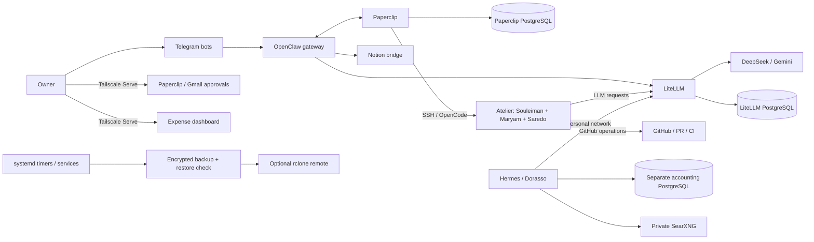

# Software Factory Architecture Audit

**Review date:** 2026-10-28
**Reviewed ref:** `ubuntu-server`, commit `123f6d6` (merge PR #24)
**Scope:** Repository source, prompts, configuration, infrastructure, tests, CI and documentation on `ubuntu-server`.
**Method:** Static, read-only review. No repository scripts, tests, deployments, services, secrets or live host state were accessed or executed. Findings describe repository evidence, not independently verified runtime behavior.

## 1. Executive Summary

`ubuntu-server` now describes a Linux-hosted, containerized agent platform and a separate personal assistant/accounting system; it is not the Windows/OpenCode deployment described in the repository’s older top-level documentation. The main operational path is OpenClaw for Telegram conversations, LiteLLM for model routing, Paperclip for tracked tasks, and an SSH atelier running OpenCode for agents. The provisioning script includes Souleiman, Maryam and Saredo, although Saredo’s role instructions limit the work to research. Systemd timers and units provide host operations, including cost synchronization, stuck-run cleanup, owner approval pages and encrypted backups. A separate Hermes instance, Dorasso, uses its own personal network and PostgreSQL ledger.

The design contains meaningful controls: digest-pinned images, loopback-only host publications, internal Docker networks, resource limits, `no-new-privileges`, narrowly scoped ledger roles, a review/owner approval flow, and a backup pipeline that exercises restores in isolated containers. The agent prompts explicitly describe tool limitations, staged approvals and project-owner authority. The deployment has also added bounded owner-only Notion, Gmail and expense surfaces.

The principal concern is the **atelier trust boundary**. Coding agents use the same SSH user and persistent `/work` volume, have outbound internet, and can read a mounted GitHub credential. A system-wide pre-push hook is explicitly documented as bypassable, so it is not an enforcement boundary. The repository’s own incident journal records a GitHub token exposure to an execution log and a model context, marked only partially corrected. These facts argue against treating the atelier as a disposable, mutually isolated runner or increasing its autonomy before credential rotation and containment are verified.

Other material gaps are operational rather than architectural: the README and current architecture/exploitation guides still present a Windows-based system; CI runs only on Windows and does not execute the new tests under `infra/gmail-approvals` or `infra/depenses`; the expense service unit invokes the system Python although its own deployment README says that Python lacks `psycopg`; and Paperclip cost attribution is a time-window join, not a per-request run correlation. The Linux backup path is notably stronger than the old report described, but its off-site configuration and restore drills still require live verification.

**Readiness:** suitable for a supervised single-owner pilot with human review and owner-controlled merge/deployment. The checked-in controls are not evidence of multi-tenant isolation, hard per-run cost limits, safe unrestricted egress, or verified Ubuntu recovery. Treat prompt rules and the atelier hook as defense-in-depth, not security boundaries.

## 2. Current Architecture

The diagram reflects the checked-in Ubuntu design. It does not assert that every optional profile or service is currently running.

### Confirmed from repository evidence

- Asia’s checked-in capability description places it on Ubuntu, with file tools limited to its workspace, no shell, no OpenCode/Windows integration, and Paperclip/Telegram as the current coordination surfaces. The factory role names Souleiman, Maryam and Saredo with owner approval gates. ([Asia instructions](infra/agents/asia/AGENTS.md#L9-L13), [factory workflow](infra/agents/asia/AGENTS.md#L37-L60))
- The main Compose stack includes OpenClaw, LiteLLM, PostgreSQL and optional audio, budget, Notion and browser services. Host-published ports are loopback-bound; internal networks separate the database, agent, personal, workshop and browser-control paths. Most services drop capabilities and set resource limits. ([Compose](infra/compose.yaml#L9-L39), [optional services](infra/compose.yaml#L57-L177), [networks](infra/compose.yaml#L288-L297))
- Paperclip and its PostgreSQL database run in a separate Compose project. Paperclip is joined to the shared `agents`, `outbound` and `workshop` networks and publishes its UI only on host loopback. ([Paperclip Compose](infra/paperclip/compose.yaml#L3-L54))
- Paperclip provisions OpenCode coding agents in a separate SSH container. The environment uses key-only access, disables forwarding/root/password login, pins the host key, and supplies per-agent LiteLLM keys through Paperclip secret references. ([atelier SSH config](infra/atelier/sshd_config#L1-L17), [provisioning](infra/paperclip/provision-atelier.py#L30-L44), [environment and secrets](infra/paperclip/provision-atelier.py#L96-L110))
- Atelier shares a persistent `/work` volume and a read-only mount of its GitHub CLI credentials; it has outbound access and joins the shared workshop network. Its pre-push hook blocks `main`/`master` and branch deletion but explicitly says it is bypassable. ([atelier Compose](infra/atelier/compose.yaml#L6-L20), [hook](infra/atelier/pre-push#L1-L14))
- The factory’s task plug-in constrains ticket creation, binds ticket work to a running Paperclip issue/run, uses request receipts to avoid blind repeated mutations, limits agent status changes, and reserves ticket closure to the owner. ([tickets plug-in](infra/paperclip/plugin/tickets.mjs#L1-L25), [run validation and receipts](infra/paperclip/plugin/tickets.mjs#L57-L125))
- Linux host services and timers cover backups, Paperclip cost synchronization, wakeups/orphan cleanup, and owner-facing approval pages. ([systemd units and timers](ops/systemd/))
- Dorasso is a separate Hermes deployment with its own ledger volume and internal `ledger` network; its database has separate migrator, engine, dry-run and read-only Dorasso roles. ([Dorasso Compose](infra/dorasso/compose.yaml#L3-L63), [ledger role setup](infra/dorasso/ledger/init-roles.sh#L1-L56))
- The backup wrapper runs a restore check before retention, attempts an optional off-site `rclone copy`, alerts on off-site failure, and has a separate stale-backup watchdog. The restore implementation includes isolated checks for Paperclip and the Dorasso ledger. ([backup wrapper](ops/run-docker-backup.sh#L1-L40), [isolated ledger restore](ops/backup-docker.py#L142-L210), [backup timers](ops/systemd/asia-backup.timer#L1-L9), [alert watchdog](ops/backup-alert.py#L1-L28))

### Unknown or not verified

- Which services/profiles are running, the active host firewall, Tailscale ACLs and Serve routes, Docker daemon access, actual volume permissions, and installed systemd overrides.
- Whether the GitHub credential documented in the historical incident was rotated, what its current scope is, or whether the incident’s logs/model context were retained or deleted.
- Whether Paperclip’s SSH adapter creates sufficiently isolated per-run directories and whether agents can access one another’s active or historical files in the shared `/work` volume.
- Whether the runtime image digests, provider model names, budgets, service versions and third-party integrations remain current.
- Whether off-site copies, alerts, the expense dashboard and owner approval paths have been validated on the deployed host.

## 3. Findings & Problems

Severity reflects practical impact for the documented single-owner factory. “Confirmed” means the design or documentation is directly present in the repository; it does not mean exploitation or live impact was tested.

| ID | Severity | Component | Finding | Evidence | Recommendation | Effort |
|---|---|---|---|---|---|---|
| F-01 | **High** | Atelier / GitHub credentials | **The coding environment is not a strong per-agent or per-run isolation boundary.** All agents provisioned into the atelier (including the research role) use the same `node` identity and persistent `/work` volume. The GitHub credential directory is readable inside the container, while the container has outbound internet. The hook guarding protected branches is documented as bypassable. The incident journal also records a GitHub token exposure to an execution log and model context, still marked partially corrected. Current token status is unknown. **Confirmed design and historical incident; live exposure not verified.** | [Atelier mounts/networks](infra/atelier/compose.yaml#L6-L20), [single SSH user](infra/atelier/sshd_config#L1-L17), [agent roster](infra/paperclip/provision-atelier.py#L30-L44), [hook limitation](infra/atelier/pre-push#L1-L14), [incident record](infra/notion-bridge/journal.py#L187-L190) | Verify revocation/rotation of the incident token immediately. Replace the shared credential with a least-privilege GitHub App or short-lived per-run credentials; enforce repository and branch rules server-side. Give each run a distinct unprivileged workspace/container, and restrict outbound destinations where feasible. Keep owner review and merge/deploy. | High: 3-7 days, excluding GitHub plan/account changes |
| F-02 | **High** | Documentation / operations | **The repository’s operator-facing “current state” remains inconsistent with the Ubuntu deployment.** The README and architecture/exploitation guides still describe Windows, Docker Desktop, PowerShell tasks, OpenCode on Windows and Windows backup paths, while updated agent instructions and systemd units describe Ubuntu and the atelier. The Atelier provisioning comment also says 12 daily runs while the applied heartbeat configuration sets 24, and provisions Saredo into the same environment despite the research role’s no-code instructions. This can cause operators and agents to rely on inconsistent deployment or permission assumptions. **Confirmed documentation/configuration drift.** | [README](README.md#L3-L9), [architecture](documentation/architecture.md#L3-L7), [exploitation](documentation/exploitation.md#L3-L28), [Ubuntu instructions](infra/agents/asia/AGENTS.md#L9-L13), [atelier limits and agent roster](infra/paperclip/provision-atelier.py#L9-L44), [Saredo role](infra/agents/recherche/PAPERCLIP.md#L1-L22), [systemd backup](ops/systemd/asia-backup.service#L1-L14) | Publish one dated authoritative Ubuntu operations guide covering service ownership, Compose projects/profiles, Tailscale routes, secrets, backup/restore and rollback. Reconcile all per-agent capabilities, run limits and actual provisioned adapters. Label Windows guides historical/rollback-only and reconcile links before removing them. | Medium: 1-3 days |
| F-03 | **Medium** | CI / tests | **CI does not validate the Linux target and omits new standalone service tests.** The workflow runs on `windows-latest`; unit-test discovery is limited to `test/`, so `infra/gmail-approvals/test_server.py` and `infra/depenses/test_server.py` are not run there. `compileall` checks syntax, not Linux systemd, socket credentials, service startup or database integration. **Confirmed from workflow; runtime coverage unknown.** | [CI runner and test discovery](.github/workflows/ci.yml#L1-L37), [Gmail tests](infra/gmail-approvals/test_server.py#L1-L20), [expense tests](infra/depenses/test_server.py#L1-L20), [Gmail deployment assumptions](infra/gmail-approvals/README.md#L1-L8) | Add a Linux CI job and explicit discovery for the standalone test directories. Validate systemd unit syntax and add Linux integration checks for Tailscale identity injection, socket peer credentials, and the ledger connection without using production secrets. | Medium: 1-3 days |
| F-04 | **Medium** | Expense dashboard | **The checked-in systemd unit and deployment instructions disagree about Python dependencies.** The unit starts `/usr/bin/python3`; the README says the system Python does not have `psycopg` and that the service uses `/opt/depenses/venv`. If that documented dependency state is accurate, page/API database reads fail at import time. The README also requires a systemd IP allow-list override for the ledger’s Docker IP, which is an operational dependency that must be refreshed if that IP changes. **Confirmed configuration mismatch; service behavior unverified.** | [unit](ops/systemd/depenses.service#L7-L14), [README dependency and network notes](infra/depenses/README.md#L85-L100), [lazy database driver import](infra/depenses/server.py#L25-L35) | Align `ExecStart` with the documented venv (or install/declare the driver for the system interpreter); validate the effective unit and API against a non-production DB. Prefer a stable, documented network endpoint over a manually refreshed container IP where possible. | Low-medium: 0.5-2 days |
| F-05 | **Medium** | Cost accounting | **Paperclip costs are useful estimates of ticket spend, but attribution is heuristic and posting is not locally idempotent.** The sync job assigns LiteLLM requests to a run by agent key alias and time window (through a 60-minute grace period), rather than a request-level run ID. It can attribute an agent’s non-ticket request in the same window. It posts cost events before persisting the run in local state, so a crash after a successful post but before the state write may repost an event unless the remote API deduplicates it. The plugin presents the result as “real” ticket cost. **Confirmed algorithm; duplicate behavior depends on upstream API and was not tested.** | [time-window attribution](infra/paperclip/sync-costs.py#L24-L60), [event posting/state update](infra/paperclip/sync-costs.py#L94-L116), [ticket cost presentation](infra/paperclip/plugin/tickets.mjs#L38-L43) | Carry a non-secret `heartbeatRunId` correlation value into LiteLLM request metadata and reconcile by that value. Add a deterministic idempotency key or read-before-write reconciliation for cost events; label amounts as attributed/estimated until this is in place. | Medium: 1-3 days |
| F-06 | **Medium** | Agent egress / shared services | **The atelier has unrestricted outbound access and resides on shared internal networks.** The Compose file gives it `outbound`, `search` and `workshop` connectivity. This supports package installation and LLM/GitHub access, but repository content, package lifecycle scripts or prompt-injected instructions can trigger requests to destinations beyond those explicit needs. Docker network membership also should not be mistaken for per-agent authorization. **Confirmed network topology; reachable destinations not tested.** | [Atelier networks](infra/atelier/compose.yaml#L17-L20), [shared workshop network](infra/paperclip/compose.yaml#L36-L54), [agent untrusted-input rules](infra/agents/developpement/AGENTS.md#L1-L12) | Inventory required destinations, proxy/allowlist egress where practical, and test that agents cannot reach host administration endpoints, unrelated personal services or cloud metadata. Keep credentials out of build/install jobs and avoid installing dependencies from unreviewed sources in privileged contexts. | Medium: 1-3 days |
| F-07 | **Low-medium** | TTS proxy | **The TTS proxy bounds request size but not upstream response size.** It reads the full LiteLLM audio response into memory and uses a threaded server; several concurrent or unexpectedly large responses can consume the service’s bounded memory and make speech unavailable. It is not host-published beyond loopback, but it is connected to multiple internal networks. **Confirmed resource-handling design; exploitability not tested.** | [body limit](infra/tts-proxy/server.py#L18-L18), [unbounded response read and conversion](infra/tts-proxy/server.py#L82-L111), [listener](infra/tts-proxy/server.py#L116-L116), [Compose limits/networks](infra/compose.yaml#L89-L118) | Enforce an upstream byte cap while streaming, validate the JSON object and audio type, and bound concurrent conversions. Keep the existing request limit, execution timeout and container resource caps. | Low: 0.5-1 day |
| F-08 | **Low** | Notion integration | **The bridge is intentionally narrow but uses one shared bearer key for all authorized callers.** It can list, create and update every project record in its configured database and append sections; page ownership is checked against that database, not against an agent/project authorization map. Compromise of any caller that can read the key therefore grants the same write scope. The token itself is held by the bridge and is not logged. **Confirmed trust model; key distribution and actual Notion scopes unverified.** | [bridge API capabilities](infra/notion-bridge/server.py#L286-L317), [database ownership check](infra/notion-bridge/server.py#L196-L203), [auth and body limit](infra/notion-bridge/server.py#L335-L361), [plugin key use](infra/paperclip/plugin/notion.mjs#L1-L21) | Keep the integration scoped to the one database; verify the Notion token’s page access. If agent trust boundaries change, use per-agent keys or authorize project IDs and actions server-side. Keep HTML, page contents and tool outputs untrusted. | Low-medium: 0.5-2 days |
| F-09 | **Medium** | Paperclip task transitions | **Agent instructions require transitions the Paperclip tool refuses.** Souleiman, Saredo and Maryam are instructed to finish tickets with status `done`; the ticket plug-in only accepts `blocked`, `in_review` and `in_progress` from agent updates, and explicitly reserves closure to the owner. Unless a separate Paperclip review transition performs that step, the instructions cannot be followed as written and may leave runs stuck or encourage workarounds. **Confirmed policy mismatch; live workflow behavior unverified.** | [developer instructions](infra/agents/developpement/PAPERCLIP.md#L7-L15), [research instructions](infra/agents/recherche/PAPERCLIP.md#L7-L15), [reviewer instructions](infra/agents/maryam/PAPERCLIP.md#L12-L17), [tool status allow-list](infra/paperclip/plugin/tickets.mjs#L120-L125) | Align the role instructions with the supported lifecycle. Define which stage is owned by the agent, reviewer and human; add a focused contract test for the expected status transitions. Do not grant agents closure authority unless that is an intentional governance decision. | Low-medium: 0.5-1 day |

### Positive controls worth keeping

- Docker images are pinned by digest, most application containers drop all capabilities, host ports bind to loopback, and the database networks are internal. ([Compose](infra/compose.yaml#L9-L39), [networks](infra/compose.yaml#L288-L297))
- The atelier disables password/root SSH access and port forwarding. Its GitHub credential is read-only mounted and not written into the image; however, the agent can read it at runtime, which remains the principal credential concern. ([SSH config](infra/atelier/sshd_config#L1-L17), [credential mount](infra/atelier/compose.yaml#L10-L20))
- Paperclip task mutations use stable request IDs and durable receipts; agents cannot close their own tickets through the plug-in, and human review is an explicit workflow stage. ([ticket plug-in](infra/paperclip/plugin/tickets.mjs#L57-L125), [review workflow](infra/paperclip/plugin/tickets.mjs#L15-L24))
- Gmail approval is owner-gated, uses short-lived one-time tokens bound to item/hash/action, escapes email content, and sends decisions through a Unix socket to the trusted host service. The README explicitly states that local processes and Tailscale Serve are part of the trust boundary. ([Gmail server](infra/gmail-approvals/server.py#L59-L85), [identity and decision checks](infra/gmail-approvals/server.py#L119-L123), [deployment boundary](infra/gmail-approvals/README.md#L36-L58))
- The expense page checks the injected Tailscale identity, uses a read-only transaction and verifies its database role/database; its tests include hostile text and identity checks. The production Tailscale route and service environment remain unverified. ([expense server](infra/depenses/server.py#L54-L68), [identity gate](infra/depenses/server.py#L134-L153), [tests](infra/depenses/test_server.py#L36-L65))
- Dorasso’s database is not joined to the factory agent network, has no published host port, requires SCRAM for TCP, and separates write/read roles. The backup code checks that the ledger is included and restores it in an isolated throw-away cluster. ([Dorasso Compose](infra/dorasso/compose.yaml#L37-L68), [role setup](infra/dorasso/ledger/init-roles.sh#L28-L56), [restore check](ops/backup-docker.py#L142-L210))
- The Linux backup system runs nightly with a persistent timer, restore check, optional off-site copy, failure alert and a separate staleness watchdog. Whether the rclone remote and alert path work in production must still be checked. ([timer and unit](ops/systemd/asia-backup.timer#L1-L9), [backup execution](ops/run-docker-backup.sh#L17-L39), [alert logic](ops/backup-alert.py#L65-L84))

## 4. Agent Roles & Delegation

| Agent / service | Repository-described role | Assessment |
|---|---|---|
| Asia | Telegram coordinator and project manager; scopes work, creates tasks/subtasks, owns Notion project documentation. | Good explicit authority boundaries and a strong “do not invent tool capabilities” policy. Its lack of shell and GitHub connector narrows direct execution, but its instructions remain prompt-level controls. |
| Souleiman | Coding agent in the atelier; prepares branches/PRs. | Higher-risk role because it can execute repository code, access the shared workspace and use GitHub credentials. Requires stronger isolation and server-side branch protection. |
| Maryam | QA/reviewer in the atelier; separate model family for review. | Separate role/model improves review diversity but does not establish runtime isolation when both agents share one SSH identity/container. |
| Saredo | Research role; the Paperclip provisioning script also places it in the Atelier SSH environment. | Its role instructions prohibit code changes, but the runtime has a broader shared execution and GitHub-credential boundary; align the provisioned capabilities with the role. |
| Paperclip | Durable issue state, assignment, review and owner approval. | Strong source for tracked work; separate DB and maintenance timers add operational components. |
| Dorasso | Personal Hermes assistant with separate data, budget and ledger. | Appropriate separation from OpenClaw/Paperclip, with explicit privacy and no-payment boundaries; keep personal data out of shared Notion/project paths. |

The agent instructions deliberately specify approval points between design, estimation and implementation, one lot at a time, and human merge/deploy. These are governance controls, not technically enforced restrictions on code running within Atelier. ([Asia factory process](infra/agents/asia/AGENTS.md#L37-L60), [developer limits](infra/agents/developpement/AGENTS.md#L1-L20), [Paperclip task checks](infra/paperclip/plugin/tickets.mjs#L57-L125))

## 5. Operations, Observability & Cost

The Linux operating model is directionally sound: systemd timers trigger backup, wake/reaper and cost synchronization; Docker health checks and restart policies provide local service supervision. Resource limits are present for core containers. This is a more appropriate headless-server design than the old Windows-oriented docs suggest. ([systemd inventory](ops/systemd/), [main Compose](infra/compose.yaml#L9-L39), [atelier limits](infra/atelier/compose.yaml#L17-L33))

Observability is split across Paperclip (tickets/runs), LiteLLM (provider use/cost), GitHub (PR/CI), systemd/journalctl (host operations), and backup reports. The cost synchronizer’s timestamp/alias matching means Paperclip’s per-ticket amounts should not be treated as an authoritative invoice-grade ledger yet. The code also queries up to 1,000 Paperclip runs and fetches LiteLLM spend logs from the first run date; growth and pagination behavior are not evidenced by tests here. ([cost sync](infra/paperclip/sync-costs.py#L63-L116), [Paperclip cost tool](infra/paperclip/plugin/tickets.mjs#L38-L43))

**Operational improvements:** make the Ubuntu runbook authoritative; add end-to-end correlation IDs to LLM requests and receipts; monitor systemd timer freshness and actual off-site completion; record image/source versions and restore evidence; distinguish estimates, attribution and provider billing. Avoid collecting prompts or secrets in diagnostics.

## 6. Stack Assessment

| Component | Recommendation | Rationale |
|---|---|---|
| OpenClaw | **Keep** | Current Telegram gateway and conversational coordinator, with narrow agent tool configurations. |
| LiteLLM + PostgreSQL | **Keep** | Central model routing, key budgets and spend telemetry; task-level reconciliation needs stronger correlation. |
| Paperclip + PostgreSQL | **Keep as the single durable agent queue** | Provides task assignment/review and persistent state. Avoid duplicating tracked work across competing boards. |
| OpenCode / Atelier | **Keep with a stronger boundary** | Current coding execution path; isolate workspaces, credentials and egress before expanding autonomy. |
| GitHub / Actions | **Keep** | Reviewable PR and CI path; enforce branch protections at GitHub rather than relying on local hooks. |
| Docker Compose | **Keep for this scale** | Digest-pinned containers, internal networks and limits are proportionate for a single-owner platform. |
| systemd | **Keep** | Suitable host supervision and scheduling for Ubuntu; centralize the service/runbook inventory. |
| Telegram | **Keep** | Main owner interaction path; distinct bots remain a meaningful workflow choice. |
| Notion bridge | **Keep narrowly scoped** | Useful project record, but retain database boundary and validate token grants. |
| Gmail approval service | **Keep** | Owner-only explicit decision path; maintain the host socket/Tailscale boundary and verify it after deployment. |
| TTS proxy / Speaches | **Optional** | Audio is a specific feature and should not be mandatory for core operations. Harden response/resource bounds. |
| Browser / SearXNG | **Optional, egress-controlled** | Useful research capability but adds network reach and resource use. |
| Dorasso / accounting ledger | **Separate personal subsystem** | Separate networks, database and roles are purposeful boundaries; do not merge it into the factory runtime. |
| Expense dashboard | **Keep after packaging correction** | Provides read-only, owner-gated visibility; fix interpreter mismatch and verify Docker-IP allow-list maintenance. |
| Legacy Windows web app and Windows operations | **Retain only for rollback/history** | The current Ubuntu branch’s agent instructions disallow these capabilities; existing documentation is misleading as a live runbook. |

No evidence justifies adding another agent framework, vector database, custom dashboard or enterprise observability platform.

## 7. Repository Cleanup Recommendations

These are review candidates, not authorization to delete files.

| Candidate | Why it needs attention | Safe approach |
|---|---|---|
| `README.md`, `documentation/architecture.md`, `documentation/exploitation.md` | State a Windows deployment with Windows services and OpenCode while the current branch documents Ubuntu, SSH Atelier and systemd. | Rewrite or label as historical; preserve rollback details and reconcile navigation first. |
| `docs/` and `documentation/` roots | Historic operational material and current platform guidance are mixed. | Keep an index that labels the authoritative Ubuntu docs and historical Windows docs. |
| `infra/` bootstrap/provisioning scripts | Several deployment surfaces exist: OpenClaw, Paperclip, atelier, Notion, Gmail, expense and Dorasso. | Map owners, prerequisites, secret sources, idempotency and rollback for each; do not remove a subsystem solely because it is optional. |
| `infra/notion-bridge/journal.py` | Contains operational/incident records and appears to be a rebuild input, not a routine runtime module. | Preserve as controlled historical data; review whether it belongs in the source tree and ensure it contains no credentials or personal data before publication. |
| Windows scripts and old UI | The branch still carries legacy Windows code and docs. | Confirm no current timer, service or rollback depends on it; remove only after restore and rollback acceptance. |
| Optional audio/browser services | Add network, CPU and memory overhead. | Keep profiles optional, track actual usage and disable unused services. |

### Missing or weakly surfaced operational files

- One Ubuntu source-of-truth runbook with current service map, startup/shutdown order, Tailscale paths, secret rotation, backup and full restore.
- A documented security model for Atelier: agent identity, per-run workspace lifecycle, credential delivery, network destinations, branch policy and cleanup.
- Linux CI coverage for all standalone tests and unit/config validation.
- A cost-attribution contract with a run-level identifier, idempotent event posting and a clear “estimated vs. billed” label.
- A deployment acceptance checklist for the expense service, Gmail approvals and Tailscale Serve.

## 8. Security & Governance Recommendations

### Controls to preserve

- Treat HTML, repository content, external pages and model/tool outputs as untrusted input. Keep prompts from being the only authorization boundary. ([agent policy](infra/agents/asia/AGENTS.md#L3-L13))
- Keep owner approval for merge, deployment, secret changes, financial decisions and destructive operations.
- Keep personal Dorasso data on its isolated network and dedicated ledger; preserve read-only access for the assistant and review the restore-isolation matrix. ([Dorasso Compose](infra/dorasso/compose.yaml#L27-L68), [role setup](infra/dorasso/ledger/init-roles.sh#L28-L56))
- Keep Tailscale Serve as the only supported public-facing path for owner pages; never expose their loopback listeners directly. The services trust the injected identity header, so local processes/proxies must remain in the trust boundary. ([Gmail README](infra/gmail-approvals/README.md#L25-L58), [expense README](infra/depenses/README.md#L34-L50))
- Keep credentials out of Git, logs and model prompts; verify past token exposure has been handled before further use.

### Before increasing autonomy

1. Revoke/rotate the credential recorded as exposed; inspect its current repository permissions and access history through the trusted GitHub operator flow.
2. Replace the atelier’s shared, long-lived GitHub credential with scoped, short-lived or per-run credentials. Enforce protected branches and PR requirements on GitHub itself.
3. Use a disposable workspace/container per task and agent, with no cross-run files by default. Keep the Paperclip control plane and Docker socket unavailable to task code.
4. Define and test outbound network policy from Atelier, including denial of host services, metadata endpoints and unrelated personal services.
5. Add hard limits for job time, retries, concurrent runs and provider/team budgets. Prompt instructions and a git hook are not enforcement.
6. Require a task receipt to record source commit, changed paths, tests actually run, PR/CI status, approvals, and cost provenance. Do not equate an agent comment with verified completion.
7. Test restoration and alert delivery on the Ubuntu host, including encrypted off-site recovery, while keeping Telegram consumers disabled until restore validation is complete.

### Evidence limits

No credential values are reproduced here. No host files, live network, Docker daemon, systemd manager, GitHub token scopes, Tailscale ACLs, database or production service was inspected. The repository’s historical incident entry establishes a prior exposure report, not whether the same credential remains valid today. This is a static architecture review, not a penetration test.

## 9. Autonomy & Orchestration Strategy

There is no need to introduce a central Claude Code dependency into the platform. The checked-in design uses OpenClaw/Asia to coordinate conversations and Paperclip to coordinate tracked jobs; OpenCode is the atelier execution engine. The personal Dorasso workflow is separate. ([Asia capabilities](infra/agents/asia/AGENTS.md#L9-L13), [atelier provisioning](infra/paperclip/provision-atelier.py#L30-L44), [Dorasso boundary](infra/dorasso/compose.yaml#L3-L18))

Recommended task flow:

1. The owner asks a short question in Telegram or explicitly creates a Paperclip task for durable work.
2. Asia scopes the work and creates only necessary subtasks; Paperclip owns issue/run/review state. Keep ad-hoc delegation separate from ticketed runs.
3. The assigned agent works in a disposable, task-specific workspace with least-privilege credentials and controlled egress.
4. The agent returns a branch/PR and a receipt; GitHub CI supplies independent checks.
5. Maryam reviews where configured, then the owner reviews and merges. Deployment, secret changes and irreversible operations remain human-controlled.
6. Close the ticket only after verifying the PR, CI and requested outcome. If a submission outcome is uncertain, reconcile the original request rather than creating a fresh mutation.

Safeguards:

- One canonical ticket and one run identifier per tracked task.
- No shared writable workspace between agents or runs.
- Hard caps on concurrency, retries, runtime and cost.
- Repository-level branch protections; do not treat prompt rules or client-side hooks as enforcement.
- Stop and report on unclear permissions, failed checks or uncertain side effects.

## 10. Progress Tracking & Observability

Use the existing system boundaries:

- **Paperclip:** tracked work, assignment, comments, owner/reviewer decisions and run IDs.
- **OpenClaw:** Telegram conversation/session behavior.
- **GitHub:** branch, PR, review and CI state.
- **LiteLLM:** model/provider usage and spend.
- **systemd/journal:** host service and scheduled-job outcomes.
- **Backup reports:** archive/restore and off-site-copy status.

The main gap is correlation and truth labeling, not another dashboard. Propagate Paperclip run IDs to LiteLLM metadata, make cost synchronization idempotent, and distinguish provider billing from heuristic task attribution and external tool costs. Monitor failed/stale systemd timers, backup freshness, failed off-site copies, stuck task runs and exhausted budgets. Keep request/response content out of logs unless there is a specific, consented diagnostic need.

## 11. Simplification Opportunities

| Rank | Opportunity | Benefit | Trade-off |
|---:|---|---|---|
| 1 | Publish one authoritative Ubuntu operations guide and mark Windows materials historical. | Prevents incorrect startup, backup and rollback actions. | Requires reconciling old migration records and links. |
| 2 | Make task isolation and credential brokerage one standard Atelier path. | Reduces the highest-impact agent blast radius and clarifies cleanup. | More runner setup and GitHub app/token lifecycle work. |
| 3 | Keep Paperclip as the sole durable agent-task queue. | Avoids duplicated status and completion records. | None if current Paperclip workflows remain supported. |
| 4 | Keep Dorasso and its accounting ledger operationally separate. | Preserves personal-data and credential boundaries. | A separate stack/database consumes resources and backup effort. |
| 5 | Leave browser and audio services optional. | Lowers baseline resource and egress exposure. | Those features are unavailable while stopped. |
| 6 | Retain only exercised model aliases and agent identities. | Reduces model drift and credential maintenance. | Fewer fallback/specialist choices. |
| 7 | Consolidate historical docs and duplicate install instructions without deleting evidence. | Makes current operating steps easier to find. | Requires careful preservation of rollback and incident records. |

No broad rewrite or new infrastructure stack is warranted by the checked-in evidence.

## 12. Migration & Roadmap

Ubuntu is the target represented by this branch, so the roadmap focuses on making that deployment reproducible and safer rather than proposing a new OS migration. Effort estimates are one-person engineering time and exclude external account approvals and live restore observation.

### Phase 0 — Correct security and reliability blockers

| Item | Plan |
|---|---|
| Actions | Rotate the historically exposed GitHub token; validate scope. Correct the expense service interpreter; reconcile the Ubuntu runbook with actual units and Compose profiles. |
| Dependencies | Trusted operator access to GitHub and the deployed Ubuntu host. |
| Effort | 1-3 days. |
| Benefits | Closes the clearest known credential risk and avoids a known configuration mismatch. |
| Validation | Token is revoked/rotated without printing it; expected GitHub operations work; expense API connects using the documented environment; unit and route are verified on Linux. |
| Rollback | Revoke only the new credential on failure; retain the old service configuration privately until the replacement passes checks, then revoke any exposed credential regardless. |

### Phase 1 — Establish the source of truth

| Item | Plan |
|---|---|
| Actions | Replace Windows-current-state docs with an Ubuntu service/runbook map; label historical procedures; add Linux CI and discover all standalone unit tests. |
| Dependencies | Inventory of deployed Compose projects, profiles, timers, environment files and Tailscale routes. |
| Effort | 2-4 days. |
| Benefits | Reproducible operations and review coverage aligned with production. |
| Validation | A clean operator can identify service owners and follow start/stop/restore instructions; Linux CI runs each relevant test suite and fails on a deliberately broken unit/config check. |
| Rollback | Preserve legacy docs in an explicitly historical section and restore links if a still-active rollback depends on them. |

### Phase 2 — Harden the factory runner

| Item | Plan |
|---|---|
| Actions | Introduce per-task/per-agent disposable workspaces, brokered short-lived GitHub credentials, server-side branch protection and outbound allowlists. |
| Dependencies | GitHub permissions, Paperclip adapter lifecycle and a tested workspace cleanup strategy. |
| Effort | 4-8 days. |
| Benefits | Limits cross-task leakage and repository/host impact while retaining agent PR creation. |
| Validation | Concurrent tasks cannot read or modify each other’s workspace; credential canaries cannot be exfiltrated; protected-branch pushes fail at GitHub; access to host, metadata and unrelated networks is denied. |
| Rollback | Disable automatic coding runs and credential issuance; preserve branches and receipts; return to owner-started supervised changes. |

### Phase 3 — Trustworthy task cost and recovery

| Item | Plan |
|---|---|
| Actions | Correlate LiteLLM requests to Paperclip run IDs, make event posting idempotent, mark cost provenance; rehearse off-site restore and alert delivery. |
| Dependencies | Run metadata support and access to a non-production restore environment. |
| Effort | 2-5 days plus a restore exercise. |
| Benefits | More trustworthy ticket cost reports and demonstrated recovery rather than configuration-only confidence. |
| Validation | Duplicate sync does not double-post; a sample task reconciles to LiteLLM events; off-site archive decrypts/restores on an isolated target; backup alerts reach the owner. |
| Rollback | Keep the existing reports labeled as estimates; preserve previous archives and disable only the new sync/alert path if it misbehaves. |

## 13. Final Recommendation

Operate the `ubuntu-server` system as a **supervised single-owner factory**. Keep OpenClaw, LiteLLM, Paperclip, GitHub PR/CI, the owner approval surfaces, and the separate Dorasso ledger. Keep audio/search optional. Do not infer strong isolation from the current Atelier container, shared `node` identity, `/work` volume or local push hook.

Before granting the coding agents broader autonomy, verify that the historical GitHub credential is revoked, move to per-run credentials and workspaces, enforce GitHub branch protection, and constrain Atelier egress. Then align the Ubuntu documentation and CI, fix the expense service packaging mismatch, and make cost synchronization correlated and idempotent. Finally, rehearse off-site backup restore and owner alerting on the actual Linux deployment.

The practical loop should be: owner creates a tracked task; Asia scopes it; an isolated agent proposes a branch/PR; CI and the configured reviewer report independently; the owner approves and merges; the system records the verified result and cost provenance. Keep personal assistant and accounting data outside this factory path. Until the runner, credential and recovery controls are verified in deployment, keep execution supervised and deployment human-operated.
