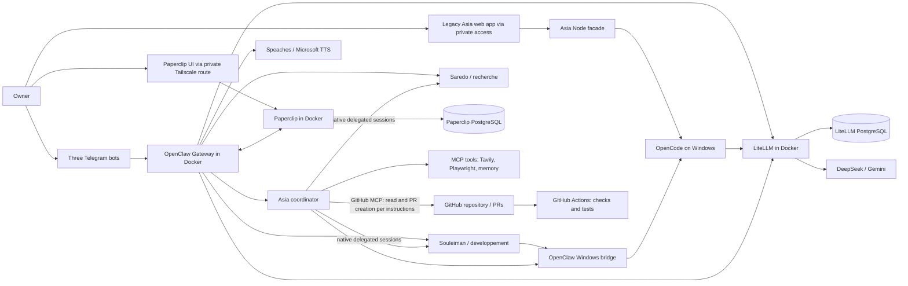
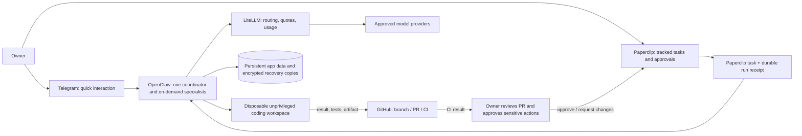
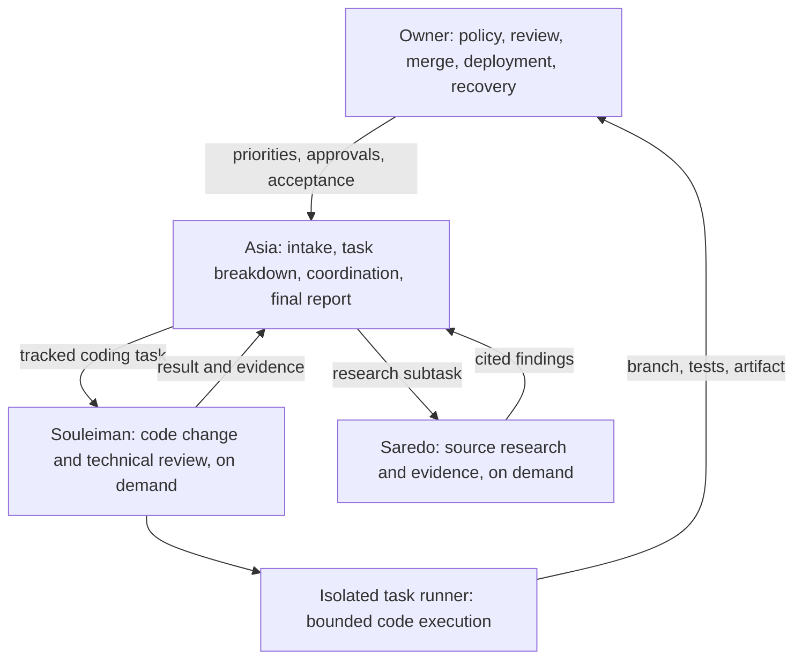

# Software Factory Architecture Audit

**Review date:** 2026-10-28
**Scope:** Repository source, prompts, configs, scripts, infrastructure, tests, CI, and documentation.
**Method:** Static, read-only review of the checked-in repository. Tests, deployment commands, live services, secrets, and the host deployment were not accessed or executed.

## 1. Executive Summary

The repository contains a functioning, carefully guarded **personal agent platform pilot**, not yet a low-maintenance autonomous software factory. The checked-in architecture is centered on OpenClaw, not Claude Code: Asia is the coordinator, with two specialists, Telegram entry points, LiteLLM routing, and Paperclip task tracking. OpenCode remains an execution dependency for work on the Windows host. A small legacy web application and its Windows services are retained for continuity and rollback.

The architecture is coherent in its component responsibilities, and much better controlled than an unconstrained agent runner. It has durable request receipts, explicit human approvals, pinned container images, bounded container resources, separate agent workspaces, LLM budget accounting, encrypted backups, and a meaningful automated test suite. CI checks the application, Python utilities, and PowerShell syntax. These are worth preserving.

The main problem is **operational complexity and mismatched deployment assumptions**. The project context describes an Ubuntu server, but the repository's operational runbooks describe Docker Desktop on Windows, PowerShell scheduled tasks that require a Windows logon session, Windows paths, and an OpenCode bridge back to the Windows host. The platform is therefore not portable to a headless Ubuntu server as currently documented or configured. It also has multiple overlapping surfaces: Telegram, a legacy Asia web app, OpenCode/OpenChamber, OpenClaw, Paperclip, native OpenClaw delegation, a custom Windows execution bridge, multiple PostgreSQL instances (current LiteLLM and Paperclip databases plus the retained Windows rollback stack), and a substantial training/provisioning toolset.

**Largest risks before increasing autonomy:** the OpenCode bridge can run commands as the Windows service account; its approval workflow is a policy control, not an OS sandbox. Agent/task limits are partly prompt-level defaults rather than enforceable spend or lifetime quotas. Paperclip's documented integration stores some device credentials as direct profile values, and its own task cost display is not the financial source of truth. Backups have good integrity and restore checks but remain on the same PC, with no external failure alert. Live OpenClaw configuration is also not fully represented by the checked-in example.

**Recommendation:** keep OpenClaw, LiteLLM, Telegram, Paperclip (as the one durable agent task queue), GitHub PR/CI, and the tested backup/idempotency controls. Continue the owner-only pilot, not unattended code execution. Make an isolated, disposable coding environment the precondition for broader autonomy. Retire the Windows bridge, old UI/runtime, duplicate task paths, and optional services only after their replacements or rollback window are explicitly validated. Use Paperclip for tracked jobs and Telegram for short interactions; do not build a custom observability platform.

**Current readiness:** good supervised agent-assisted operations, limited task-level visibility and bounded delegation, but not safe general-purpose autonomous software delivery. The repo records successful pilot exercises and also names untested recovery, runtime, and Telegram paths; that is stronger evidence than treating the pilot as production-ready. This audit did not independently verify the deployment claims.

## 2. Current Architecture

The checked-in documentation describes this as a hybrid Windows-hosted pilot. The statements below document the repository's account of the deployment; they are not independent live-service verification.

### Confirmed from repository evidence

- The README describes OpenClaw as the Telegram agent gateway and LiteLLM as the model router; the architecture guide assigns OpenClaw agent/channel/session responsibilities and LiteLLM model routing. OpenCode is still used for Windows execution and the old web client. ([README](README.md#L3-L9), [architecture](documentation/architecture.md#L5-L7), [architecture diagram](documentation/architecture.md#L11-L35))
- There are three agent identities. Asia is the coordinator; the two specialists have bounded roles and cannot directly coordinate with each other. The Paperclip integration is a separate task surface with its own PostgreSQL database. ([agent catalogue](infra/agents/catalogue.json), [delegation](documentation/delegation.md#L19-L38), [Paperclip](documentation/paperclip.md#L19-L53))
- LiteLLM uses provider API keys from the runtime environment and a PostgreSQL database. Container definitions bind published ports to loopback, define separate internal networks, resource caps, and `no-new-privileges`/dropped capabilities. Playwright additionally has an egress network. ([LiteLLM config](gateway/config.yaml#L2-L6), [Compose](infra/compose.yaml#L10-L40), [Compose](infra/compose.yaml#L107-L213))
- OpenClaw's checked-in example denies native shell execution, requires permission for `exec`, disables elevated execution and ordinary agent-to-agent messaging, and restricts direct file tools to workspaces. This is an example/bootstrap configuration, not proof of the live configuration. ([OpenClaw example](infra/openclaw.example.json#L43-L63), [operations](documentation/exploitation.md#L30-L43))
- Paperclip task work wakes OpenClaw agents, while the separate native delegation path remains available outside ticketed tasks. The repository explicitly says not to duplicate a ticket task with `sessions_spawn`. ([Paperclip](documentation/paperclip.md#L34-L38))
- The custom OpenCode bridge records task ownership and request IDs, fails closed on uncertain submissions, and exposes a one-time native approval path. The eventual process nevertheless runs against the Windows OpenCode service and Windows account. ([bridge](infra/opencode-bridge/bridge.mjs#L14-L20), [bridge](infra/opencode-bridge/bridge.mjs#L69-L115), [Windows access](documentation/acces-windows-souleiman.md#L3-L21))
- The CI workflow runs on `windows-latest`, has read-only repository permissions, and runs Node tests, Python tests, build, repository checks, and syntax validation. It does not deploy. ([CI](.github/workflows/ci.yml#L1-L37))

### Unknown or not verified

- The actual running host, current live service configuration, current secrets, effective firewall and Docker Desktop/daemon policies, Tailscale ACLs, GitHub token scopes, and status of external providers were not observable from this repository review.
- The docs cite historical production checks, test results, and user confirmations. They establish what the project reports, not the current health of those services or a fresh reproduction of the results.
- The repo contains no `Claude Code` / `Claude` reference in its checked-in files. This is not evidence about tools installed or used outside this repository. There is no checked-in Claude Code integration or Claude Code dependency visible in this audit.
- No Ubuntu/systemd deployment path or Ubuntu-specific operations guide was found in the repository inventory. The current docs explicitly describe a Windows host. A move to Ubuntu would be a migration, not a supported current deployment established by this repo.

## 3. Findings & Problems

Severity describes practical impact for the documented single-owner pilot. “Confirmed” means directly established by repository evidence; “likely” means the design creates a credible concern; “requires verification” means runtime evidence is needed.

| ID | Severity | Component | Finding | Evidence | Recommendation | Effort |
|---|---|---|---|---|---|---|
| F-01 | High | Deployment / operating model | **The repository does not implement the stated Ubuntu-server operating model.** Its runbooks depend on Docker Desktop, PowerShell, Windows paths, scheduled tasks, and a Windows logon session. Some startup and recovery checks remain untested. This creates a material availability and portability gap if Ubuntu is the intended host. **Confirmed.** | [operations](documentation/exploitation.md#L5-L28), [Windows requirements](documentation/exploitation.md#L30-L43), [remaining recovery tests](documentation/revue-et-tests.md#L87-L91) | Decide which host is authoritative. Either document and support the current Windows pilot honestly, or create a separate Ubuntu migration with a clean-install, headless startup, permission, recovery, and rollback acceptance test. Do not copy Windows paths/scripts and call it a port. | Medium: 2-5 days for a measured migration plan and first Linux deployment |
| F-02 | High | Windows execution bridge | **The host bridge has a larger blast radius than the container workspace.** Souleiman can ask OpenCode to access files, run programs/commands, and reach the local network with the Windows service account's permissions. Native approvals, request receipts, and separate journals reduce accidental/repeated actions, but they do not contain a command after approval or provide OS isolation from that account. **Confirmed design; exploitation not tested.** | [Windows access](documentation/acces-windows-souleiman.md#L3-L21), [bridge request handling](infra/opencode-bridge/bridge.mjs#L69-L115), [approval handling](infra/opencode-bridge/bridge.mjs#L164-L194) | Before unattended coding, execute each job in a disposable, unprivileged worktree/container/VM with a narrow repository mount, no host credentials or Docker socket, and network off by default. Keep human approval for publishing, merging, deleting, deployment, and access outside the job workspace. | High: 3-7 days for a viable isolated runner and recovery path |
| F-03 | High | Runtime configuration / reproducibility | **The checked-in OpenClaw example is not the live source of truth.** Documentation says `config set` mutates active state and the example is not the active config after initialization. This permits production behavior to drift away from reviewed files, tests, and backups. **Confirmed.** | [operations](documentation/exploitation.md#L30-L43), [example config](infra/openclaw.example.json#L1-L63), [migration-state docs](documentation/revue-et-tests.md#L7-L18) | Keep a sanitized, versioned desired-state manifest plus a generated diff against live config. Add a read-only config-drift check to the operator runbook; require review and backup before applying changes. Never commit runtime secrets. | Medium: 1-3 days |
| F-04 | Medium | Secrets / Paperclip | **Some Paperclip device credentials are direct profile values, not individually encrypted fields.** The docs say protection relies on Windows/Docker access controls and encrypted backups. A database/profile export or host account compromise can therefore expose credentials. The scope is a single trusted owner; no leak is confirmed. **Confirmed storage limitation; exploitation not tested.** | [Paperclip credential handling](documentation/paperclip.md#L59-L63), [private deployment directory](documentation/paperclip.md#L59-L67) | Prefer the integration's supported secret references if those fields become supported; otherwise restrict DB/profile access, minimize credential lifetime and scope, and document/automate rotation after compromise or restore. Keep backups encrypted and recovery keys separately protected. | Low-medium: 0.5-2 days, plus upstream support if required |
| F-05 | Medium | Autonomy / cost controls | **Cost and job limits are not hard guarantees.** LiteLLM's budget accounting can lag in-flight requests; per-task Paperclip cost is explicitly not authoritative. Native delegation timeouts are defaults/instructions and may be overridden; the child limit is concurrent rather than a lifetime quota. Third-party tool costs are outside the LLM budget. **Confirmed.** | [costs](documentation/exploitation.md#L61-L65), [Paperclip costs and limits](documentation/paperclip.md#L53-L57), [delegation limits](documentation/delegation.md#L34-L38) | Set enforceable provider/account budgets where available; add an admission quota per issue (max children, calls, elapsed time, retries) outside the prompt; stop new work when exhausted. Show “estimated / delayed / unknown” rather than presenting the ledger as a hard cap. | Medium: 1-3 days |
| F-06 | Medium | Observability | **The operator cannot reliably answer all requested task-level questions from one place.** LiteLLM metrics capture request/model/token/cost data but not a Paperclip issue ID or a stable agent/task correlation field. Paperclip's own cost display is not the financial source of truth. Neither a test record nor a model narrative is a reliable replacement for a durable job receipt. **Confirmed.** | [metrics fields](gateway/metrics.py#L13-L37), [Paperclip cost caveat](documentation/paperclip.md#L53-L57), [desired observability gaps](documentation/revue-et-tests.md#L87-L98) | Reuse Paperclip for state/assignment/approval and LiteLLM for billing. Propagate a non-sensitive issue/run correlation ID through OpenClaw and LiteLLM metadata; surface a small per-issue receipt with model, tokens, estimated cost, tests, PR, and operator action. Avoid storing prompts or responses in the metrics path. | Medium: 2-4 days |
| F-07 | Medium | Recovery / availability | **Backups are well designed but do not yet establish disaster recovery.** Archives are written to `D:` on the same PC; an independent off-host copy and failure notification are explicitly outstanding. Scheduled tasks require an interactive owner session, and a clean-machine rebuild has not been demonstrated. Individual database snapshots are not a distributed transaction. **Confirmed.** | [backup limitations](documentation/exploitation.md#L78-L84), [coordinated restore caveat](documentation/exploitation.md#L102-L102), [Paperclip restore requirements](documentation/paperclip.md#L94-L104), [remaining work](documentation/revue-et-tests.md#L87-L90) | Add encrypted off-host replication and an alert on missed/failed backup. Perform a clean-machine restore with consumers disabled, then verify the Telegram, Paperclip, budget, and rollback paths before enabling agents. | Medium: 1-3 days plus restore exercise |
| F-08 | Medium | Security boundary / browser | **The Playwright service has an egress network and the repo does not show destination-level egress controls.** Host-header allowlisting and `file://` refusal tests are useful but do not establish that an agent-controlled browser cannot reach sensitive network destinations. Prompt-injected pages and untrusted URLs are a likely threat path, not a confirmed exploitable vulnerability. **Requires runtime/network verification.** | [Playwright command and networks](infra/compose.yaml#L10-L40), [network definitions](infra/compose.yaml#L199-L209), [agent untrusted-input guidance](infra/agents/asia/AGENTS.md#L5-L9), [Playwright validation scope](documentation/revue-et-tests.md#L71-L73) | Test access to loopback, host-gateway, private subnets, cloud metadata, and internal service names from the browser container. Add a deny-by-default egress policy or a controlled proxy if browser access is kept. Continue treating page content as untrusted data. | Medium: 1-3 days |
| F-09 | Medium | Documentation / governance | **The repo has conflicting claims about current permissions and deployment status.** For example, the migration report says the developer has no shell and only Asia has a Windows bridge; the dedicated Windows-access guide says Souleiman has the bridge. The initial migration plan says Windows remains in production, while later docs report the bot has moved to OpenClaw. **Confirmed documentation drift.** | [older migration plan](docs/plan-plateforme-agents.md#L1-L7), [current migration summary](documentation/revue-et-tests.md#L3-L18), [contradictory status](documentation/revue-et-tests.md#L91-L114), [Windows bridge guide](documentation/acces-windows-souleiman.md#L3-L21) | Establish one dated “current state” document. Mark plans and incident reports historical, link to the current authority, and reconcile permissions before the next agent or bridge change. | Low: 0.5-1 day |
| F-10 | Medium | Workflow / autonomy | **The pipeline is not autonomous software delivery.** Paperclip can wake an OpenClaw agent and support human review; code execution still depends on OpenCode/Windows approvals, publication permissions are bounded, and CI does not deploy. Recovery, timeout, and some Telegram delegation paths remain explicitly untested. **Confirmed.** | [Paperclip stages](documentation/paperclip.md#L65-L83), [GitHub publication constraints](documentation/publication-github.md#L1-L18), [CI](.github/workflows/ci.yml#L1-L37), [remaining tests](documentation/revue-et-tests.md#L63-L76) | Treat automation as “bounded task execution that produces a reviewable PR,” not autonomous merge/deploy. Automate only the intake-to-branch/PR path after the isolated runner exists; retain owner merge/deploy and explicit recovery of uncertain work. | Medium: 2-5 days after isolation |
| F-11 | Low | Supply chain / CI | **CI is useful but does not pin third-party Actions by immutable commit SHA or perform a dependency/image vulnerability review.** Container images are digest-pinned, which is a strong counterexample; this is a hardening opportunity, not evidence of compromise. **Confirmed.** | [Action references and CI steps](.github/workflows/ci.yml#L9-L37), [digest-pinned containers](infra/compose.yaml#L10-L11) | Pin Actions to verified full commit SHAs and retain readable version comments. Add a lightweight scheduled dependency/container advisory review if update cadence justifies it; avoid adding a large security platform for a solo project. | Low: 0.5-1 day |
| F-12 | Low | Resource efficiency | **The pilot is heavy relative to the available host headroom.** The docs report a 12 GB PC with less than 1 GB free while Windows and Docker run together. Compose caps services, but those caps do not create actual memory. Startup and sleep/wake behavior are still being measured. **Repository-reported, not independently measured.** | [resource status and tests](documentation/revue-et-tests.md#L87-L91), [Compose service limits](infra/compose.yaml#L36-L38), [optional services](infra/compose.yaml#L57-L86) | Keep audio and browser services optional; measure idle and two-job peak memory. Remove or stop services not used for a defined workflow. Set an operational reserve and avoid restarting loops under pressure. | Low: 0.5-1 day |

### Positive controls worth keeping

- The Node facade uses loopback checks, owner checks for the Tailscale identity, CSRF validation, request-size limits, restrictive browser headers, and idempotent submission receipts. ([server](server.mjs#L16-L37), [server](server.mjs#L63-L67), [request handling](server.mjs#L125-L163))
- The Docker Compose file uses immutable image digests, loopback-only host ports, internal service networks, dropped capabilities, `no-new-privileges`, resource limits, and Docker secrets for the database password. ([Compose](infra/compose.yaml#L107-L120), [Compose](infra/compose.yaml#L125-L194), [Compose](infra/compose.yaml#L199-L213))
- The Paperclip tool limits task state mutations, disallows agent closure, binds changes to the current agent/run, uses request receipts, and has a human approval stage. The documentation candidly calls out the limits of its project filter and quoted owner request. ([Paperclip plugin](infra/paperclip/plugin/tickets.mjs#L1-L40), [Paperclip caveats](documentation/paperclip.md#L69-L83))
- Backup code uses AES-GCM, integrity manifests, safe staging, restore checks, and separate temporary database restores. The documented shortfall is off-host resilience, not absent integrity controls. ([Docker backup](ops/backup-docker.py#L121-L178), [backup validation](ops/backup-docker.py#L188-L244))
- CI has read-only repository permissions, bounded runtime, tests, and syntax checks; the documented historical suite is extensive. Static review did not rerun it. ([CI](.github/workflows/ci.yml#L5-L37), [historical test summary](documentation/revue-et-tests.md#L48-L76))

## 4. Recommended Target Architecture

Design for one owner, one primary host, a few concurrent tasks, and low operational burden. Keep the existing OpenClaw-to-LiteLLM integration and durable task tracking. Avoid adding a separate orchestration service, dashboard, metrics stack, or agent framework.

### Keep

- **OpenClaw** as the agent/channel gateway and bounded coordinator. It already supplies Telegram, agent identities, sessions, tools, and native delegation.
- **LiteLLM** as the single provider-routing and financial accounting path while multiple providers/models are used.
- **Paperclip** as the one durable queue and task status surface during the pilot. Use its built-in review and assignment flow; do not duplicate ticket tasks with a second OpenClaw spawn.
- **GitHub** for source history, reviewable PRs, and CI. A Paperclip task can link to the PR; not every conversational request needs a GitHub issue.
- **Existing idempotency receipts, tests, pinned images, one-time approvals, and encrypted restore checks.**
- **Telegram** for quick interactions, not as the durable work ledger.

### Replace, remove, or consolidate

- Replace the **Windows host execution bridge** for automated coding with a task-scoped, disposable runner. The owner can retain manual Windows access if it remains useful, but it should not be the default autonomous execution boundary.
- Retire the **legacy Asia/OpenCode UI and redundant OpenCode services** only after a replacement interface and rollback period are accepted. If OpenCode remains as an executor, do not also build a second execution abstraction around it.
- Keep Paperclip as the canonical agent task queue; use GitHub issues only where they are already the product/project's issue source. Do not mirror every Paperclip task into GitHub or vice versa.
- Keep a two-agent organization for now: Asia (intake/coordination) and one on-demand specialist selected by task type. Do not add a permanent project-manager, QA, or auditor bot until actual workload shows a gap.
- Keep audio, browser automation, memory, and the full model catalog optional and usage-driven. The repo does not show that every provider route or MCP tool is required for daily delivery.
- Consolidate configuration around a reviewed sanitized desired state and make “live settings” changes observable. Do not store active secrets in Git.

### Add only the missing capabilities that unblock safe operation

1. A disposable per-task coding environment with a worktree/repository-only mount, no persistent host credentials, no Docker socket, a timeout, and explicit outbound-network policy.
2. A task/run receipt that joins Paperclip issue ID, OpenClaw run, LiteLLM usage, GitHub PR, CI status, and approval decision without copying prompts or secrets into logs.
3. Off-host encrypted backup replication, missed-backup alerts, and a clean-machine restore rehearsal.
4. A single operator runbook that distinguishes documented state, live state, and historical test evidence.

These are capabilities and controls, not a recommendation to adopt a new enterprise platform.

## 5. Recommended Agent Organization

### Roles and boundaries

- **Owner (human):** sets priority, scopes the task, approves anything external/destructive/high impact, reviews the PR, merges, deploys, and decides recovery when an effect is uncertain. This is not an agent role.
- **Asia (coordinator):** the single intake and synthesis point. It may create one Paperclip parent task and delegate up to one bounded subtask per specialist where needed. It reports blockers and receipts; it cannot convert a specialist's claim into proof.
- **Souleiman (developer/reviewer):** implementation in an isolated task environment and evidence-backed review. Keep implementation and independent review separate when risk warrants it; for ordinary work, the owner or CI can serve as the review gate rather than adding a permanent QA agent.
- **Saredo (researcher):** on-demand external-source research with citations. The docs say its own web-search connectors are not yet fully connected; validate the actual tool set before assigning source-heavy work.
- **Paperclip:** task state and review assignment, not a fourth agent or an execution engine. Do not use both Paperclip and `sessions_spawn` for one tracked task.
- **OpenClaw:** execution/session gateway, not an independent business authority. The model's prose and tool outputs are untrusted data; permissions, network rules, task receipts, and owner approvals remain authoritative.

### Autonomy and approval

- Allow agents to read repository files, prepare changes, run bounded tests, and open a PR through the permitted GitHub workflow.
- Require human review before merge, deployment, production configuration/secret changes, deleting data, external communications, or granting new permissions.
- Agent-generated task descriptions, quoted user requests, web pages, PR contents, and specialist reports are not authorization.
- Stop on timeout or lost acknowledgment. Reconcile the original run/request/PR before any retry; do not manufacture a new request ID to get past uncertainty.
- Use only one task controller per tracked task. Set hard maximum run duration, per-task spend/call limits, bounded retries, and cancellation behavior in enforceable code/config—not only prompt instructions.

## 6. Technology Stack Assessment

| Technology | Current purpose | Keep / replace / remove | Reason | Alternative | Migration effort |
|---|---|---|---|---|---|
| OpenClaw | Telegram, agent sessions, tools, native delegation | **Keep** | It is the actual coordinator/gateway documented by the repo and already supports the agent workflow. | No replacement justified by repository evidence. | None |
| OpenCode | Legacy Asia UI backend and Windows code execution | **Keep temporarily; replace execution boundary** | Current tasks rely on its Windows bridge, but it executes with host account permissions and anchors deployment to Windows. | Disposable isolated runner, after acceptance tests; retain manual OpenCode only if needed. | High |
| LiteLLM | Provider routing, budgets, models, usage | **Keep; reduce catalog** | Centralizes providers and routing; request costs and budgets are already configured. Costs are not hard/instantaneous and task attribution is incomplete. | Direct provider routing only if one model/provider becomes sufficient. | Low to medium |
| PostgreSQL (LiteLLM) | LiteLLM persistent database/accounting | **Keep** | Used for persistent gateway state and budget accounting. | No justified change. | None |
| Paperclip | Task board, assignments, comments, approvals | **Keep as sole agent queue; verify ongoing value** | It already wakes OpenClaw agents and offers durable task status. Its cost display is not authoritative, and its separate DB adds operations. | GitHub Issues/Projects only if a measured workflow can replace task/review behavior; do not operate both as duplicate boards. | Medium |
| PostgreSQL (Paperclip) | Dedicated Paperclip database | **Keep initially** | Separate service/volume and backups reduce coupling. Combining it with LiteLLM may save modest resources but increase recovery coupling. | Shared PostgreSQL service with separate databases/users only after Paperclip support, isolation, and restore are verified. | Medium |
| Docker Compose | Container orchestration and service limits | **Keep for pilot** | Simple local deployment, digest-pinned images, health checks and explicit networks. | Systemd/containers only if an Ubuntu migration is selected. | Medium-high |
| Windows / Docker Desktop | Current documented host and scheduled start/backup | **Replace only if Ubuntu is the actual goal** | Not a headless server deployment; scheduled tasks depend on user logon. | Ubuntu host with a tested service manager and Linux paths. | High |
| Telegram | Human-to-agent chat entry point | **Keep** | Actual primary interaction path with distinct bots. | None needed. | None |
| GitHub / GitHub Actions | Code hosting, PRs and CI | **Keep** | Existing source-of-truth and review path; CI checks build/tests, no deploy. | Avoid extra task dashboard for duplicate records. | None |
| Tailscale | Private access to owner-facing services | **Keep** | Current private access design avoids publishing app ports directly. Validate ACLs and host trust at runtime. | No replacement justified. | None |
| Asia web app (Node + static PWA) | Legacy OpenCode conversation UI | **Deprecate after parity decision** | Duplicates interface/agent session surfaces, but remains documented and may have user value. | OpenClaw/Paperclip UI, if the required mobile/chat workflows are verified. | Medium |
| OpenChamber | Alternative OpenCode UI | **Remove from active operation after rollback window** | Docs describe it as a retained alternative/rollback surface, not a required agent role. | None if legacy OpenCode is retired. | Low-medium |
| Playwright MCP | Browser interaction for Asia | **Optional, retain only if used** | Adds a privileged network-capable browser container and memory footprint; must have tested egress rules. | Manual browser or no browser for tasks that do not need it. | Low |
| Tavily MCP | Web search/extraction for Asia | **Optional; make available to Research only when validated** | Adds a separate provider/cost path; docs note Research does not yet have its own search connector. | Existing official/public docs or manual research. | Low |
| Speaches / Whisper | Local CPU speech-to-text | **Optional profile** | Provides local transcription but adds service, model downloads, memory, and CPU use. | Disable when no audio workflow is active. | Low |
| Microsoft Edge TTS | Speech synthesis | **Optional** | The text leaves the PC for a Microsoft service; external availability is not guaranteed. | Text-only response, or a separately evaluated local TTS service. | Low-medium |
| MCP | Tool protocol for browser, search, memory, integrations | **Keep selectively** | Useful interface pattern, but each server expands tool/network/credential trust. | Remove unused servers; do not replace wholesale. | Low |
| Node.js / Python | Web facade, gateway controls, infrastructure and test utilities | **Keep** | Both are used directly and tested in CI. | No replacement justified. | None |
| SQLite request journal | Durable prompt idempotency for legacy Asia app | **Keep only while that app is active** | Prevents unsafe repeated submissions after uncertain acknowledgments. | Retire with the legacy UI; preserve equivalent receipts for any replacement. | Low |
| Local metrics JSONL | LiteLLM usage details without prompts/responses | **Keep as low-overhead source; add correlation** | Privacy-conscious and useful for model/cost metrics, but lacks task-level join. | Do not replace with a broad observability stack. | Low |
| Training/outage harness | Failure tests, bounded training and receipts | **Keep core regression tests; move campaign artifacts/runbooks out of the main runtime path where possible** | Demonstrates useful failure handling, but materially expands repository and operational surface. | Smaller scheduled test harness; retain reproducible test cases. | Medium |

No evidence supports adding a second agent framework, custom dashboard, vector database, or enterprise monitoring stack.

## 7. Repository Cleanup Recommendations

No files were deleted or changed during the audit. These are review candidates, not proof that a file is safe to remove.

| Candidate | Why it is questionable | Dependency / risk check before action |
|---|---|---|
| `docs/plan-plateforme-agents.md` | Its opening status says Windows remains in production and the Docker candidate is still in validation, while later documentation says the bot has migrated. It is valuable design history but misleading as a current guide. | Keep the history, label it explicitly as the initial plan, and update incoming links; do not delete while it explains decisions. |
| `docs/operations.md` | Covers the legacy Windows/OpenCode/LiteLLM/PostgreSQL environment, alongside `documentation/exploitation.md` for current Docker operations. | Retain only the portions needed for rollback and mark them “legacy/rollback”; do not merge away recovery steps without proving they are obsolete. |
| `documentation/revue-et-tests.md` | It mixes a dated migration log, test reports, current state, and open work; some claims conflict with later guides. | Keep historical evidence but split/label current operational status; reconcile claims before simplifying it. |
| `documentation/` and `docs/` | Two documentation roots separate current operations from historical/legacy docs without a clear status convention. | Establish a single navigation/index and archival status; preserve links and dated test evidence. |
| Legacy web app and OpenChamber assets/configuration | The README calls the Asia UI “old” while it remains available; OpenChamber is described as a rollback alternative. | Check actual usage and rollback acceptance before removing `src/`, `public/`, `server.mjs`, `request-journal.mjs`, `build.mjs`, and `integrations/openchamber/`. |
| Legacy Windows integrations and duplicate backup entry points | The repo contains earlier Windows scripts plus a Docker-host stack and separate backup logic. This is justified during migration/rollback, but expensive to maintain indefinitely. | Map scheduled tasks, secrets, restore coverage, and current usage. Do not remove either backup path until a tested restore and rollback decision supersedes it. |
| `infra/training/` and associated test campaign files | The outage/learning harness is robust but broad relative to an everyday factory runtime. | Separate operational regression tests from one-off campaign/provisioning scripts; preserve deterministic tests and receipt validation. |
| Optional services (`speaches`, `playwright`) | They add resource use and network surface, and may not be required for every task. | Keep Compose profiles; measure real use and resource impact before removing. |
| `gateway/config.yaml` model catalog and UI profile list | Many manual model aliases can go stale; provider capabilities and pricing are time-dependent. | Compare with actual LiteLLM key usage and run compatibility tests before retiring routes. |
| OpenClaw bootstrap example vs. live configuration | The example is not the deployed active config after initialization. It can mislead readers and reviewers. | Keep the example but label it as bootstrap-only; add a sanitized live-state export/diff process, never an export containing secrets. |

### Missing or weakly surfaced operational files

- A short current-state/ownership page stating host OS, authoritative live config, active entry points, which services are optional, and last verified date.
- A clean-machine Linux migration and restore runbook if Ubuntu remains the intended deployment.
- A browser egress policy/test and task runner isolation acceptance checklist.
- A task/run cost correlation schema and backup-failure notification procedure.

## 8. Security & Governance Recommendations

### Confirmed controls

- Secrets are intentionally kept outside Git; Compose uses a secret file for the Postgres password; provider credentials are environment-injected. ([README](README.md#L74-L76), [Compose](infra/compose.yaml#L107-L112), [LiteLLM config](gateway/config.yaml#L2-L6))
- Container ports are loopback-bound; Postgres is not host-published; internal networks separate the database, agent traffic, and browser control. Services drop Linux capabilities and set `no-new-privileges`. ([Compose](infra/compose.yaml#L107-L120), [Compose](infra/compose.yaml#L139-L194), [Compose networks](infra/compose.yaml#L199-L213))
- OpenClaw's example policy disables native shell and elevated access, and enables workspace-only file tools. Agent instructions treat pages and tool outputs as untrusted, bar secret disclosure, and require human approval before irreversible actions. ([OpenClaw config](infra/openclaw.example.json#L43-L49), [Asia instructions](infra/agents/asia/AGENTS.md#L3-L9), [Windows bridge approval](infra/opencode-bridge/bridge.mjs#L164-L194))
- The Node web facade has owner/loopback authorization, CSRF checks on mutations, size limits, and restrictive response headers. Durable request IDs prevent blind resubmission. ([server](server.mjs#L16-L37), [headers](server.mjs#L63-L67), [submission handling](server.mjs#L125-L163))
- Backups are encrypted and verified, but a second local disk is not an independent disaster-recovery location. The docs explicitly state that off-PC replication remains outstanding. ([backup](ops/backup.py#L37-L55), [operations](documentation/exploitation.md#L78-L84))

### Risks and controls before expanding autonomy

1. **Treat the Windows bridge as a privileged human-operated feature, not an agent sandbox.** Limit it to the owner until isolated execution exists. Isolate task workspaces at the OS/process boundary; prohibit host home mounts, credentials, Docker socket, and general private-network access.
2. **Reduce credentials in application databases.** Paperclip documents direct profile values for `authToken` and `devicePrivateKeyPem` that are not individually encrypted. Restrict access to the profile DB and backups, scope credentials narrowly, and rotate them after suspected access. Do not copy secrets into task prompts or diagnostic logs.
3. **Constrain browser egress.** A browser service that can reach the internet can also become a path to internal network resources if destinations are not restricted. Test private IPs, loopback, host gateway, metadata endpoints, and service DNS from the actual container. A host allowlist for the MCP server is not itself a destination firewall.
4. **Make authorization deterministic.** The Paperclip plugin checks a model-provided quoted `ownerRequest`; its docs correctly say this is not cryptographic proof of a Telegram request. Keep the approval stage and do not infer consent from quoted text or a ticket created by an agent.
5. **Convert prompt-level policy into enforcement where it matters.** Agent instructions are useful governance, not a security boundary. Enforce maximum job duration, children, retries, spend, external destinations, and allowed repository paths in the runner/orchestrator.
6. **Keep the single-owner trust model explicit.** OpenClaw agents share a Gateway and host; Paperclip tasks can be read in the shared project. Do not treat workspace separation as multi-tenant isolation. If untrusted users/agents are introduced, separate processes, OS identities, credentials, and data.
7. **Protect operational recovery.** Replicate encrypted archives off the host; keep the recovery key separate; alert on backup failures; rehearse a new-host restore before re-enabling Telegram consumers. Logs and receipts should remain useful without capturing prompts or tokens.
8. **Harden software supply chain proportionately.** Pin GitHub Actions by full commit SHA; keep container image digests and update them through reviewed, tested changes. Review lockfile and dependency advisories on a modest cadence.

### Evidence limits

No secret values are included in this report. No host files, runtime firewall, live database, Docker daemon, identity provider, or image contents were inspected. The repository's own OpenClaw audit record reports zero critical findings, but also says that this was not a penetration test. The browser egress item is a **potential risk requiring runtime verification**, not a confirmed vulnerability. ([historical audit boundary](documentation/revue-et-tests.md#L48-L60))

## 9. Autonomy & Orchestration Strategy

There is **no repository evidence of a Claude Code central dependency**. In the actual documented setup, OpenClaw is the gateway/coordinator, Asia directs on-demand specialist sessions, and Paperclip wakes agents for tracked issues. The Windows OpenCode bridge is an execution dependency, not the coordinator. ([architecture](documentation/architecture.md#L5-L7), [delegation](documentation/delegation.md#L19-L38), [Paperclip](documentation/paperclip.md#L34-L38))

Recommended task flow:

1. The owner starts a short interaction in Telegram or creates a tracked task in Paperclip. Only explicit tracking requests create tasks.
2. For a tracked task, Paperclip assigns/wakes the appropriate OpenClaw agent. Asia scopes the work and creates at most the necessary specialist subtasks. Do not also spawn a duplicate native session for the same ticket.
3. The task runs in an isolated, time-bounded workspace. The agent can inspect code, make a branch, run approved local checks, and return a durable receipt.
4. The agent opens or prepares a reviewable GitHub PR. CI reports automated checks. The issue/run receipt records the PR link, tested commit, test results, cost estimate, and any approval needed.
5. The owner reviews the diff and CI, requests changes or merges. Production deployment, destructive operations, credential changes, and uncertain external side effects stay human-controlled.
6. The ticket is closed only after the actual PR/acceptance outcome is verified. If an acknowledgment is lost, reconcile the original run/PR before retrying.

### Safeguards against loops and conflicts

- One canonical task record per job and one controller for the job.
- One bounded subtask per specialist per need; no open-ended delegation chains.
- Hard caps on elapsed time, model calls/spend, child count, retries, and tool/network scope.
- One worktree/branch per coding task; no shared mutable checkout between concurrent agents.
- Stop and report on unclear permissions, failed tests, out-of-scope changes, or an uncertain result; never auto-retry a side effect under a new ID.
- Keep CI and human review separate from agent self-report.
- Avoid persistent heartbeat/polling behavior unless an explicitly scheduled operational task has a measurable purpose and alert path.

## 10. Progress Tracking & Observability

Use the tools already present:

- **Paperclip:** canonical tracked-task state, assignee, subtasks, comments, blocked/review status, and owner decision.
- **OpenClaw:** live session/run state and tool/approval state.
- **GitHub:** branch, PR, review, and CI status.
- **LiteLLM:** model usage, provider, tokens, latency, and financial accounting.
- **Encrypted backup report:** latest backup/restore result and source commit.

The gap is correlation, not a missing dashboard. Add a stable, non-secret `issue_id`/`run_id` to LiteLLM metadata and a compact task receipt that links state across those existing surfaces. In Paperclip, add a final comment with the PR, tested commit, checks, estimated cost, approvals, and unresolved risks. Present live status as running/blocked/waiting/review, not “done” until the source PR or task state confirms completion. Clearly distinguish provider cost from external tool cost and from estimates.

Do not build an entire custom dashboard unless these existing surfaces fail a specific, measured operator question. Keep logs content-free by default; redact tokens and avoid prompt/response retention. Add an alert only for actionable conditions such as missed backup, repeated task failure, depleted budget, or a stuck approval.

## 11. Simplification Opportunities

Ranked by likely reduction in operational burden. These are recommendations; no changes were made.

| Rank | Opportunity | Complexity removed / benefit | Functionality lost |
|---:|---|---|---|
| 1 | Choose one deployment host and stop carrying two production-shaped runbooks after migration/rollback is accepted. | Removes dual OS assumptions, duplicate service managers and divergent path/permission behavior. | Fast rollback to the old host until the migration is proven; Windows-native execution if moving to Linux. |
| 2 | Replace the Windows host bridge with one isolated coding runner. | Reduces the largest privilege boundary and removes the need to delegate to a desktop session. | Direct agent action on arbitrary Windows programs, files, and local devices. |
| 3 | Make Paperclip the only durable agent task queue; use native OpenClaw delegation only for non-ticket ad-hoc subtasks. | Avoids two competing states, duplicated delegation, and unclear completion authority. | Independent Paperclip-less task history for work that should have been tracked. |
| 4 | Retire the legacy Asia/OpenCode UI and OpenChamber only after UI parity and rollback acceptance. | Removes a second chat interface, web server, SQLite journal, old configs, and support burden. | Existing mobile UI, OpenCode session view, and immediate rollback option. |
| 5 | Reduce the permanent agent roster to Asia plus one on-demand specialist; keep research as an optional capability. | Fewer identities, credentials, instructions, Telegram bots, and daily operations. | A dedicated research identity/bot and some parallel specialist coverage. |
| 6 | Keep only connectors used by active workflows; leave speech and browser services disabled by default. | Frees memory/CPU and reduces network/credential attack surface. | Audio and browser capability when those optional services are stopped. |
| 7 | Trim the model catalog based on usage and verified capability. | Less pricing/capability drift, fewer fallback cases, simpler tests and choice. | Manual access to low-usage or specialized model aliases. |
| 8 | Retire the old Windows LiteLLM/PostgreSQL/Telegram stack after the rollback window. | Removes duplicate model routing, database maintenance, schedules, and budget confusion. | Quick return to the former service stack. |
| 9 | Establish a one-page current-state source and archive historical plans/test reports. | Reduces contradictory instructions and time spent reconciling status. | No substantive runtime functionality; historical evidence must remain searchable. |
| 10 | Keep training campaign tooling out of the default runtime and retain only reusable regression tests. | Reduces the number of provisioning scripts and operating procedures an owner must understand. | One-command recreation of specialized outage/training campaigns unless maintained separately. |

## 12. Migration Roadmap

Estimates are one-person engineering effort, excluding external account approval, provider wait time, and long-duration restore observation.

### Phase 0 — Security and critical corrections

| Item | Plan |
|---|---|
| Actions | Decide and publish the authoritative host; reconcile conflicting permission/state documentation; limit Windows bridge use to supervised work; review Paperclip credential access and rotate if exposure is suspected; verify browser egress from the running container; add off-host encrypted backup and failure alert. |
| Dependencies | Owner decision on Windows vs Ubuntu; access to host/runtime and backup destination. |
| Effort | 2-5 days. |
| Expected benefits | Reduced risk of host-wide agent effects, less ambiguity about what is running, and recoverability beyond one PC. |
| Risks | Egress rules can break browser use; rotating gateway credentials can interrupt Paperclip; a host migration can cause downtime or duplicate Telegram polling. |
| Validation criteria | Negative tests prove the browser cannot reach prohibited internal targets; bridge remains disabled or supervised; credentials rotated without exposing them; off-host archive decrypts and restores in an isolated environment; a missed-backup alert is observed; docs agree on host and permissions. |
| Rollback | Revert network policy only after documenting the exact blocked use case; restore the prior credential/config snapshot from encrypted backup; keep previous host/services stopped, not concurrently polling Telegram. |

### Phase 1 — Simplification

| Item | Plan |
|---|---|
| Actions | Choose Paperclip as the durable agent queue; document when native delegation is appropriate; mark old plans as historical; identify unused models/connectors from actual usage; keep optional services off unless used; define an explicit rollback-retirement window for the legacy UI, Windows runtimes, and old database. |
| Dependencies | Phase 0 source-of-truth page and activity inventory. |
| Effort | 2-4 days. |
| Expected benefits | Fewer overlapping states and less ongoing maintenance without replacing the functional core. |
| Risks | Removing a legacy UI or model too early may disrupt a real workflow; pruning a provider may remove an unrecorded fallback. |
| Validation criteria | Each daily workflow has one documented path; all active links/scripts resolve; every retained model has an owner/use case; rollback is still possible until its acceptance criteria are met. |
| Rollback | Keep known-good image digests, prior config snapshots, legacy procedures, and encrypted backup until the stated retirement date; reverse one service retirement at a time. |

### Phase 2 — Agent autonomy

| Item | Plan |
|---|---|
| Actions | Build a disposable, unprivileged coding environment per issue/branch; connect Paperclip task IDs to runs, branches, and PRs; enforce job duration, budget, concurrency, retries, file scope, and outbound network; allow agents to prepare PRs while keeping merge/deploy human-controlled. |
| Dependencies | Chosen host, isolated runner, durable receipts, budget controls, and recovery path. |
| Effort | 4-8 days. |
| Expected benefits | Tasks can progress without Claude Code or constant manual dispatch while retaining a reviewable, recoverable boundary. |
| Risks | Runner bugs, conflicting branches, hidden side effects, repeated tool calls, or incorrect cost enforcement. |
| Validation criteria | Exercises cover crash before/after submission, duplicate event, timeout, cancellation, secret canary, path escape, network denial, budget exhaustion, overlapping tasks, CI failure, and human review; no task can merge/deploy itself. |
| Rollback | Disable automatic task wake-up and runner credentials, leave tasks blocked with receipts, preserve branches and logs, and return to owner-started supervised jobs. |

### Phase 3 — Visibility and operational maturity

| Item | Plan |
|---|---|
| Actions | Add issue/run correlation to LiteLLM metadata; publish compact receipts in Paperclip; define staleness and alert thresholds; run scheduled backup-restore drills; review model and dependency changes regularly. |
| Dependencies | Stable task/run contract from Phase 2 and a reliable off-host backup. |
| Effort | 2-4 days, then approximately 1-2 hours per month. |
| Expected benefits | The owner can quickly see who is working, what is blocked, what changed, which checks ran, and estimated/actual provider cost without a custom platform. |
| Risks | Over-logging may retain prompts/secrets; estimates may be mistaken for exact costs; alert noise can be ignored. |
| Validation criteria | A sample task can be traced from Paperclip to OpenClaw, LiteLLM, PR, CI and approval; no prompt or credential appears in receipts; alert tests reach the owner; restore drill meets an agreed recovery objective. |
| Rollback | Remove the optional correlation/receipt layer without disabling the existing Paperclip, LiteLLM, GitHub, or encrypted-backup records. |

## 13. Final Recommendation

If I were the sole owner, I would operate this as a **supervised OpenClaw + LiteLLM pilot**, not as a company of autonomous agents. I would keep OpenClaw, LiteLLM, Telegram, Paperclip as the one task queue, GitHub PR/CI, and the existing conservative approval/idempotency and backup controls. I would keep the two specialist identities only if their separate outputs are used regularly. I would leave speech and browser automation optional, reduce the model catalog to routes with demonstrated value, and avoid a new dashboard or agent framework.

I would not allow an agent to run arbitrary commands on the host without an isolated disposable environment. I would keep merge, deployment, secret changes, destructive actions, and recovery under human control. I would choose either the current Windows host or a deliberate Ubuntu migration, then remove the other operational path only after clean restore and rollback have been demonstrated. Before calling the factory autonomous, I would require enforced per-job/time/cost limits, reliable task receipts, an off-host backup, browser egress restrictions, and a successful end-to-end task-to-PR-to-CI drill.

The practical daily loop is: create a Paperclip task for durable work; let Asia scope and assign one bounded agent; have that agent produce a branch/PR and evidence in an isolated runner; inspect the CI result and diff; approve or request changes; merge and deploy manually; close the task only when the outcome is verified. For brief questions, use Telegram and do not create tickets. If the owner cannot explain which service owns a task, where the code ran, what it changed, what it cost, and how to recover it, the system is not ready for more autonomy.
