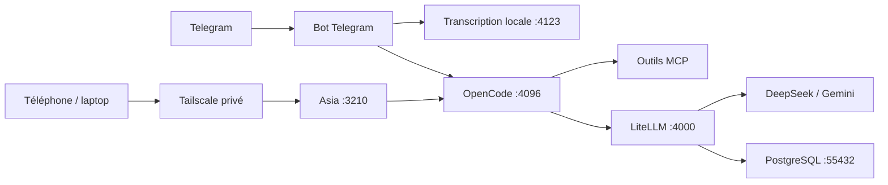

# Plateforme agentique — Asia

Assistant personnel accessible depuis un téléphone ou un ordinateur, avec une interface web en français et une intégration Telegram. OpenCode exécute les tâches ; LiteLLM route les appels vers DeepSeek et Gemini. L'interface propose des thèmes clair et sombre.

Évolution prévue : [plan Docker, un bot Telegram par agent et future application commune](docs/plan-plateforme-agents.md). Ce plan décrit la cible ; l'architecture ci-dessous reste celle de l'installation actuelle.



## Contenu du dépôt

| Dossier / fichier | Rôle |
| --- | --- |
| `src/`, `public/` | Interface, PWA, thèmes, conversations et suivi des outils |
| `server.mjs`, `request-journal.mjs` | Accès privé, passerelle OpenCode, CSRF, journal des envois |
| `gateway/` | Modèles, routage économique, métriques et lancement LiteLLM/PostgreSQL |
| `integrations/` | Scripts Windows OpenCode, Telegram, audio et OpenChamber ; exemple de politique OpenCode/MCP |
| `ops/` | Sauvegardes chiffrées et vérification de restauration |
| `test/` | Tests d'accès, de soumission et de reprise après incident |
| `docs/operations.md` | État de l'installation de référence et exploitation |
| `.github/workflows/ci.yml` | Vérification des fichiers suivis, tests, compilation et syntaxe |

## Développement de l'interface

Prérequis : Git et Node.js 24 ou supérieur. Depuis la racine du dépôt :

```powershell
npm.cmd ci
npm.cmd test
npm.cmd run build
```

Pour démarrer l'application, OpenCode doit être disponible sur `127.0.0.1:4096`, avec son authentification configurée. Copier `config.example.json` vers `config.local.json` si ce fichier n'existe pas, puis renseigner les chemins absolus, le compte propriétaire Tailscale et le nom de la machine. Les valeurs d'exemple ne sont pas développées automatiquement.

```powershell
npm.cmd start
```

Asia écoute sur `http://127.0.0.1:3210`. `start-asia.ps1` assure la supervision sous Windows. Le clonage n'installe pas OpenCode, PostgreSQL, les clés LiteLLM, les dépendances vocales ni les tâches Windows : consulter [les intégrations](integrations/README.md) et [l'exploitation](docs/operations.md).

Le mode Auto utilise les règles de `gateway/config.yaml` et les adaptations de `gateway/routing_context.py`. La politique affichée dans l'interface est décrite par `gateway/routing-policy.json` et la configuration locale. Les quotas financiers sont appliqués à la clé de service LiteLLM, et ne sont pas créés par le fichier de configuration de l'interface. Les capacités et prix des fournisseurs doivent être revalidés avant une mise à jour des modèles.

## Données locales et secrets

Les clés API, mots de passe, paramètres propres au PC, conversations, bases de données, journaux, dépendances et archives de sauvegarde sont exclus de Git. Le dépôt contient des exemples de configuration et des références vers les secrets locaux. `npm run check:repo` contrôle les fichiers suivis et des formats de clés connus ; ce contrôle ne remplace pas la revue du contenu avant chaque envoi.

GitHub conserve le code et son historique. Les données d'utilisation restent couvertes par le mécanisme de sauvegarde chiffrée documenté dans `docs/operations.md`.

## Vérification avant envoi

```powershell
git status
# Ajouter uniquement les fichiers de code/configuration d'exemple concernés.
git add CHEMINS_DES_FICHIERS
npm.cmd run check:repo
npm.cmd test
npm.cmd run build
git diff --cached --stat
git commit -m "Description du changement"
git push
```

La CI répète les contrôles à chaque push et pull request, sans clés de production, sans appel aux modèles et sans déploiement automatique. Les essais réels des fournisseurs, de Telegram, de Tailscale et des restaurations restent des validations distinctes.
