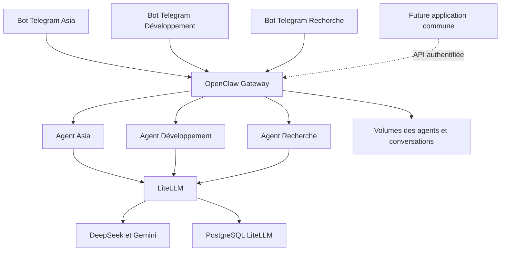

# Plan de migration Docker et application de gestion des agents

Mis à jour le 11 octobre 2026. Statut : plan de réalisation, sans activation de la nouvelle infrastructure.

La plateforme hébergera plusieurs agents persistants, accessibles d'abord chacun par leur propre bot Telegram, puis depuis une application commune. Asia restera l'agent personnel. Les autres agents auront leurs identités, instructions, conversations, outils et limites propres. La future application retrouvera ces agents et leurs sessions côté serveur.

La première infrastructure utilisera des images publiées, sans construire d'image de l'application Asia actuelle. OpenClaw sera le premier moteur des agents ; LiteLLM centralisera les modèles et les coûts. La reconstruction fonctionnelle pourra simplifier certains comportements actuels, avec les écarts documentés avant la bascule.

## Architecture cible

Développement et Recherche sont les rôles proposés pour les premiers spécialistes. Chaque bot sera lié explicitement à un seul agent. L'accès direct à un spécialiste ne passera pas obligatoirement par Asia. Une délégation entre agents pourra être ajoutée séparément ; elle ne devra pas fusionner leurs conversations ni envoyer une réponse dans le mauvais bot.

OpenClaw documente plusieurs agents et comptes de messagerie dans une même Gateway. Les espaces et historiques des agents sont distincts, mais la séparation des processus, des outils et de certains stockages de plugins demande des réglages supplémentaires. Une seule Gateway convient au premier déploiement personnel ; des frontières de confiance différentes appelleraient des instances séparées. [Routage multi-agent](https://docs.openclaw.ai/concepts/multi-agent)

## Composants retenus

| Composant | Rôle et décision |
| --- | --- |
| OpenClaw | Agents, comptes Telegram, sessions, outils, approbations et interface d'administration. Image officielle `ghcr.io/openclaw/openclaw`, version et empreinte à figer après validation. Variante navigateur si nécessaire. |
| LiteLLM | DeepSeek/Gemini, modèles de secours, clés de service et suivi des coûts. Partir de la version actuelle 1.104.1 pour limiter les changements simultanés. |
| PostgreSQL | Base persistante de LiteLLM. Image PostgreSQL 17 et migration par export/restauration. |
| Tailscale | Conserver initialement le service Windows pour l'accès privé HTTPS à l'administration et, ensuite, à l'application. |
| Audio | Configurer transcription et synthèse séparément. Speaches CPU est une option pour remplacer le serveur de transcription maison ; mesurer sa consommation avant activation permanente. |
| Sauvegardes | Restic ou mécanisme équivalent avec exports cohérents, chiffrement, planification et test de restauration. |
| OpenCode | Extension ultérieure de l'agent Développement si utile ; la connexion ACP requiert son plugin, son exécuteur et ses accès propres. |

Les images OpenClaw et LiteLLM sont publiées par leurs projets. Le raccordement OpenClaw–LiteLLM est documenté. Le fait qu'une image existe ne valide pas encore les outils, médias et politiques de notre installation. [Docker OpenClaw](https://docs.openclaw.ai/install/docker), [déploiement LiteLLM](https://docs.litellm.ai/docs/proxy/deploy), [connexion LiteLLM](https://docs.openclaw.ai/providers/litellm)

## Ordre de réalisation et critères de validation

Chaque étape produit ses résultats de test. Une défaillance sur un critère de bascule maintient le service actuel en production.

| Étape | Travail prévu | Validation requise |
| --- | --- | --- |
| 1. Préparer la reprise | Inventorier fonctions utilisées, modèles, connecteurs et comptes. Sauvegarder la configuration, les secrets et les données hors Git. Préparer le retour à l'installation actuelle. | Restauration isolée exploitable ; ancien bot et services toujours fonctionnels. |
| 2. Créer le socle Docker | Démarrer Docker Desktop/WSL 2. Créer un projet Compose distinct avec OpenClaw, LiteLLM et PostgreSQL, ses volumes et ses ports de test. | Services prêts, données conservées après recréation, accès non autorisé refusé, consommation mémoire mesurée. |
| 3. Configurer Asia et les modèles | Créer l'identité Asia, ses permissions et ses connexions. Configurer les profils de modèles et une clé de service dédiée. | Texte, outils, images et erreurs testés ; facturation attribuée à Asia ; refus d'une clé invalide et d'un budget de test épuisé. |
| 4. Ajouter les agents et leurs bots | Créer les spécialistes avec chacun un compte Telegram, un espace de travail, des accès et une clé LiteLLM propres. Tester Asia sur un bot temporaire avant reprise du bot habituel. | Chaque bot répond sous la bonne identité ; conversations et fichiers correctement séparés ; réponses renvoyées au bon bot ; compte Telegram non autorisé refusé. |
| 5. Valider les fonctions et les API | Reconnecter les outils nécessaires par agent ; tester audio et documents selon leurs rôles. Utiliser un petit client technique pour vérifier les fonctions dont la future application aura besoin. | Liste des agents/sessions, envoi, réponse progressive, arrêt, approbations et reconnexion utilisables sans interface Telegram. Aucun renvoi aveugle après résultat incertain. |
| 6. Fiabiliser puis basculer | Tester restauration, redémarrage Windows, panne fournisseur et retour arrière. Arrêter l'ancien consommateur Telegram avant de transférer le bot habituel à Asia. | Un seul consommateur par token ; messages traités une seule fois dans les scénarios testés ; tous les bots validés ; restauration et retour arrière démontrés. |
| 7. Développer l'application commune | Créer d'abord une application web adaptée au téléphone, installable si pertinent. Relier ses écrans aux agents et sessions déjà utilisés depuis Telegram. | Même agent et même session retrouvés entre interfaces ; outils, approbations et pièces jointes utilisables ; rendu mobile et bureau validé. |

Les nouveaux bots nécessitent chacun un compte créé via BotFather et un token distinct, conservé hors Git. Les associations bot–agent seront explicites, pour éviter qu'un compte oublié soit routé vers Asia par défaut. Le canal Telegram et ses règles d'accès seront configurés pour un usage personnel. [Telegram OpenClaw](https://docs.openclaw.ai/channels/telegram)

## Identités et conversations

Une identité d'agent reste stable quand son nom d'affichage change ou quand on ajoute une interface. Un compte Telegram représente un accès à cet agent. Les sessions conservent leur propriétaire ; la future application affichera plusieurs conversations par agent et permettra d'ouvrir celle du bot concerné.

Configurer explicitement la visibilité entre agents et les mémoires des plugins. Le partage de documents sera limité à des espaces désignés ; une délégation transmettra les éléments nécessaires à la tâche. La présence de plusieurs agents dans une Gateway n'est pas une garantie d'isolation du système d'exploitation.

Le transfert de l'ancien historique OpenCode vers les sessions OpenClaw n'est pas présumé compatible. Conserver l'archive d'origine et, si utile, importer des synthèses identifiées comme telles plutôt que modifier directement les bases internes. [Sessions OpenClaw](https://docs.openclaw.ai/concepts/session)

## Préparer la future application dès le socle

Le protocole Gateway d'OpenClaw expose notamment agents, sessions, chat et approbations par WebSocket, avec des rôles et portées d'accès. Le prototype de l'étape 5 vérifiera ces opérations sur la version retenue. [Protocole Gateway](https://docs.openclaw.ai/gateway/protocol)

Le contrat d'intégration à documenter couvrira :

- Identifiants des agents, comptes de canal, sessions, demandes et exécutions, avec leur correspondance dans le moteur.
- Messages, pièces jointes, événements de progression, erreurs et résultats finaux.
- Demandes d'approbation, décisions, annulation et états après reconnexion.
- Droits des clients et capacités disponibles pour chaque agent.
- Attribution des coûts et limites, sans fournir la clé administrateur LiteLLM aux clients.

Réutiliser les API officielles et stocker les données métier dans leur service propriétaire. Ne pas coupler l'application aux tables SQLite internes ou à une copie parallèle des historiques. Une fine couche d'adaptation pourra être développée si la gestion de plusieurs moteurs ou l'accès limité aux statistiques l'exige. Les opérations non prises en charge devront être signalées ; les agents OpenCode ne seront pas supposés interchangeables avec les agents OpenClaw.

La première application proposera liste des agents, conversations, état des tâches, approbations, pièces jointes et thèmes clair/sombre. La création d'agents, les réglages avancés, notifications et tableaux de coûts enrichis viendront ensuite. Telegram restera utilisable en parallèle.

## Routage et maîtrise des coûts

Les deux décisions seront séparées : OpenClaw adresse un message au bon agent ; LiteLLM choisit le modèle ou le modèle de secours. Chaque agent pourra avoir un profil par défaut, tout en utilisant les mêmes fournisseurs.

Conserver initialement une enveloppe globale de référence de 20 USD sur 30 jours, à répartir entre les agents sans la multiplier à chaque ajout. Vérifier l'application effective du budget partagé et des limites par clé dans LiteLLM. Les appels en cours et les délais de comptabilisation empêchent de traiter ce seuil comme un plafond instantané exact.

Privilégier des profils natifs économique, raisonnement, vision et audio avec des replis compatibles. Le routeur actuel contient des règles personnalisées pour les médias et le JSON strict : elles doivent être remplacées et testées explicitement. Un module monté dans l'image officielle reste une option si une règle indispensable n'a pas d'équivalent natif ; il ne serait pas une image de l'application Asia.

Vérifier séparément les appels secondaires : transcription, synthèse vocale, mémoire, embeddings, résumés et délégations. Les clés fournisseurs resteront dans LiteLLM lorsque le chemin est compatible ; toute exception devra être documentée et comptabilisée. Une clé propre à chaque agent ne sera considérée opérationnelle qu'après vérification de l'identité de facturation réelle, y compris pendant une délégation.

## Exploitation et migration des données

Remplacer les chemins Windows par des volumes et chemins Linux. Utiliser les noms des services pour les communications internes. Ne pas exposer PostgreSQL au réseau ; limiter les accès d'administration à la machine et au réseau privé prévu. Adapter l'authentification, les origines et la confiance envers le proxy Tailscale, sans reprendre automatiquement les règles de l'ancien serveur Asia.

Remplacer les superviseurs PowerShell par des politiques de redémarrage et des contrôles de santé. Un état unhealthy ne redémarre pas à lui seul un conteneur : prévoir une détection et une procédure de récupération. Le démarrage de Docker Desktop et la veille Windows doivent faire partie du test d'exploitation.

Pour PostgreSQL, restaurer un dump dans un volume Linux et conserver le secret de chiffrement LiteLLM avec la base. Ne pas copier le répertoire de données Windows comme volume PostgreSQL Linux. Sauvegarder l'état OpenClaw de manière cohérente avec sa version, ainsi que les espaces de travail et secrets. Garder une copie chiffrée hors du PC et tester sa restauration. GitHub conserve le code et les configurations d'exemple, pas les données d'usage.

Le PC dispose d'environ 12 Go de RAM. Commencer avec trois services principaux et une concurrence limitée ; ajouter navigateur et transcription locale après mesure. Le fonctionnement de tous les services en charge reste à valider sur cette machine.

## Livrables dans le dépôt

- `infra/compose.yaml` et paramètres d'exemple, avec images figées et profils facultatifs.
- Configurations OpenClaw, associations bots–agents et catalogue des modèles LiteLLM.
- Instructions et permissions propres à chaque agent, sans tokens ni comptes personnels dans les exemples.
- Tests d'intégration des API, canaux, modèles, redémarrages et restaurations.
- Procédures de migration, bascule, retour arrière, sauvegarde et mise à jour.
- Plus tard, code de l'application commune et adaptateurs nécessaires.

Le premier jalon livré sera une plateforme Docker avec des agents accessibles séparément par leurs bots Telegram, des coûts attribués et une restauration validée. Le développement complet de l'application commencera après ce jalon ; la validation de ses API aura déjà été effectuée.
