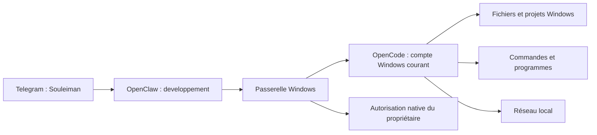

# Accès Windows de Souleiman

Le propriétaire a demandé le 12 octobre 2026 un accès général au PC pour Souleiman. Son bot reste sur OpenClaw dans Docker ; les opérations sur le PC passent par OpenCode, déjà installé et exécuté sur Windows. L'accès ne se limite pas au contrôle de la télévision.



## Droits et fonctionnement

- `asia_opencode_task` et `asia_opencode_approve` sont désormais autorisés pour `developpement`. Le préfixe historique ne signifie pas une délégation à Asia.
- Souleiman peut demander à OpenCode de lire et modifier des fichiers Windows, exécuter des commandes, lancer des programmes et contacter les appareils du réseau dans le périmètre confié par le propriétaire.
- Les outils directs `read/write/edit` d'OpenClaw restent ceux de son workspace Linux. Pour un chemin Windows, il doit utiliser la passerelle.
- Les permissions OpenCode existantes restent en vigueur : les commandes demandent généralement un accord unique, l'accès à un répertoire extérieur peut demander une validation et les fichiers de secrets restent protégés.
- La passerelle n'élève pas le processus en administrateur et n'ajoute pas un outil de souris/clavier ou de capture du bureau. Les opérations soumises à l'UAC restent soumises à Windows.
- Les commandes suivent une session OpenCode et son identifiant de tâche. Une issue incertaine n'est pas rejouée ; le suivi reste explicite.

Les coûts de la conversation sont attribués à la clé Souleiman. Les appels de l'exécuteur Windows utilisent la clé OpenCode existante, dans le budget commun LiteLLM ; ils ne sont pas automatiquement réattribués à la clé Souleiman.

## Séparation et approbations

Le journal historique d'Asia reste `asia-opencode/tasks.json`. Souleiman utilise `asia-opencode/developpement/tasks.json`, avec ses propres reçus d'approbation. Les anciennes tâches dépourvues de champ propriétaire restent celles d'Asia. Une tâche créée par l'un n'est pas consultable, continuable, annulable ou approuvable par l'autre au travers de ces outils.

Les deux agents travaillent néanmoins sur le même ordinateur avec le même compte Windows. Les journaux séparés ne sont pas une isolation système entre deux utilisateurs hostiles. Le modèle ne reçoit pas les identifiants du serveur OpenCode.

Les approbations natives de Souleiman ciblent uniquement le propriétaire autorisé, dans son échange privé avec le bot Souleiman. Le filtre global des approbations inclut Asia et Souleiman ; chaque compte Telegram garde son propre filtre. Saredo et les agents de formation n'obtiennent pas cette passerelle. Une délégation sans surface d'approbation peut rester bloquée : privilégier la conversation directe avec Souleiman pour les opérations Windows.

## Installation et retour arrière

Après avoir configuré la passerelle Asia existante :

```powershell
python infra/configure-souleiman-windows.py
python infra/configure-souleiman-windows.py --apply
node infra/test-opencode-bridge.mjs --souleiman
node infra/test-opencode-bridge.mjs --souleiman --files
node infra/test-opencode-bridge.mjs
```

Le premier appel valide la configuration sans l'appliquer. L'application exige qu'OpenCode soit au repos, conserve les fichiers précédents dans `%LOCALAPPDATA%\AsiaDocker\souleiman-windows-private.json`, puis recharge le plugin. Le journal interdit une réapplication aveugle. Aucun token Telegram, budget, pare-feu, montage de disque ou réseau Docker n'est modifié.

Pour restaurer la version précédente :

```powershell
python infra/configure-souleiman-windows.py --rollback
```

Le retour arrière refuse un état qui a changé depuis le déploiement. Inspecter le journal privé en cas de déploiement partiel ou de conflit. Les historiques OpenCode, les tâches, les reçus et les dépenses ne sont pas effacés. Les effets d'une commande exécutée sur Windows ne sont pas annulés par ce rollback de configuration.

## Vérifications

Les tests unitaires couvrent les journaux séparés, la conservation des anciennes tâches Asia, l'accord natif consommable une seule fois, le refus des reçus étrangers et la préservation des autres permissions. La formation conserve ses outils limités.

Le test d'intégration utilise une commande `echo` artificielle. L'option `--files` crée, relit et supprime un fichier temporaire unique avec une commande fixée par le test. Il contrôle un refus puis un accord natif via le client Gateway de test, la sortie Windows réelle, l'absence de double exécution et le refus d'accès de l'autre agent. Le programme refuse d'autoriser une commande différente de celle prévue. Ce parcours technique ne remplace pas un clic du propriétaire dans Telegram ; ne pas le présenter comme une validation humaine Telegram.

Les appareils du réseau et leurs adresses sont conservés dans les notes privées des agents, pas dans ce dépôt. L'accès réseau et la disponibilité d'un outil sont deux vérifications distinctes ; un conteneur Docker peut atteindre un appareil local par IP sans réussir sa découverte multicast.

### Résultat du 12 octobre 2026

Déploiement appliqué et huit fichiers contrôlés contre l'instantané prévu. Les seuls champs de configuration modifiés sont les outils de Souleiman, le filtre global d'approbation et les approbations de son compte Telegram. Les trois comptes Telegram sont actifs et leurs sondes réussissent.

Les tests réels passent pour Souleiman (`echo`, puis création/lecture/suppression d'un fichier temporaire Windows) et pour Asia (`echo` de non-régression). Les traces OpenCode confirment une seule exécution de chaque commande exacte après l'accord ; les refus précédents n'ont pas exécuté la commande. Le fichier temporaire est supprimé. Le propriétaire n'a pas encore confirmé les boutons dans le bot Souleiman ; les tests natifs ont utilisé le client Gateway appairé.

Tests locaux : 71 tests Node et 60 tests Python réussis, compilation de l'application et contrôle du dépôt réussis. Les deux scénarios de rollback sont testés avec des fichiers simulés, et les huit fichiers réellement déployés correspondent à la cible privée. Aucun retour arrière réel de cette extension ni redémarrage Windows n'a été réalisé pendant cette étape.
