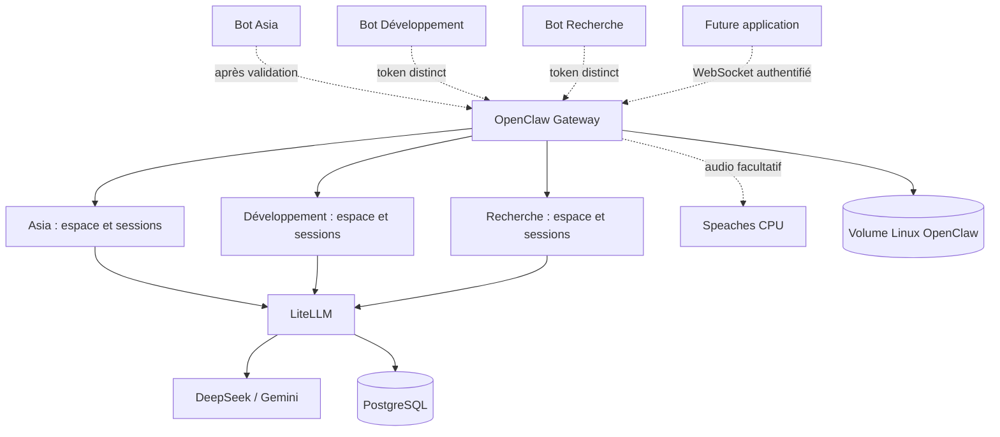

# Architecture

## Deux environnements pendant la migration

L'installation Windows continue de traiter le bot habituel : bot Telegram → OpenCode → LiteLLM → DeepSeek/Gemini. Asia Web et OpenChamber sont des interfaces supplémentaires d'OpenCode. Les connecteurs MCP sont exécutés par OpenCode, pas par LiteLLM.

Le candidat Docker utilise des images publiées, figées par empreinte dans [Compose](../infra/compose.yaml). Les configurations et scripts d'exploitation sont versionnés, sans construction d'image personnalisée.

## Composants

| Composant | Responsabilité | Stockage / exposition |
| --- | --- | --- |
| OpenClaw 2026.10.1 | Identités, sessions, outils, canaux et API des agents | Volume Linux `openclaw-state`, hôte `127.0.0.1:18789` |
| LiteLLM 1.104.1 | Catalogue des 34 routes, choix du modèle, replis, clés et coûts | PostgreSQL et métriques limitées, hôte `127.0.0.1:14000` |
| PostgreSQL 17.11 | Configuration et comptabilité LiteLLM | Volume `postgres-data`, aucun port publié |
| Speaches, profil `audio` | Transcription locale sur CPU | Cache de modèles dédié, hôte `127.0.0.1:18000` |
| Tailscale Windows | Accès privé aux interfaces publiées explicitement | Configuration actuelle conservée pendant la validation |
| Scripts `infra/` | Initialisation, migration et tests reproductibles | Aucun service applicatif supplémentaire |
| Scripts `ops/` | Archives chiffrées et restauration de contrôle | Archives sur D:, clé de récupération hors Git |

Le réseau `database` est interne et relie PostgreSQL à LiteLLM. `agents` est interne pour les échanges applicatifs. Les services ayant besoin d'Internet disposent aussi de `outbound`. Les ports publiés écoutent uniquement sur la boucle locale Windows.

## Identités et droits

Les identifiants stables sont `asia`, `developpement` et `recherche`. Chaque agent possède son répertoire d'état, son espace de fichiers et une clé LiteLLM propre. Le test de facturation vérifie une augmentation de dépense sur la clé de l'agent réellement appelé.

Les futurs comptes Telegram sont associés explicitement aux agents. `session.dmScope=per-account-channel-peer` sépare les conversations par compte et correspondant. Les groupes doivent rester désactivés et les messages directs réservés à l'identifiant numérique du propriétaire.

La visibilité des sessions est limitée à l'agent. L'accès inter-agent est désactivé. Les outils de fichiers sont limités à l'espace de travail et le shell est désactivé dans le candidat initial. Ce sont des politiques applicatives dans un processus partagé. Pour des utilisateurs ou agents qui ne se font pas confiance, utiliser des instances et identités système séparées.

L'authentification Gateway est maintenue même si une interface passe ensuite par Tailscale. Le secret administrateur LiteLLM ne doit jamais être remis à un agent ou à une application cliente. La clé Gateway HTTP donne des droits de propriétaire sur toute la Gateway ; la future application doit préférer des appareils appairés avec des portées adaptées.

## Routage et coûts

OpenClaw choisit l'agent ; LiteLLM choisit le modèle. [Le catalogue](../gateway/config.yaml) reste la source des capacités et du routage. [Le garde de routage](../gateway/routing_context.py) conserve les replis compatibles avec les images, documents, audio et JSON strict. [Les métriques](../gateway/metrics.py) ne conservent ni prompts ni réponses.

Le candidat a une équipe LiteLLM de test à 1 USD/30 jours et trois clés à 0,30 USD chacune. Ce budget réduit sert uniquement à la validation. La cible de production reste une enveloppe partagée de 20 USD/30 jours, en tenant compte des dépenses et clés de l'ancienne installation. Ne pas multiplier cette enveloppe par le nombre d'agents. Une limite financière n'est pas un plafond instantané exact : les requêtes en cours peuvent être comptabilisées après admission.

## Données et dépendances

PostgreSQL est migré par `pg_dump`/`pg_restore`, avec conservation de `LITELLM_SALT_KEY`. Le dossier de données PostgreSQL Windows n'est jamais monté dans Linux. OpenClaw utilise un volume Linux car les opérations de permissions POSIX requises par son stockage ne fonctionnent pas correctement sur un montage Windows.

L'historique OpenCode reste consultable dans l'ancienne installation et ses sauvegardes. Aucune conversion silencieuse en historique OpenClaw n'est effectuée. Les connecteurs Google, recherche web et navigateur doivent être reconnectés et testés avec les droits du nouvel agent avant la bascule.

Sources : [Docker OpenClaw](https://docs.openclaw.ai/install/docker), [multi-agent](https://docs.openclaw.ai/concepts/multi-agent), [LiteLLM](https://docs.openclaw.ai/providers/litellm), [audio](https://docs.openclaw.ai/nodes/audio).
