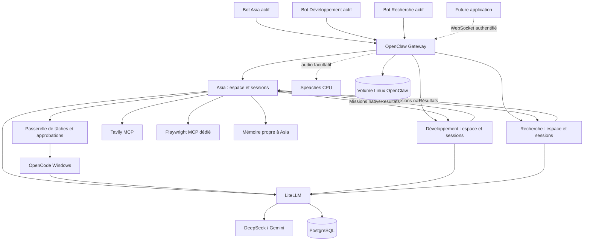

# Architecture

## Architecture pendant la phase pilote

Depuis le 11 octobre 2026, les bots Asia, Développement et Recherche sont reçus par OpenClaw dans Docker. L'ancien consommateur Telegram Windows est arrêté. Asia Web et OpenChamber restent des interfaces d'OpenCode, qui sert aussi d'exécuteur Windows à Asia. OpenCode et OpenClaw utilisent tous deux LiteLLM Docker. Les connecteurs MCP sont exécutés par les moteurs d'agents, pas par LiteLLM.

L'installation Docker utilise des images publiées, figées par empreinte dans [Compose](../infra/compose.yaml). Les configurations et scripts d'exploitation sont versionnés, sans construction d'image personnalisée. Les anciens LiteLLM et PostgreSQL Windows sont conservés pour le retour arrière.

## Composants

| Composant | Responsabilité | Stockage / exposition |
| --- | --- | --- |
| OpenClaw 2026.10.1 | Identités, sessions, outils, canaux et API des agents | Volume Linux `openclaw-state`, hôte `127.0.0.1:18789` |
| LiteLLM 1.104.1 | Catalogue des 34 routes, choix du modèle, replis, clés et coûts | PostgreSQL et métriques limitées, hôte `127.0.0.1:14000` |
| PostgreSQL 17.11 | Configuration et comptabilité LiteLLM | Volume `postgres-data`, aucun port publié |
| Speaches, profil `audio` | Transcription locale sur CPU | Cache de modèles dédié, hôte `127.0.0.1:18000` |
| Playwright MCP 0.0.83 | Navigateur d'Asia | Réseau dédié, sans port hôte ; seul le workspace Asia monté |
| Plugin `asia-opencode` | Tâches Windows et validations natives | Journal privé dans le volume OpenClaw ; serveur Windows 4096 conservé |
| Tailscale Windows | Accès privé aux interfaces publiées explicitement | Configuration actuelle conservée pendant la validation |
| Scripts `infra/` | Initialisation, migration et tests reproductibles | Aucun service applicatif supplémentaire |
| Scripts `ops/` | Archives chiffrées et restauration de contrôle | Archives sur D:, clé de récupération hors Git |

Le réseau `database` est interne et relie PostgreSQL à LiteLLM. `agents` est interne pour les échanges applicatifs. Les services ayant besoin d'Internet disposent aussi de `outbound`. Les ports publiés écoutent uniquement sur la boucle locale Windows.

## Identités et droits

Les identifiants stables sont `asia`, `developpement` et `recherche`. Chaque agent possède son répertoire d'état, son espace de fichiers et une clé LiteLLM propre. Le test de facturation vérifie une augmentation de dépense sur la clé de l'agent réellement appelé.

Les comptes Telegram actifs sont associés explicitement aux agents. `session.dmScope=per-account-channel-peer` sépare les conversations par compte et correspondant. Les groupes sont désactivés et les messages directs réservés à l'identifiant numérique du propriétaire.

Asia peut créer des missions natives chez les deux spécialistes et recevoir leurs résultats. La visibilité des sessions est limitée à l'arbre de la conversation ; les missions créées par Asia sont accessibles à leur parent, mais pas les conversations Telegram indépendantes des spécialistes. Les échanges ordinaires entre agents restent désactivés. Les spécialistes ne peuvent ni s'envoyer de messages ni redéléguer. Voir [la délégation et ses limites](delegation.md).

Les outils directs de fichiers restent limités au workspace et le shell natif reste désactivé. Asia seule possède une passerelle vers les tâches Windows OpenCode, avec les permissions Windows existantes et des validations natives à usage unique. Ce sont des politiques applicatives dans une installation de confiance à propriétaire unique. Pour des utilisateurs ou agents qui ne se font pas confiance, utiliser des instances et identités système séparées.

L'authentification Gateway est maintenue même si une interface passe ensuite par Tailscale. Le secret administrateur LiteLLM ne doit jamais être remis à un agent ou à une application cliente. La clé Gateway HTTP donne des droits de propriétaire sur toute la Gateway ; la future application doit préférer des appareils appairés avec des portées adaptées.

## Routage et coûts

OpenClaw choisit l'agent ; LiteLLM choisit le modèle. [Le catalogue](../gateway/config.yaml) reste la source des capacités et du routage. [Le garde de routage](../gateway/routing_context.py) conserve les replis compatibles avec les images, documents, audio et JSON strict. [Les métriques](../gateway/metrics.py) ne conservent ni prompts ni réponses.

La bascule a transféré l'enveloppe de 20 USD/30 jours vers l'équipe commune Docker, en déduisant les 0,07122516 USD déjà enregistrés côté Windows : plafond partagé de 19,92877484 USD, dont les dépenses Docker déjà réalisées restent déduites. Les trois clés d'agents et la clé OpenCode sont limitées individuellement à 20 USD et restent soumises à ce plafond commun. La clé OpenCode Windows est bloquée dans l'ancien LiteLLM. Le plafond réduit doit être réévalué explicitement au changement de période ; il ne remonte pas automatiquement à 20 USD. Les requêtes en cours peuvent être comptabilisées après admission.

## Données et dépendances

PostgreSQL est migré par `pg_dump`/`pg_restore`, avec conservation de `LITELLM_SALT_KEY`. Le dossier de données PostgreSQL Windows n'est jamais monté dans Linux. OpenClaw utilise un volume Linux car les opérations de permissions POSIX requises par son stockage ne fonctionnent pas correctement sur un montage Windows.

L'historique OpenCode reste consultable dans l'ancienne installation et ses sauvegardes. Aucune conversion silencieuse en historique OpenClaw n'est effectuée. Tavily, le navigateur et la mémoire ont été raccordés pour Asia. Google est exclu de cette bascule à la demande du propriétaire. Voir [les tests et limites du transfert](bascule-asia.md).

Sources : [Docker OpenClaw](https://docs.openclaw.ai/install/docker), [multi-agent](https://docs.openclaw.ai/concepts/multi-agent), [LiteLLM](https://docs.openclaw.ai/providers/litellm), [audio](https://docs.openclaw.ai/nodes/audio).
