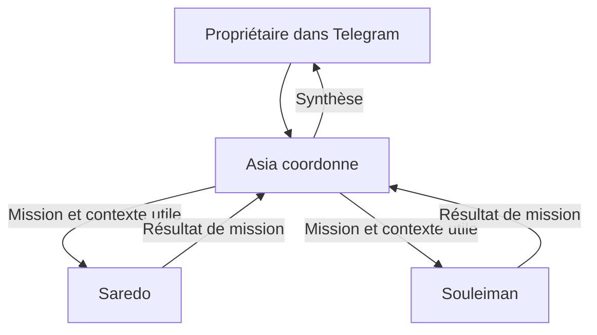

# Délégation coordonnée par Asia

Depuis le 11 octobre 2026, Asia peut confier des missions à Saredo et Souleiman et réunir leurs résultats. Chaque spécialiste garde son bot Telegram, son workspace et sa clé LiteLLM. Les missions utilisent des sessions natives OpenClaw distinctes des conversations Telegram personnelles.



Saredo et Souleiman ne peuvent pas se contacter directement ni créer leurs propres sous-agents. Le retour vers Asia passe par la livraison native du résultat ; ils n'ont pas d'outil d'envoi inter-agent. Les trois bots restent utilisables directement par le propriétaire.

## Mécanisme et permissions

La version installée est OpenClaw 2026.10.1. La délégation utilise `sessions_spawn`, `sessions_yield` et les contrôles natifs de sous-agents, sans plugin supplémentaire. La configuration effectivement acceptée par cette image reste la référence ; une documentation en ligne plus récente peut décrire des options supplémentaires.

- Asia reçoit `agents_list`, `sessions_spawn`, `sessions_yield` et `subagents`. Ses cibles déclarées sont `recherche` et `developpement`.
- `tools.agentToAgent.enabled` reste `false` : les échanges ordinaires entre agents demeurent fermés. Les missions créées par leur parent bénéficient de l'exception native de propriété.
- `tools.sessions.visibility` passe à `tree` : le demandeur voit sa conversation et ses missions. Il n'obtient pas l'accès aux conversations Telegram des spécialistes. La session canonique `main` conserve l'exception native pour les sessions de son propre agent.
- Les spécialistes ont un refus explicite des outils d'orchestration, de messagerie et d'envoi externe. Le même refus est appliqué aux sous-agents. La profondeur maximale est de un niveau ; Swarm est désactivé.
- Le contexte demandé est `isolated`. Les instructions imposent de transmettre uniquement la consigne et les données utiles. Le test place une donnée privée artificielle dans la conversation mère et vérifie son absence dans les deux missions.
- Les outils existants d'Asia et les permissions Windows restent en place. Une mission ne vaut jamais autorisation d'exécuter une commande Windows. Saredo dispose actuellement de lecture d'URL ; Souleiman prépare et révise les changements ; les commandes Windows passent par OpenCode avec validation native dans une conversation directe. Une sous-mission ne dispose pas du scope operator.approvals nécessaire à ces validations interactives.

Le résultat d'un spécialiste reste une donnée à vérifier. Les instructions ne remplacent pas les contrôles de permissions ; les espaces et processus restent ceux d'une Gateway de confiance à propriétaire unique.

Pour une publication GitHub, transmettre le contenu complet des documents et leurs chemins cibles. Asia et les nouvelles missions de Souleiman peuvent ouvrir une PR demandée sur une branche déjà poussée. Le transfert de documents et la préparation Windows suivent [la procédure de publication](publication-github.md).

## Attente, résultats et coûts

Asia découvre les schémas avant d'appeler les outils. Elle démarre une mission avec `mode: "run"`, `context: "isolated"`, `completionTarget: "parent"`, puis attend avec `sessions_yield` et `waitFor: "message"`. Le retour réveille Asia, qui peut lancer une deuxième mission ou synthétiser les résultats. L'attente explicite est nécessaire : un retour privé au parent sans `yield` ne promet pas une réponse finale automatique dans Telegram.

Les limites natives autorisent une mission en exécution par conversation coordinatrice et deux enfants actifs au maximum ; elles ne sont pas un quota total à vie. Le délai par défaut est de 180 secondes. Les instructions fixent une mission par spécialiste et par demande, sans répétition automatique ni changement de modèle. Le modèle peut techniquement fournir un autre délai de lancement : 180 secondes est un défaut et une consigne, pas un plafond matériel inviolable. Les frais restent soumis à l'équipe LiteLLM commune, et chaque tâche utilise la clé de son agent. La facturation réelle des trois clés a été contrôlée.

Une erreur ou un délai dépassé doit être signalé. Asia ne recrée pas une mission dont l'issue est incertaine. `/stop` dans sa conversation utilise l'annulation native de ses tâches ; le comportement après crash et le parcours d'annulation Telegram restent à éprouver sur ce canal.

## Installation et retour arrière

Depuis la racine du dépôt :

```powershell
python infra/configure-delegation.py
python infra/configure-delegation.py --apply
node infra/test-delegation.mjs
```

Le mode par défaut valide la modification et sa configuration inverse sans les appliquer. L'application exige une archive vérifiée de moins de 24 heures et conserve les politiques et instructions précédentes dans `%LOCALAPPDATA%/AsiaDocker/delegation-private.json`, inclus dans la sauvegarde chiffrée. Les tokens, associations Telegram, secrets et budgets ne sont pas réinitialisés. Un journal existant empêche une réapplication aveugle.

Avant un retour arrière, laisser finir ou arrêter les missions en cours, puis :

```powershell
python infra/configure-delegation.py --rollback
```

Cette commande restaure les politiques et les fichiers `AGENTS.md` précédents. Elle ne supprime ni les sessions de missions ni leurs dépenses. Les modifications de politiques intervenues depuis doivent être examinées avant de restaurer cet état antérieur. L'inverse du patch a été validé par le schéma et testé sur fixture ; aucun rollback de délégation n'a été infligé aux conversations utilisateur actives.

## Validation

`infra/test-delegation.mjs` crée une conversation WebChat artificielle, puis fait déléguer par Asia une tâche à Saredo et une à Souleiman. Il contrôle les deux sessions réelles, leurs réponses, le retour dans la conversation mère, l'attente native, l'absence de la donnée privée, la lecture des missions par Asia, le refus de lecture entre spécialistes et le refus de lecture d'une conversation étrangère par Asia. Il vérifie aussi les refus HTTP des outils d'envoi/création chez les spécialistes et la facturation des trois agents. Ces refus HTTP complètent les politiques vérifiées ; ils ne suffisent pas seuls à prouver toute l'isolation du moteur.

Les essais n'envoient aucun message Telegram. La restitution sur le bot réel doit encore être essayée par le propriétaire, par exemple : « Asia, demande à Saredo d'analyser cette idée, puis à Souleiman de proposer une solution, et fais-moi une synthèse. » Les tests de timeout, panne pendant une mission et reprise après redémarrage ne sont pas encore réalisés.

Rapport synthétique privé : `delegation-test-result.json`. Les historiques artificiels restent hors Git. Références : [outils de sous-agents](https://docs.openclaw.ai/tools/subagents/tool-reference), [permissions](https://docs.openclaw.ai/tools/subagents/tool-policy), [retour au parent](https://docs.openclaw.ai/tools/subagents/announce).
