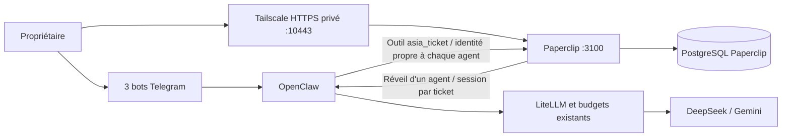

# Paperclip : tâches et discussions entre agents

Installation du 12 octobre 2026. Paperclip complète les trois bots existants : il conserve les tâches, leurs responsables, les sous-tâches, les commentaires et les validations. Telegram reste le canal de conversation privé de chaque agent.

## Utilisation

- Une question ou une conversation normale ne crée **aucun ticket**.
- Pour suivre un travail : demander à Asia « Crée une tâche pour comparer les solutions de sauvegarde et confie-la à Saredo ».
- Asia retourne le numéro du ticket et son lien. Les précisions sur cette même tâche deviennent des commentaires.
- Dans Paperclip, **Tasks** affiche une liste ou un tableau. Ouvrir un ticket pour lire le travail, les échanges et les sous-tâches. **Agents** montre les trois responsables.
- Un résultat passe en **In Review** et revient au propriétaire. Lire les livrables avant de le valider. Un résultat bloqué doit préciser la prochaine action attendue.
- **Un commentaire seul ne relance pas un ticket In Review attribué au propriétaire.** Il faut une décision de demande de modifications pour rendre le travail à l'agent. De même, écrire « Je valide » ne clôture pas la tâche. Asia peut enregistrer un commentaire depuis Telegram, mais son outil actuel ne peut pas prendre ces décisions humaines ; elle doit expliquer cette limite.
- Un commentaire dans Paperclip n'est pas automatiquement envoyé dans Telegram. Les discussions privées des bots ne sont pas recopiées dans les tickets.

Accès privé : `https://desktop-ep5nvk0.taild656dc.ts.net:10443/EQU/issues`, avec Tailscale connecté sur le téléphone ou le laptop et ce PC disponible. L'accès distant a besoin de Tailscale **et** de la connexion Paperclip. L'adresse locale `http://localhost:3100` sert aux diagnostics ; utiliser l'adresse HTTPS pour se connecter, car les cookies de session sont sécurisés.

Les identifiants du propriétaire sont dans `%LOCALAPPDATA%\AsiaPaperclip\connexion.txt`, hors Git. Aucun email d'invitation ni serveur SMTP n'est configuré.

## Architecture et limites des responsabilités



Paperclip utilise l'adaptateur officiel `openclaw_gateway`. Les agents ne sont pas recréés dans un nouveau moteur : leurs profils Paperclip désignent les agents OpenClaw `asia`, `recherche`, `developpement`. Les sessions de travail sont `agent:<nom>:paperclip:issue:<UUID>`, distinctes des conversations Telegram.

Asia coordonne et crée les sous-tâches. Saredo et Souleiman lisent et commentent les tickets du projet partagé, avec attribution de leur identité ; ils ne créent pas d'autres agents ni de nouvelles tâches. Les permissions OpenClaw existantes restent applicables : Souleiman produit des propositions sans shell, Saredo dispose de ses outils actuels, et les actions Windows d'Asia restent soumises au mécanisme d'approbation OpenCode. Paperclip n'ajoute pas de connecteur Google.

Une tâche suivie dans Paperclip doit être déléguée par sous-tâche, sans doubler la même mission avec `sessions_spawn`. La délégation conversationnelle historique reste disponible hors tickets. Les agents peuvent lire les tickets du projet partagé ; cette installation n'est pas un système d'isolation entre plusieurs clients confidentiels.

## Déploiement réel

| Élément | Configuration |
| --- | --- |
| Application | Image officielle `ghcr.io/paperclipai/paperclip`, version `2026.1005.0` |
| Révision amont | `467125fafb47a8520856504fecc48d6e32055db1` |
| Image figée | `sha256:de762433b50d56ed9180fef96a13fa236b37856c5c7a7718e8f19afe3d1e8670` |
| Compose | [`infra/paperclip/compose.yaml`](../infra/paperclip/compose.yaml), projet `asia-paperclip` |
| Base | PostgreSQL 17.11 dédié, aucune publication de son port |
| Volumes | `asia-paperclip_paperclip-data`, `asia-paperclip_postgres-data` |
| Réseau | Base isolée ; réseau OpenClaw existant pour l'adaptateur et l'API interne |
| Écoute Windows | `127.0.0.1:3100` uniquement, reverse proxy Tailscale sur `10443` |
| Authentification | Mode `authenticated`, exposition `private`, hôtes explicitement autorisés |
| Ressources | Paperclip 1 Gio / 1 CPU ; PostgreSQL 512 Mio / 0,5 CPU |
| Déclenchements | À la demande seulement, aucun intervalle de travail périodique |
| Limites | Un passage concurrent par agent, 12 passages par jour et par agent, délai adaptateur 240 s |

Les clés des fournisseurs restent dans LiteLLM. Les coûts affichés par Paperclip ne sont **pas** le relevé financier de référence : l'adaptateur peut afficher zéro alors que LiteLLM a facturé des appels. Les budgets existants de LiteLLM restent la limite financière. Les plafonds de passages Paperclip ne remplacent pas ces budgets.

Secrets privés : `%LOCALAPPDATA%\AsiaPaperclip`, accès restreint au propriétaire Windows et à SYSTEM. Les fichiers `paperclip.env` et `postgres.env` contiennent la connexion DB et les secrets du service ; `owner-login.json` le compte local ; `key-*.json` les clés des agents ; `gateway-device.json` l'identité de l'adaptateur ; `deployment.json` le journal de provisioning. Ne pas publier ces fichiers ni les diagnostics privés.

La version figée résout les `secret_ref` pour `adapterConfig.env`, mais pas pour les champs directs `authToken` et `devicePrivateKeyPem`. Ces deux champs ont donc été enregistrés dans la configuration privée des profils. **Ne pas prétendre que ces champs sont chiffrés individuellement en base** : leur protection repose sur les accès Windows/Docker et les sauvegardes chiffrées.

L'appareil Gateway dédié ne possède que `operator.read` et `operator.write`. La tentative `config.set` a été refusée. Le contrôle natif d'environnement ne signe pas toujours le challenge avec cet appareil ; le script [`test-connection.mjs`](../infra/paperclip/test-connection.mjs) et les exécutions réelles valident la connexion signée.

## Outil de tickets

Le plugin [`asia-paperclip`](../infra/paperclip/plugin/index.mjs) expose `asia_ticket` dans OpenClaw. Les clés ne sont pas injectées dans les prompts. Le code lit `/home/node/.openclaw/paperclip-control/credentials.json`, hors des espaces de travail accessibles aux modèles.

- Destination API fixe : `http://paperclip:3100` ; projet et entreprise contrôlés à chaque lecture ciblée.
- Mutations de tâche liées à l'agent, au ticket courant et au passage Paperclip actif.
- Clôture automatique interdite par l'outil ; résultats `in_review` ou `blocked`. Une étape native d'approbation humaine est attachée à chaque ticket créé.
- Journal de mutations persistant avec création atomique du reçu avant l'appel. Une réponse perdue reste bloquée pour réconciliation ; aucun nouvel envoi automatique.
- Un `requestId` réutilisé avec un contenu différent est refusé. Les relectures de résultats validés ne soumettent pas une seconde création.
- Les 30 commentaires les plus récents sont triés chronologiquement, même si l'API les retourne dans l'ordre inverse.
- Les lectures exposent aussi l'attribution humaine, `awaitingHumanReview` et l'agent de retour. La réponse d'ajout de commentaire précise qu'elle ne confirme pas une relance.

### Retour après validation humaine

Dans la version figée, l'opérateur connecté comme approbateur peut demander une correction par `PATCH /api/issues/<UUID>` avec `status: "in_progress"` et `comment` **dans la même requête**. Paperclip enregistre `changes_requested`, restaure automatiquement l'agent de retour et déclenche son travail. Le commentaire de décision peut référencer les précisions déjà publiées. Une validation finale utilise `status: "done"` avec son commentaire dans la même requête ; cette décision appartient au propriétaire. Les commentaires précédents ne satisfont pas cette exigence native.

Ne pas remplacer ce mécanisme par un simple passage en `todo` : le compte administrateur peut alors contourner et effacer l'étape de revue au lieu d'enregistrer la décision. Ne pas multiplier les commentaires pour tenter de réveiller un agent. Vérifier ensuite le statut, l'attribution, le nouveau passage et le résultat livré. Ces transitions ne sont pas autorisées par l'outil des agents.

La distinction conversation/tâche combine les instructions d'agent et la vérification d'une citation explicite (`ownerRequest`). **La citation est fournie par le modèle : ce n'est pas une preuve cryptographique du message Telegram d'origine.** Le test réel de conversation ordinaire passe, mais une future passerelle vérifiant directement le message utilisateur renforcerait ce contrôle. Les clés restent des clés d'agents Paperclip standard : le filtre du projet est une protection du plugin, pas une restriction intrinsèque de ces clés en cas de compromission.

## Exploitation et reprise

Depuis la racine du dépôt :

```powershell
& .\infra\paperclip\compose.ps1 ps
& .\infra\paperclip\compose.ps1 up -d --wait --wait-timeout 240
```

Le script Windows [`ops/start-docker.ps1`](../ops/start-docker.ps1) démarre Paperclip après le socle existant, lorsque `deployment.json` existe et que le marqueur privé `suspended` est absent. Les deux conteneurs ont aussi `restart: unless-stopped`. Le démarrage dépend toujours de Docker Desktop et de l'ouverture de session Windows ; aucun nouveau redémarrage Windows complet n'a été réalisé pour cet ajout.

La sauvegarde Docker existante inclut maintenant la base Paperclip par `pg_dump`, son volume de données et ses fichiers privés `.json`/`.env`. L'archive globale est chiffrée AES-GCM avec la clé de récupération existante. Le compte reste récupérable via `owner-login.json`, même si `connexion.txt`, fichier de consultation, n'est pas copié.

```powershell
python .\ops\backup-docker.py --restore-check
```

Le test restaure les données Paperclip dans un dossier temporaire privé et PostgreSQL dans une **base de contrôle séparée**, vérifie entreprise, agents, tickets et commentaires, puis supprime uniquement la base temporaire. Il ne remplace jamais la production. La sauvegarde est cohérente par base, sans transaction distribuée entre OpenClaw, LiteLLM et Paperclip ; la prendre hors exécutions en cours pour une restauration coordonnée.

Pour reconstruire une machine : récupérer le dépôt, l'archive chiffrée et la clé de récupération conservée séparément ; restaurer les fichiers privés, le volume `/paperclip`, le dump dans la base Paperclip et la sauvegarde native OpenClaw correspondante, avant de réactiver les agents. Les images restent figées. `install-plugin.py` s'arrête si le journal de rollback existe : ne pas l'effacer ni relancer le provisioning sur une installation restaurée. Une installation neuve exige aussi le premier compte, l'entreprise, le projet, les profils et l'appairage Gateway ; le seul `compose up` ne provisionne pas ces identités.

## Retour arrière de cet ajout

1. Créer le fichier vide `%LOCALAPPDATA%\AsiaPaperclip\suspended` pour empêcher la relance par le script Windows.
2. Arrêter uniquement cette stack : `& .\infra\paperclip\compose.ps1 stop`. Ne pas utiliser `down -v`.
3. Revenir aux instructions et à la configuration OpenClaw précédentes : `python .\infra\paperclip\install-plugin.py --restore`.
4. Redémarrer uniquement `asia-platform-staging-openclaw-1`, puis vérifier les trois bots. Le snapshot est `%LOCALAPPDATA%\AsiaPaperclip\openclaw-before.json`. Si d'autres modifications OpenClaw ont eu lieu depuis, comparer les configurations avant une restauration intégrale.
5. Retirer uniquement la route ajoutée : `tailscale serve --https=10443 off`. Conserver les routes existantes 443, 8443 et 9443.
6. Conserver volumes, reçus et archives. Une désinstallation complète ultérieure peut révoquer les trois clés Paperclip et l'appareil Gateway dédié après vérification de son ID dans `pairing.json`.

La sauvegarde antérieure à l'ajout, vérifiée avec restauration, est `docker-20261012T051015-75cda802.aes` dans `D:\AsiaBackups`.

## Validation et limites constatées

Le pilote comprend **EQU-1** (coordination Asia), **EQU-2** (Saredo) et **EQU-3** (Souleiman, créé par Asia). Les commentaires sont attribués aux bons agents et visibles dans l'interface HTTPS. Saredo a fourni trois recommandations ; Asia les a lues et transmises dans sa sous-tâche ; Souleiman a livré une revue puis une correction demandée par le superviseur. Ce sont des propositions, pas du code appliqué automatiquement.

La première proposition de Souleiman permettait encore un retry après une réponse perdue. Elle a été rejetée et corrigée dans le ticket : ce cas illustre pourquoi la revue humaine reste nécessaire, même quand le transport et les contrôles techniques fonctionnent.

Dans cette version amont, le transfert d'une tâche à l'approbateur humain peut terminer le passage avec `cancelled / issue_reassigned`. Cela n'efface pas le commentaire livré ni le statut **In Review**. Vérifier le ticket et le résultat, pas seulement le compteur de passages « Succeeded ». Cette particularité de présentation reste présente.

Les reçus de validation, sans clés dans Git, sont décrits dans le [bilan](paperclip-validation.md). Les fonctionnalités Telegram photo/vocal ne sont pas converties en pièces jointes Paperclip par cet ajout. L'interface Paperclip reste principalement en anglais.

Références : [Docker officiel](https://docs.paperclip.ing/reference/deploy/docker/), [adaptateur OpenClaw](https://docs.paperclip.ing/reference/adapters/openclaw-gateway/), [Tailscale privé](https://docs.paperclip.ing/reference/deploy/tailscale-private-access/). Les comportements particuliers ci-dessus ont été contrôlés dans le code de la révision figée.
